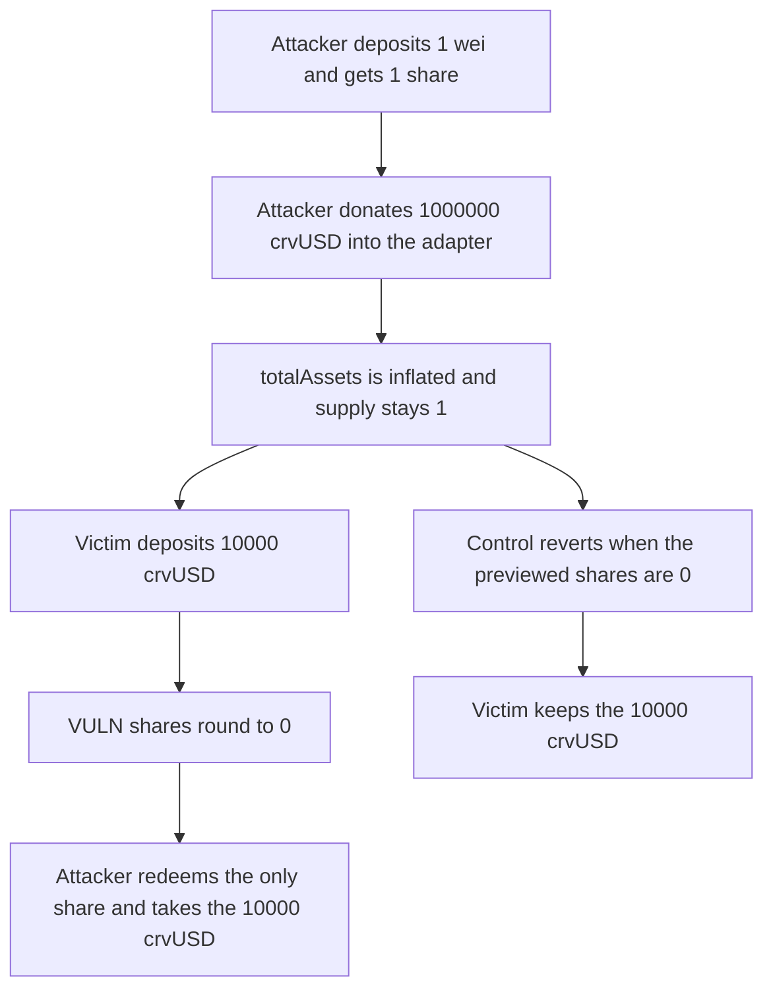

# RWA vault: a 1 wei share plus a donation takes the next 10000 crvUSD

> **Vulnerability classes:** `vuln/arithmetic/precision-loss` · `vuln/logic/price-calculation`

<!-- non-defihacklabs -->
<!-- source-auditvault: https://github.com/Auditware/AuditVault/blob/main/findings/66180-h-18-inflation-attack-in-rwa-vault-pashov-audit-group-none-r.md -->
<!-- date: 2025-05 -->

## Key info

| Field | Value |
|---|---|
| **Loss** | 10000 crvUSD taken from the depositor who receives 0 shares |
| **Vulnerable contract** | `RwaVault._deposit` |
| **Attacker EOA** | `0xcb765594180e396a38d309cc2ea641b6b157c65d` (the first depositor) |
| **Attack contract** | `Exploit` |
| **Attack tx** | `Exploit.run()` |
| **Chain / block / date** | Ethereum model · block 0 · 2025-05 |
| **Compiler** | solc 0.8.27, cancun, via IR |
| **Bug class** | Share mint divides by assets that a donation can inflate |

## TL;DR

The first deposit mints shares 1:1. The attacker then transfers 1000000 crvUSD straight into the adapter. `totalAssets` jumps and `totalSupply` stays 1. The next deposit of 10000 crvUSD computes `deposited * supply / assetsBefore`, which rounds to 0. The tokens are already in the adapter. The attacker redeems the only share and receives the donation back plus the victim's 10000 crvUSD. The control reverts when the previewed share count is 0, and the victim keeps the 10000 crvUSD.

## Background

Pashov Audit Group's 6 May 2025 Regnum Aurum review, finding H-18. The vault prices shares off `totalAssets`, which sums each adapter's token balance. A direct transfer increases that sum without minting shares. The report's example is a first depositor minting a dust amount, donating, and leaving later depositors to buy shares at the inflated price. At the numbers below the later deposit rounds all the way to zero shares.

## The vulnerable code

```solidity
if (supplyBefore == 0 || assetsBefore == 0) {
    sharesMinted = depositedAssetValue;
} else {
    // @> VULN: donated assets inflate assetsBefore, so this deposit rounds to zero shares and the first depositor can redeem it
    sharesMinted = (depositedAssetValue * supplyBefore) / assetsBefore;
}
```

`assetsBefore` is `adapter.totalValue()`, the raw token balance. The donation is included. The victim's tokens are pulled before this division runs, and a zero result is still minted.

## Root cause

Share price is `totalAssets / totalSupply`, and `totalAssets` trusts the adapter balance. Nothing virtual-offsets the supply, and a deposit that rounds to 0 shares is not reverted or refunded.

## Preconditions

- The attacker can be the first depositor. The first branch mints 1 share for 1 wei.
- The attacker can transfer the underlying token to the adapter. That is a normal ERC-20 transfer.
- A later depositor deposits 10000 crvUSD while supply is 1 and assets are about 1000000 crvUSD.

## Attack walkthrough

1. The attacker deposits 1 wei and receives 1 share. Supply is 1. Assets are 1 wei.
2. The attacker transfers 1000000 crvUSD to the adapter. Supply is still 1.
3. The victim deposits 10000 crvUSD. The division rounds to 0 shares.
4. The victim's share balance is 0. Supply is still 1. The adapter holds the victim's tokens.
5. The attacker withdraws 1 share and receives every token in the adapter.
6. Net of the attacker's own 1 wei and donation, the gain is 10000 crvUSD. The control reverts the victim's deposit before pulling the tokens.

## Diagrams



## Impact

The later depositor loses the full 10000 crvUSD. They receive no shares, so they have no claim on the vault. The attacker, holding the only share, withdraws the victim's deposit together with the donation they put in.

## Remediation

Revert when the computed share amount is 0, and do it before the tokens are pulled, which is what the control does. A virtual offset or dead shares on the first deposit stops the same rounding for larger victim deposits.

## How to reproduce

```bash
cd 66180-h-18-inflation-attack-in-rwa-vault-pashov-audit-group-none-r_exp
forge test -vv
```

`test_exploit_donation_zeros_victim_shares` asserts the victim's share balance is 0 and the attacker gained 10000 crvUSD. `test_control_zero_share_deposit_reverts_and_victim_keeps_assets` asserts the deposit reverts and the victim still holds 10000 crvUSD. Captured output is `output.txt`.

## Sources

- AuditVault finding: https://github.com/Auditware/AuditVault/blob/main/findings/66180-h-18-inflation-attack-in-rwa-vault-pashov-audit-group-none-r.md
- Pashov report: https://github.com/pashov/audits/blob/master/team/md/RegnumAurum-security-review_2025-05-06.md
