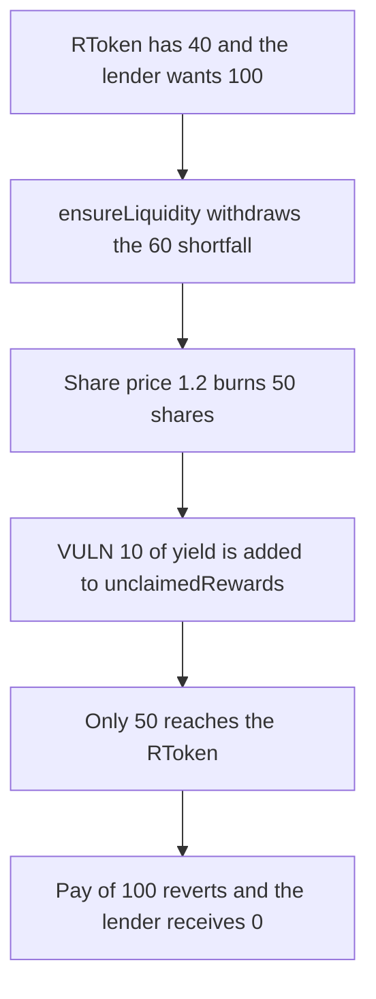

# Regnum Aurum: yield skim leaves the RToken 10 short of a withdrawal

> **Vulnerability classes:** `vuln/logic/fee-calculation` · `vuln/dos/frozen-funds`

<!-- non-defihacklabs -->
<!-- source-auditvault: https://github.com/Auditware/AuditVault/blob/main/findings/66181-h-19-users-may-fail-to-withdraw-from-lending-pool-pashov-aud.md -->
<!-- date: 2025-05 -->

## Key info

| Field | Value |
|---|---|
| **Loss** | Lender's withdrawal of 100 crvUSD reverts. 10 is diverted to unclaimed rewards |
| **Vulnerable contract** | `LendingPool.withdrawFromVault` |
| **Attacker EOA** | `0x1111111111111111111111111111111111111111` |
| **Attack contract** | `Exploit` |
| **Attack tx** | `Exploit.run()` |
| **Chain / block / date** | Ethereum model · block 0 · 2025-05 |
| **Compiler** | solc 0.8.27, cancun, via IR |
| **Bug class** | required vault withdrawal ignores the yield debit |

## TL;DR

`ensureLiquidity` withdraws `amount - rTokenBalance` from the curve vault. `withdrawFromVault` then skims yield from that same amount before forwarding crvUSD. With 40 already in the RToken and a share price of 1.2 against a stored 1.0, a 60 withdrawal burns 50 shares and books 10 of yield. The RToken receives 50, holds 90, and cannot pay 100. The lender receives nothing.

## The vulnerable code

```solidity
yield = (burnedShares * priceDiff) / 1 ether;
unclaimedRewards += yield; // @> VULN: yield is taken out of the assets just withdrawn for the lender
uint256 transferAmount = amount - yield;
token.transfer(address(rtoken), transferAmount);
```

The report says `requiredAmount` has to be grossed up by the yield that will be removed.

## Root cause

The shortfall is computed from the RToken balance alone. The very next function reduces the assets that arrive by the yield. Those two steps are not the same number, so the RToken is short by exactly the yield.

## Preconditions

- RToken holds 40 crvUSD. The lender wants 100.
- Curve vault holds 60 and `pricePerShare` is 1.2 ether.
- `lastSharePrice` is 1 ether, so the price gap is 0.2.

## Attack walkthrough

1. Mint 40 to the RToken and 60 to the curve vault.
2. `ensureLiquidity(100)` computes a 60 shortfall and withdraws it.
3. Burned shares are 60 / 1.2 = 50. Yield is 50 * 0.2 = 10.
4. 50 is forwarded. RToken balance is 90. Pool keeps 10 as `unclaimedRewards`.
5. `RToken.pay(lender, 100)` reverts. Lender balance stays 0.

## Diagrams



## Impact

The lender cannot withdraw. Ten crvUSD that was pulled to cover them is now protocol yield. At a flat share price the same 60 would arrive intact and 40 + 60 would pay the withdrawal.

## Remediation

When sizing `withdrawFromVaultAmount`, divide by the fraction that will remain after the yield skim, or forward `amount` and account yield from a surplus instead of from the lender's proceeds.

## How to reproduce

```bash
cd 66181-h-19-users-may-fail-to-withdraw-from-lending-pool-pashov-aud_exp
forge test -vv
```

## Sources

- AuditVault finding: https://github.com/Auditware/AuditVault/blob/main/findings/66181-h-19-users-may-fail-to-withdraw-from-lending-pool-pashov-aud.md
- Pashov review: https://github.com/pashov/audits/blob/master/team/md/RegnumAurum-security-review_2025-05-06.md
