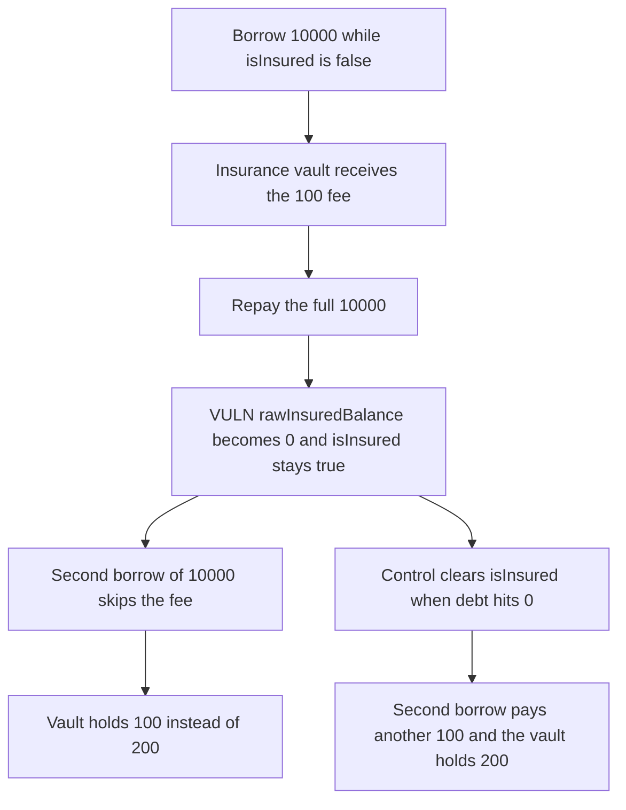

# Regnum Aurum: a repaid loan stays insured, so the next borrow skips the fee

> **Vulnerability classes:** `vuln/logic/incorrect-state-transition` · `vuln/defi/fee-manipulation`

<!-- non-defihacklabs -->
<!-- source-auditvault: https://github.com/Auditware/AuditVault/blob/main/findings/66182-h-20-users-can-avoid-insurance-fee-when-reborrowing-debt-pas.md -->
<!-- date: 2025-05 -->

## Key info

| Field | Value |
|---|---|
| **Loss** | The second 10,000 loan pays 0 of the 100 token insurance fee. The vault holds 100 instead of 200 |
| **Vulnerable contract** | `LendingPool._repay` |
| **Attacker EOA** | `0x1111111111111111111111111111111111111111` |
| **Attack contract** | `Exploit` |
| **Attack tx** | `Exploit.run()` |
| **Chain / block / date** | Ethereum model · block 0 · 2025-05 |
| **Compiler** | solc 0.8.27, cancun, via IR |
| **Bug class** | `isInsured` is not cleared when debt is fully repaid |

## TL;DR

The insurance fee is 1 percent of principal, charged only when `isInsured` is false. A full repay sets `rawInsuredBalance` down to the new debt, which is 0, and leaves `isInsured` true. The comment in the report says that reset is supposed to force the next loan to buy insurance again. It does not. The second 10,000 borrow disburses principal and charges nothing. The insurance vault holds 100. Clearing the flag when debt hits zero charges 200.

## Background

Pashov Audit Group, Regnum Aurum review dated 2025-05-06, finding H-20. The quoted repay caps `rawInsuredBalance` to `rawDebtBalance` and does not assign `isInsured = false`. This run uses a 1 percent fee so the skipped charge is 100 tokens on a 10,000 principal. The report does not publish the production fee rate. The skipped charge scales with that rate.

## The vulnerable code

```solidity
if (position.rawInsuredBalance > position.rawDebtBalance) {
    // @> VULN: insured balance is capped to remaining debt, but isInsured stays true
    position.rawInsuredBalance = position.rawDebtBalance;
}
// FIX: if (position.rawDebtBalance == 0) position.isInsured = false;
```

`borrow` charges only in the `!position.isInsured` branch, then sets the flag.

## Root cause

Two fields describe the same insurance. Repay updates the balance and not the flag. The next borrow reads the flag.

## Preconditions

- The fee is 100 basis points of principal.
- The borrower pays the fee from a separate token balance, then receives principal.
- The first loan is repaid in full, so `rawInsuredBalance` is greater than the remaining debt.

## Attack walkthrough

1. The borrower opens 10,000. The pool pulls 100 into the insurance vault, sets `isInsured`, and disburses 10,000.
2. The borrower repays 10,000. Debt is 0. Insured balance is still 10,000, so the cap writes 0.
3. `isInsured` is still true.
4. The borrower opens 10,000 again. The fee branch is skipped. `feesCharged` stays 1.
5. The insurance vault holds 100. The borrower holds the new 10,000 principal and did not pay a second 100.
6. The control uses the same pool with the flag cleared on zero debt. Two borrows charge 200.

## Diagrams



## Impact

The insurance vault is short the second fee: 100 tokens on this 10,000 reborrow, which is the entire 1 percent premium. The borrower keeps that 100 and still draws a 10,000 principal with the insured flag set. The control vault collects 200 for the same two loans.

## Remediation

When `rawDebtBalance` reaches 0, set `position.isInsured` to false, which is the fix the report recommends.

## How to reproduce

```bash
cd 66182-h-20-users-can-avoid-insurance-fee-when-reborrowing-debt-pas_exp
forge test -vv
```

`test_exploit_reborrow_skips_insurance_fee` asserts one fee, an insurance balance of 100, and the flag still set. `test_control_full_repay_clears_the_flag` asserts two fees and an insurance balance of 200. Captured output is `output.txt`.

## Sources

- AuditVault finding: https://github.com/Auditware/AuditVault/blob/main/findings/66182-h-20-users-can-avoid-insurance-fee-when-reborrowing-debt-pas.md
- Pashov report: https://github.com/pashov/audits/blob/master/team/md/RegnumAurum-security-review_2025-05-06.md
