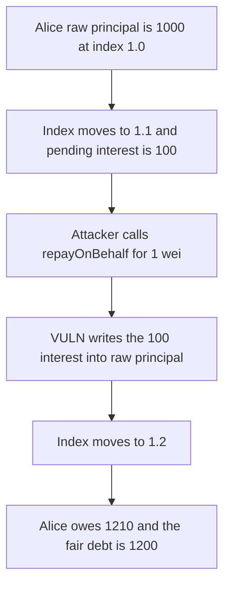

# Regnum Aurum: a 1-wei repayOnBehalf forces Alice to owe 1210 instead of 1200

> **Vulnerability classes:** `vuln/logic/state-update` · `vuln/logic/fee-calculation`

<!-- non-defihacklabs -->
<!-- source-auditvault: https://github.com/Auditware/AuditVault/blob/main/findings/66183-h-21-users-may-be-forced-to-pay-more-interest-pashov-audit-g.md -->
<!-- date: 2025-05 -->

## Key info

| Field | Value |
|---|---|
| **Loss** | Alice pays 1210 RA. The fair debt is 1200 RA. The pool takes 10 RA extra plus the 1 wei |
| **Vulnerable contract** | `LendingPool.repayOnBehalf` |
| **Attacker EOA** | `0x1111111111111111111111111111111111111111` |
| **Attack contract** | `Exploit` |
| **Attack tx** | `Exploit.run()` |
| **Chain / block / date** | Ethereum model · block 0 · 2025-05 |
| **Compiler** | solc 0.8.27, cancun, via IR |
| **Bug class** | Dust repayment capitalizes accrued interest into raw principal |

## TL;DR

Anyone can call `repayOnBehalf`. A 1-wei repayment writes all accrued interest into the borrower's raw principal and does not reduce the debt. Alice borrowed 1000 at usage index 1.0. After the index reaches 1.1 the dust call sets her raw balance to 1100. When the index reaches 1.2 she owes 1210. With no dust repayment the same path bills 1200.

## Background

Pashov Audit Group's May 2025 Regnum Aurum review, H-21. Debt is `raw + raw * (usageIndex - positionIndex) / 1e27`. The finding's pasted `calculateInsuranceFee` block does not produce this arithmetic. The synthetic follows the published `repayOnBehalf` example.

## The vulnerable code

```solidity
uint256 interest = (raw * (usageIndex - positionIndex[user])) / RAY;
// @> VULN: a 1-wei repay writes all accrued interest into raw principal
rawBalance[user] = raw + interest;
positionIndex[user] = usageIndex;
```

The 1 wei is pulled from the caller and is not subtracted from `rawBalance`. Debt before the call is 1100. Debt after the call is still 1100, now sitting entirely in principal.

## Root cause

A partial repayment replaces the scaled position with fully capitalized interest. Later index growth is charged on that larger raw balance.

## Preconditions

- Alice's raw balance is 1000 and her position index is 1e27.
- The usage index can move to 1.1e27, then to 1.2e27.
- `repayOnBehalf` is callable by anyone for 1 wei.

## Attack walkthrough

1. Accrue the index to 1.1e27. Pending interest is 100.
2. Repay 1 wei on Alice's behalf. Raw principal becomes 1100. The debt is unchanged.
3. Accrue the index to 1.2e27. Interest on 1100 is 110, so the debt is 1210.
4. Alice repays 1210. The fair bill is 1200.

## Diagrams



## Impact

Alice pays 10 RA more than the unmanipulated debt. The lending pool receives 1210 RA plus the attacker's 1 wei. A minimum repayment, or requiring the borrower's approval, leaves the raw principal at 1000 and the final debt at 1200.

## Remediation

Reject repayments below a minimum, or require the position owner to approve `repayOnBehalf`. Do not capitalize unpaid interest into raw principal on a dust payment.

## How to reproduce

```bash
cd 66183-h-21-users-may-be-forced-to-pay-more-interest-pashov-audit-g_exp
forge test -vv
```

`test_exploit_dust_repay_forces_1210` asserts the 1210 bill. `test_control_without_dust_repay_debt_is_1200` asserts the fair bill. `test_control_minimum_repay_rejects_one_wei` asserts a minimum-size guard.

## Sources

- AuditVault finding: https://github.com/Auditware/AuditVault/blob/main/findings/66183-h-21-users-may-be-forced-to-pay-more-interest-pashov-audit-g.md
- Pashov review: https://github.com/pashov/audits/blob/master/team/md/RegnumAurum-security-review_2025-05-06.md
- Reduced source: this folder's `test/66183-h-21-users-may-be-forced-to-pay-more-interest-pashov-audit-g.sol`. The review path 404s; the arithmetic is the finding's own numerical example.
