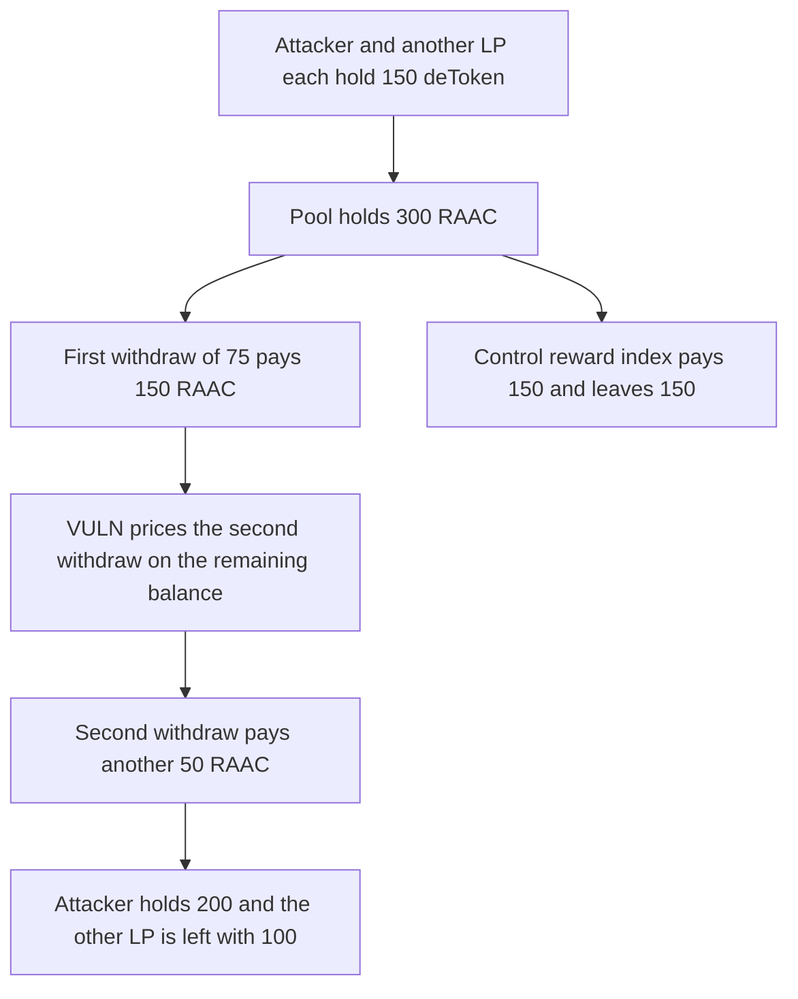

# Regnum Aurum: two partial withdraws pay 200 RAAC against a 150 entitlement

> **Vulnerability classes:** `vuln/logic/reward-calculation` · `vuln/logic/missing-check`

<!-- non-defihacklabs -->
<!-- source-auditvault: https://github.com/Auditware/AuditVault/blob/main/findings/66184-h-22-users-can-steal-rewards-from-sp-pashov-audit-group-none.md -->
<!-- date: 2025-05 -->

## Key info

| Field | Value |
|---|---|
| **Loss** | 50 RAAC taken from the other LP. The attacker receives 200 of 300 RAAC on a 150 deposit |
| **Vulnerable contract** | `StablePool.calculateRaacRewards` |
| **Attacker EOA** | `0x1111111111111111111111111111111111111111` |
| **Attack contract** | `Exploit` |
| **Attack tx** | `Exploit.run()` |
| **Chain / block / date** | Ethereum model · block 0 · 2025-05 |
| **Compiler** | solc 0.8.27, cancun, via IR |
| **Bug class** | Withdraw pays `balance * deposit / supply` and never records the claim |

## TL;DR

The stable pool pays RAAC as `raac.balanceOf(pool) * userDeposit / deToken.totalSupply` and does not store what the user already took. An attacker with 150 of 300 deToken withdraws 75, receives the full 150 RAAC entitlement, then withdraws the other 75 and receives another 50. The other LP, still holding 150 deToken, is left with 100 RAAC. A reward-per-token index pays the same attacker 150 across both withdraws.

## Background

Pashov Audit Group's May 2025 Regnum Aurum review, H-22. Users deposit RToken one-for-one for deToken. `withdraw` calls `calculateRaacRewards` and transfers that amount, then burns deToken, without a claimed-reward checkpoint.

## The vulnerable code

```solidity
uint256 totalRewards = raacToken.balanceOf(address(this));
// @> VULN: claimed RAAC is not recorded, so each withdraw pays totalRewards * deposit / supply again
if (totalDeposits < 1e6) return 0;

uint256 payout = (totalRewards * userDeposit) / totalDeposits;
```

The first call sees 300 RAAC, a 150 deposit, and a 300 supply, so it pays 150. After that transfer the pool holds 150 RAAC, the attacker still has 75 deposited, and supply is 225, so the second call pays 50 more.

## Root cause

Rewards are repriced from the live RAAC balance on every withdraw. Nothing subtracts the amount already transferred to that user.

## Preconditions

- The pool holds 300 RAAC and 300 deToken. The attacker and another LP each have 150.
- The attacker can call `withdraw` twice in one transaction. A 1 wei loop is the same formula. Two halves are enough to show the extra 50.

## Attack walkthrough

1. Withdraw 75 deToken. The formula pays 150 RAAC, the whole fair share, while 75 deToken remains.
2. Withdraw the other 75. The formula pays 50 RAAC from what is left.
3. The attacker holds 200 RAAC. The pool holds 100. The other LP's 150 deToken is unchanged.
4. The control records a reward-per-token index of 1e18 and pays 150 across the same two withdraws.

## Diagrams



## Impact

The other LP loses 50 RAAC of a 150 entitlement. The attacker exits with principal plus 200 RAAC. Repeating the partial withdraw drains more of the reward balance before honest depositors claim.

## Remediation

Account a reward-per-token index and store the index already paid to each user. Pay only `deposit * (index - paidIndex) / 1e18`, which is what the fixed pool does.

## How to reproduce

```bash
cd 66184-h-22-users-can-steal-rewards-from-sp-pashov-audit-group-none_exp
forge test -vv
```

`test_exploit_two_withdraws_take_200_raac` asserts 200 RAAC taken and 100 left. `test_control_recorded_reward_pays_150` asserts the index pays 150. Captured output is `output.txt`.

## Sources

- AuditVault finding: https://github.com/Auditware/AuditVault/blob/main/findings/66184-h-22-users-can-steal-rewards-from-sp-pashov-audit-group-none.md
- Pashov review: https://github.com/pashov/audits/blob/master/team/md/RegnumAurum-security-review_2025-05-06.md
