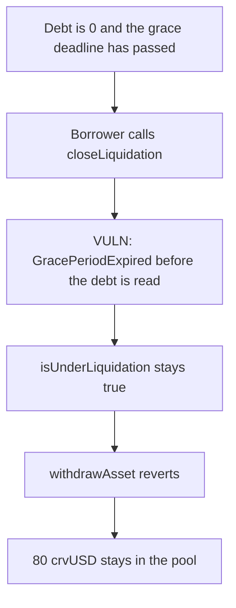

# Regnum Aurum: closeLiquidation reverts on an expired grace period even though the debt is 0

> **Vulnerability classes:** `vuln/logic/liquidation-logic` · `vuln/logic/wrong-condition`

<!-- non-defihacklabs -->
<!-- source-auditvault: https://github.com/Auditware/AuditVault/blob/main/findings/66186-h-24-unclosed-liquidation-blocks-collateral-recovery-pashov.md -->
<!-- date: 2025-05 -->

## Key info

| Field | Value |
|---|---|
| **Loss** | 80 crvUSD of collateral stays in the pool. Debt is 0. Withdraw reverts |
| **Vulnerable contract** | `LendingPool.closeLiquidation` |
| **Attacker EOA** | `0x1111111111111111111111111111111111111111` |
| **Attack contract** | `Exploit` |
| **Attack tx** | `Exploit.run()` |
| **Chain / block / date** | Ethereum model · block 0 · 2025-05 |
| **Compiler** | solc 0.8.27, cancun, optimizer 200 |
| **Bug class** | Grace deadline is checked before the debt |

## TL;DR

After a liquidation the borrower must repay and then call `closeLiquidation` inside the grace period. The grace check runs first. If the borrower repays and comes back after the deadline, `closeLiquidation` reverts `GracePeriodExpired` even though `rawDebtBalance` is 0. `isUnderLiquidation` stays true, so `withdrawAsset` reverts `CannotWithdrawUnderLiquidation`. This run loads that post-deadline state: start time 0, grace length 0, debt 0, 80 crvUSD posted. Both calls revert. The 80 stays in the pool.

## Background

Pashov Audit Group, Regnum Aurum, May 2025, finding H-24, AuditVault id 66186. The Hardhat test warps 72 hours, repays, warps one more second, and expects `GracePeriodExpired`. A local `run()` cannot warp. The position is stored already past the deadline, which is the state of the user's next transaction in that test. The comparison is the report's comparison: `block.timestamp > liquidationStartTime + liquidationGracePeriod`. At Foundry's timestamp 1 and at the playground timestamp, `timestamp > 0` is true.

## The vulnerable code

```solidity
if (block.timestamp > position.liquidationStartTime + liquidationGracePeriod) {
    revert("GracePeriodExpired"); // @> VULN: debt is not read before the grace deadline
}
if (!position.isInsured) revert("NotInsured");
uint256 positionDebt = position.rawDebtBalance;
if (positionDebt > 0) revert("DebtNotZero");
position.isUnderLiquidation = false;
```

```diff
- if (block.timestamp > position.liquidationStartTime + liquidationGracePeriod) {
+ if (position.rawDebtBalance > 0 && block.timestamp > position.liquidationStartTime + liquidationGracePeriod) {
      revert("GracePeriodExpired");
  }
```

## Root cause

The deadline gates the function before the debt is read. A zero-debt insured position that missed the window can never clear the flag. Withdrawal checks the flag and does not check the debt.

## Preconditions

- The position is insured, under liquidation, and the grace deadline is already behind `block.timestamp`.
- Debt has been repaid. Here it is stored as 0.
- 80 crvUSD of collateral is still booked on the position.

## Attack walkthrough

1. The pool takes 80 crvUSD onto the expired position.
2. The borrower calls `closeLiquidation`. It reverts `GracePeriodExpired`.
3. The borrower calls `withdrawAsset`. It reverts because the flag is still set.
4. The pool still holds 80 crvUSD. The borrower balance is 0.

## Diagrams



## Impact

The borrower cannot withdraw 80 crvUSD of collateral after repaying. The report also notes `liquidateBorrower` reverts when debt is 0, so the stability-pool path cannot clear the position either. The collateral is stuck.

## Remediation

Read the debt first. If it is 0, skip the grace check and clear `isUnderLiquidation`, which is the diff in the report.

## How to reproduce

```bash
cd 66186-h-24-unclosed-liquidation-blocks-collateral-recovery-pashov_exp
forge test -vv
```

`test_zero_debt_still_cannot_close_or_withdraw` asserts both reverts, debt 0, the flag still set, and 80 ether of collateral in the pool.

## Sources

- AuditVault finding: https://github.com/Auditware/AuditVault/blob/main/findings/66186-h-24-unclosed-liquidation-blocks-collateral-recovery-pashov.md
- Report: https://github.com/pashov/audits/blob/master/team/md/RegnumAurum-security-review_2025-05-06.md
- Reduced from the `LiquidationProxy.closeLiquidation` and `LendingPool.withdrawAsset` quotes in that report
