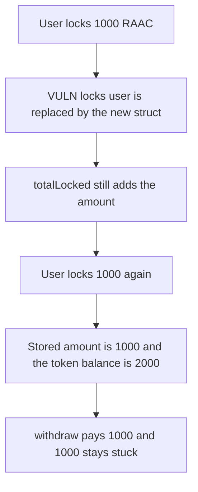

# Regnum Aurum: createLock overwrites the user and withdraw pays only the latest amount

> **Vulnerability classes:** `vuln/logic/state-update` · `vuln/logic/missing-check`

<!-- non-defihacklabs -->
<!-- source-auditvault: https://github.com/Auditware/AuditVault/blob/main/findings/66187-h-25-lock-overwrite-in-createlock-causes-undercredited-withd.md -->
<!-- date: 2025-05 -->

## Key info

| Field | Value |
|---|---|
| **Loss** | Two 1000 RAAC debits, one 1000 RAAC withdrawal. 1000 RAAC stays in veRAAC |
| **Vulnerable contract** | `VeRAACToken.createLock` |
| **Attacker EOA** | `0x1111111111111111111111111111111111111111` |
| **Attack contract** | `Exploit` |
| **Attack tx** | `Exploit.run()` |
| **Chain / block / date** | Ethereum model · block 0 · 2025-05 |
| **Compiler** | solc 0.8.27, cancun |
| **Bug class** | Per-user lock struct is replaced while totalLocked keeps both amounts |

## TL;DR

`LockManager.createLock` writes `state.locks[user] = newLock` on every call and still does `state.totalLocked += amount`. Finding 66187 is this bug. A user who locks 1000 RAAC twice is debited 2000 and stored as 1000. `withdraw` pays the stored amount. 1000 RAAC remains in the contract with no lock record. Duration 0 makes the lock mature immediately, which is this playground's stand-in for the report's `time.increase`. The overwrite does not depend on that gap.

## Background

Pashov Audit Group's 6 May 2025 Regnum Aurum review, finding H-25. AuditVault ingested the same report as 66187. The blamed lines are `LockManager.sol` 298 and 299. The accompanying Hardhat test locks 1000, waits out the duration, locks 1000 again, and withdraws only 1000. The fix is to revert when `locks[user].amount` is already nonzero.

## The vulnerable code

```solidity
Lock memory newLock = Lock({amount: amount, start: start, end: end, exists: true});
_lockState.locks[user] = newLock; // @> VULN: replaces any existing lock instead of adding to it
// FIX: if (_lockState.locks[user].amount != 0) revert LockFound();
_lockState.totalLocked += amount;
```

The contract's `FINDING` constant is `66187`, so this copy is not the sibling id. A guarded `VeRAACToken` reverts the second `lock` with `LockFound` and keeps a single 1000 debit.

## Root cause

The per-user record is a single struct, not a sum. The assignment replaces `amount`. The global total is updated as if the previous amount were still there. `withdraw` trusts the struct, so it cannot return both debits.

## Preconditions

- The user holds at least 2000 RAAC and approves veRAAC.
- `lock` does not reject an existing position. This build uses `guardSecondLock = false`.
- Duration is 0, so `end == block.timestamp` and `withdraw` is allowed in the same transaction.

## Attack walkthrough

1. `lock(1000, 0)` pulls 1000 RAAC and stores a lock of 1000.
2. The assignment writes the whole struct. `totalLocked` becomes 1000.
3. `lock(1000, 0)` pulls another 1000. The stored amount is still 1000. The token balance on veRAAC is 2000.
4. `withdraw` transfers `locks[user].amount`, which is 1000, and subtracts that from `totalLocked`.
5. The user holds 1000 RAAC. The contract still holds 1000 RAAC.

## Diagrams



## Impact

The user paid 2000 RAAC and can withdraw 1000. The other 1000 sits in veRAAC with `getLockPosition.amount` equal to zero after the withdrawal, because the record was deleted. There is no second lock to claim it. The guarded control reverts the second lock and leaves only the first 1000 in the contract.

## Remediation

At the start of `lock`, read `locks[msg.sender]` and revert with `LockFound` when `amount` is not zero. That is the diff in the report. Do not write a new struct over a live one.

## How to reproduce

```bash
cd 66187-h-25-lock-overwrite-in-createlock-causes-undercredited-withd_exp
forge test -vv
```

`test_second_lock_overwrites_and_withdraw_underpays` asserts 1000 RAAC stuck, 1000 returned, and `FINDING` equal to `66187`. `test_control_second_lock_reverts` expects `LockFound` and a single 1000 debit. Captured output is `output.txt`.

## Sources

- AuditVault finding: https://github.com/Auditware/AuditVault/blob/main/findings/66187-h-25-lock-overwrite-in-createlock-causes-undercredited-withd.md
- Report: https://github.com/pashov/audits/blob/master/team/md/RegnumAurum-security-review_2025-05-06.md
- Blamed lines: `LockManager.sol` `state.locks[user] = newLock` and `state.totalLocked += amount`, as quoted in the finding.
