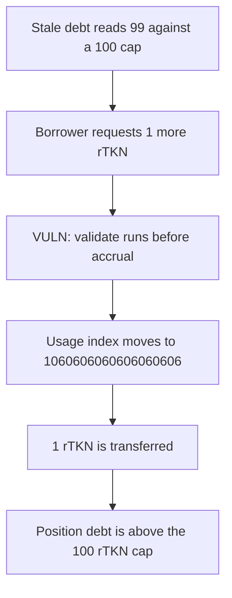

# Regnum Aurum: a borrow is checked before interest accrues and the position exceeds its 100 token cap

> **Vulnerability classes:** vuln/logic/incorrect-order-of-operations · vuln/logic/missing-check

<!-- non-defihacklabs -->
<!-- source-auditvault: https://github.com/Auditware/AuditVault/blob/main/findings/66188-h-26-stale-interest-accrual-allows-over-borrowing-pashov-aud.md -->
<!-- date: 2025-05 -->

## Key info

| Field | Value |
|---|---|
| **Loss** | 1 rTKN is borrowed after the stale debt reads 99. Accrual then puts the position above the 100 rTKN cap |
| **Vulnerable contract** | `LendingPool._borrow` |
| **Attacker EOA** | `0x0000000000000000000000000000000000661881` (the borrower) |
| **Attack contract** | `Exploit` |
| **Attack tx** | `Exploit.run()` |
| **Chain / block / date** | Ethereum model · block 0 · 2025-05 |
| **Compiler** | solc 0.8.27, cancun, via IR |
| **Bug class** | Collateral validation uses the pre-accrual usage index |

## TL;DR

`_borrow` calls `_validateBorrow` before `updateReserveState`. With `usageIndex` still 1e18, 99 ether of scaled debt plus a 1 ether borrow is not above the 100 ether cap, so the check passes. One second of interest then moves the index to 1060606060606060606. The old debt is worth 104.999... ether before the new borrow is added, and `getPositionDebt` ends above 100 ether. The pool still transfers the 1 rTKN. Accruing first makes the same borrow revert and transfers nothing.

## Background

Pashov Audit Group's 6 May 2025 Regnum Aurum review, finding H-26. `ReserveLibrary.updateReserveInterests` accrues with `block.timestamp - lastUpdateTimestamp`. The review's example is a 99 token stale debt against a 100 token maximum that becomes about 105 after interest and 106 after the extra borrow.

## The vulnerable code

```solidity
function _borrow(uint256 amount) external {
    // @> VULN: collateral is checked on the stale usage index, then interest accrues
    _validateBorrow(amount);
    updateReserveState();
    scaledDebt[msg.sender] += amount * 1e18 / usageIndex;
    borrowed = amount;
    asset.transfer(msg.sender, amount);
}
```

`lastUpdateTimestamp` is 0 and the model block timestamp is 1, so `timeDelta` is 1 without `vm.warp`. The per-second rate is 60606060606060606.

## Root cause

The debt read inside `_validateBorrow` multiplies scaled debt by the stored index. That index is stale until `updateReserveState`. The check and the accrual are in the wrong order, so the borrower is allowed to add debt that the updated index cannot support.

## Preconditions

- The borrower already has 99 ether of scaled debt and the index is 1e18.
- `maxDebt` is 100 ether.
- At least one second has passed since `lastUpdateTimestamp`. The pool holds 10 rTKN of liquidity.

## Attack walkthrough

1. `getPositionDebt` returns 99 ether.
2. `_borrow(1 ether)` calls `_validateBorrow`. `100 ether < 99 ether + 1 ether` is false.
3. `updateReserveState` sets `usageIndex` to 1060606060606060606.
4. The new borrow is added on that index and 1 rTKN is transferred to the borrower.
5. `getPositionDebt` is greater than 100 ether.
6. The control calls `updateReserveState` first. The same 1 ether borrow reverts and the borrower receives 0.

## Diagrams


