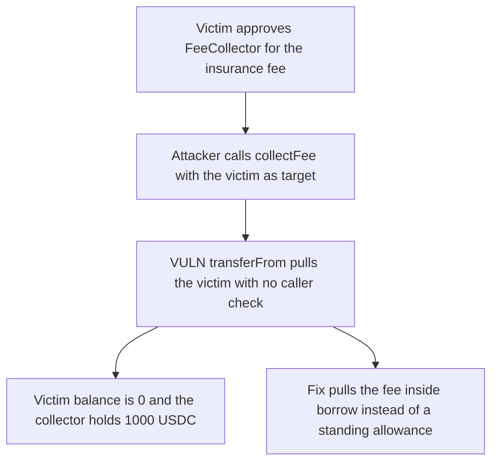

# Regnum Aurum: anyone can pull a FeeCollector allowance

> **Vulnerability classes:** `vuln/access-control/missing-auth` · `vuln/logic/missing-check`

<!-- non-defihacklabs -->
<!-- source-auditvault: https://github.com/Auditware/AuditVault/blob/main/findings/66189-h-27-unrestricted-feecollectorcollectfee-enables-unauthorize.md -->
<!-- date: 2025-05 -->

## Key info

| Field | Value |
|---|---|
| **Loss** | 1000 USDC pulled from a victim who only approved an insurance fee |
| **Vulnerable contract** | `FeeCollector.collectFee` |
| **Attacker EOA** | `0x1111111111111111111111111111111111111111` |
| **Attack contract** | `Exploit` |
| **Attack tx** | `Exploit.run()` |
| **Chain / block / date** | Ethereum model · block 0 · 2025-05 |
| **Compiler** | solc 0.8.27, cancun, via IR |
| **Bug class** | `collectFee` transferFroms an arbitrary target with no caller check |

## TL;DR

`borrowWithInsurance` requires the user to approve the insurance fee to `FeeCollector` before the pool will borrow. `collectFee` is public. It checks the fee type and the token, then `transferFrom`s `target` for `amount`. An attacker names the victim as `target` and takes the whole allowance. The victim has not borrowed. Their 1000 USDC balance is now in the collector.

## The vulnerable code

```solidity
function collectFee(address token, address target, uint256 amount, bytes32 feeType) external returns (bool) {
    if (amount == 0 || amount > MAX_FEE_AMOUNT) revert InvalidFeeAmount();
    if (feeTypes[feeType] == bytes32(0)) revert FeeTypeDoesNotExist();
    if (!isTokenSupported[token]) revert TokenNotSupported();
    MockUSDC(token).transferFrom(target, address(this), amount); // @> VULN
    collected[token] += amount;
    return true;
}
```

The report's fix is to stop requiring a standing allowance and to pull the fee inside `borrowWithInsurance`, the way lending fees are pulled.

## Root cause

The allowance is granted to the collector, and the collector will spend any target's allowance for any caller. Nothing binds `msg.sender` to the lending pool or to `target`.

## Preconditions

- USDC is a supported token and `keccak256("INSURANCE_FEE")` is a registered fee type.
- The victim holds 1000 USDC and has approved FeeCollector for 1000 USDC, which is what the borrow path demands before it will run.
- The victim does not need to call `borrowWithInsurance`.

## Attack walkthrough

1. The victim approves FeeCollector for 1000 USDC.
2. The attacker calls `collectFee(usdc, victim, 1000, INSURANCE_FEE)`.
3. The token, amount, and fee-type checks pass. There is no caller check.
4. `transferFrom` moves 1000 USDC from the victim into FeeCollector. The allowance is spent.

## Diagrams



## Impact

The victim loses the full approved amount, here 1000 USDC, whether or not they ever borrow. The tokens sit in FeeCollector. A later borrow also fails the allowance check, because the allowance is already gone.

## How to reproduce

```bash
cd 66189-h-27-unrestricted-feecollectorcollectfee-enables-unauthorize_exp
forge test -vv
```

`test_collectFee_pulls_victim_allowance` asserts the victim's balance is 0 and the collector holds 1000 USDC.

## Sources

- AuditVault finding: https://github.com/Auditware/AuditVault/blob/main/findings/66189-h-27-unrestricted-feecollectorcollectfee-enables-unauthorize.md
- Pashov report: https://github.com/pashov/audits/blob/master/team/md/RegnumAurum-security-review_2025-05-06.md
