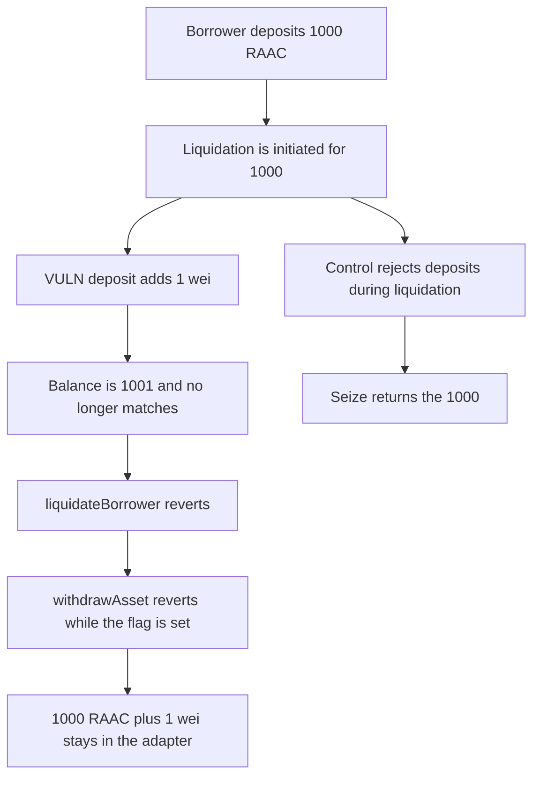

# Regnum Aurum: a 1 wei deposit during liquidation locks 1000 RAAC of collateral

> **Vulnerability classes:** `vuln/dos/frozen-funds` · `vuln/logic/liquidation-logic`

<!-- non-defihacklabs -->
<!-- source-auditvault: https://github.com/Auditware/AuditVault/blob/main/findings/66190-h-28-deposits-during-liquidation-enable-collateral-lockup-pa.md -->
<!-- date: 2025-05 -->

## Key info

| Field | Value |
|---|---|
| **Loss** | 1000 RAAC plus 1 wei stuck in the asset adapter |
| **Vulnerable contract** | `ERC20AssetAdapter.deposit` |
| **Attacker EOA** | `0x1111111111111111111111111111111111111111` |
| **Attack contract** | `Exploit` |
| **Attack tx** | `Exploit.run()` |
| **Chain / block / date** | Ethereum model · block 0 · 2025-05 |
| **Compiler** | solc 0.8.27, cancun, via IR |
| **Bug class** | Balance changed after liquidation stored an exact amount |

## TL;DR

`validateLiquidationData` requires `_balances[user] == amount`. Liquidation is started at 1000 RAAC. `deposit` does not look at that flag, so the borrower adds 1 wei and the balance becomes 1001. The liquidator's call with 1000 reverts. `withdrawAsset` also reverts while `underLiquidation` is set. The adapter holds 1001 RAAC. The control rejects the deposit and seizes the original 1000.

## Background

Pashov Audit Group's Regnum Aurum review of 2025-05-06, finding H-28. `StabilityPool.liquidateBorrower` reverts with `CollateralAndParamterDataMismatch` unless the adapter balance equals the amount in the liquidation calldata. `LendingPool.depositAsset` still calls `ERC20AssetAdapter.deposit` after `initiateLiquidation`. The report's test front-runs with 1 unit of the asset.

## The vulnerable code

```solidity
function validateLiquidationData(address user, bytes calldata data) external view returns (bool) {
    uint256 amount = abi.decode(data, (uint256));
    return _balances[user] == amount;
}

// @> VULN: _balances[user] grows during liquidation, so the stored liquidation amount no longer matches
_balances[user] += amount;
```

The liquidation gate:

```solidity
if (!IAssetAdapter(poolAdapter).validateLiquidationData(user, data)) revert CollateralAndParamterDataMismatch();
```

## Root cause

The liquidation amount is an exact balance, and deposit is still open after the position is marked. One extra wei makes every later call that still encodes the original amount revert, and the freeze flag blocks withdrawal.

## Preconditions

- The borrower has an open vault and 1000 RAAC deposited.
- `initiateLiquidation` has set `underLiquidation` against that 1000.
- The borrower can still call `depositAsset`. No admin action is required.

## Attack walkthrough

1. The borrower deposits 1000 RAAC. The adapter balance is 1000.
2. Liquidation is initiated for 1000. The flag is set.
3. The borrower deposits 1 wei. The balance is 1001.
4. `liquidateBorrower` with the original 1000 reverts.
5. `withdrawAsset` reverts because the position is under liquidation.
6. The adapter still holds 1000 RAAC plus 1 wei.

## Diagrams



## Impact

Lenders cannot seize the 1000 RAAC, and the borrower cannot withdraw it. The adapter balance is 1000000000000000000001 wei. The control blocks the 1 wei deposit and transfers the 1000 RAAC to the liquidator.

## Remediation

Reject `depositAsset` while `underLiquidation` is set, as the report suggests with `DepositsDisabledDuringLiquidation`. Do not require an exact balance that the borrower can change in the same window.

## How to reproduce

```bash
cd 66190-h-28-deposits-during-liquidation-enable-collateral-lockup-pa_exp
forge test -vv
```

`test_exploit_one_wei_deposit_locks_1000_collateral` asserts the liquidation revert, the frozen withdraw, and the 1001 unit balance. `test_control_blocks_the_deposit_and_seizes_collateral` asserts the dust deposit reverts and the 1000 is seized. Captured output is `output.txt`.

## Sources

- AuditVault finding: https://github.com/Auditware/AuditVault/blob/main/findings/66190-h-28-deposits-during-liquidation-enable-collateral-lockup-pa.md
- Pashov report: https://github.com/pashov/audits/blob/master/team/md/RegnumAurum-security-review_2025-05-06.md
