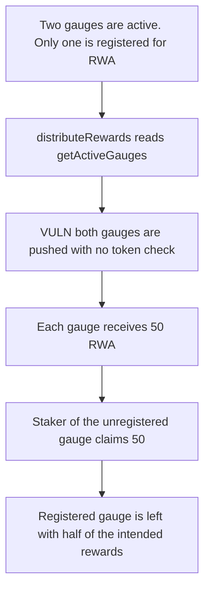

# Regnum Aurum: rewards are sent to gauges that were never registered

> **Vulnerability classes:** `vuln/logic/reward-calculation` · `vuln/logic/missing-validation`

<!-- non-defihacklabs -->
<!-- source-auditvault: https://github.com/Auditware/AuditVault/blob/main/findings/66191-h-29-gaugerewardsdistributor-distributes-rewards-to-gauges-n.md -->
<!-- date: 2025-05 -->

## Key info

| Field | Value |
|---|---|
| **Loss** | A staker in an unregistered gauge claims 50 of 100 RWA. The registered gauge is left with 50 |
| **Vulnerable contract** | `GaugeRewardsDistributor.distributeRewards` |
| **Attacker EOA** | `0x1111111111111111111111111111111111111111` |
| **Attack contract** | `Exploit` |
| **Attack tx** | `Exploit.run()` |
| **Chain / block / date** | Ethereum model · block 0 · 2025-05 |
| **Compiler** | solc 0.8.27, cancun, via IR |

## TL;DR

`distributeRewards` copies every gauge from `gaugeController.getActiveGauges()` and pays each an equal share of the token balance. It never checks `gaugeRewardTokens[gauge][token]`, which is what `addGaugeRewardToken` sets. A gauge that is active but not registered for RWA still receives 50 of 100 RWA. Its staker claims that 50. The gauge that was actually registered is left with the other 50. The filtered control sends all 100 to the registered gauge and the stranger's claim returns 0.

## The vulnerable code

```solidity
for (uint256 i = 0; i < activeGauges.length; i++) {
    address gauge = activeGauges[i];
    activeCycleGauges[address(token)].push(gauge); // @> VULN: no gaugeRewardTokens[gauge][token] check
    count += 1;
    if (count >= MAX_ACTIVE_GAUGES) break;
    token.transfer(gauge, each);
    Gauge(gauge).accountReward(address(token), each);
}
```

The report's fix wraps the push in `if (gaugeRewardTokens[activeGauges[i]][token])`. `distributeRewardsFixed` does that, and it divides only by the eligible count so the registered gauge is not shorted.

## Root cause

"Active in the controller" is not "registered for this reward token". The loop treats them as the same set.

## Preconditions

- Two gauges are active. `addGaugeRewardToken` was called for one of them.
- The attacker can stake in the other gauge and can call `distributeRewards`. Both are permissionless in this reduction. The mis-allocation itself does not need an admin key. The admin already registered the intended gauge. The attacker only stakes and triggers distribution.

## Attack walkthrough

1. The unregistered gauge is added to the active list first, then the registered one.
2. Only the registered gauge opts into RWA.
3. The attacker stakes in the unregistered gauge.
4. The distributor holds 100 RWA and splits it in half.
5. The unregistered gauge is pushed into `activeCycleGauges` and credited 50.
6. The attacker claims 50. The registered gauge still holds 50.

## Diagrams



## Impact

Reward tokens that should have gone entirely to the registered gauge are split with a gauge that never opted into that token. The registered gauge's stakers lose 50 of 100 RWA. The finding also notes that a gauge which cannot accept the token would make the transfer fail. This run shows the mis-allocation, which is the case where the transfer succeeds.

## Remediation

Skip gauges that are not in `gaugeRewardTokens` for this token, and divide the balance by the eligible count. That is `distributeRewardsFixed`. The stranger then claims 0 and the registered gauge holds 100.

## How to reproduce

```bash
cd 66191-h-29-gaugerewardsdistributor-distributes-rewards-to-gauges-n_exp
forge test -vv
```

`test_exploit_unregistered_gauge_takes_half` asserts a 50 RWA claim, 50 left on the registered gauge, and the stranger's flag still false. `test_control_filter_sends_the_full_balance_to_the_registered_gauge` asserts a 0 claim and a 100 RWA balance on the registered gauge.

## Sources

- AuditVault finding: https://github.com/Auditware/AuditVault/blob/main/findings/66191-h-29-gaugerewardsdistributor-distributes-rewards-to-gauges-n.md
- Pashov report: https://github.com/pashov/audits/blob/master/team/md/RegnumAurum-security-review_2025-05-06.md
- The finding quotes the `getActiveGauges` loop and the `addGaugeRewardToken` guard. The reduction keeps that loop.
