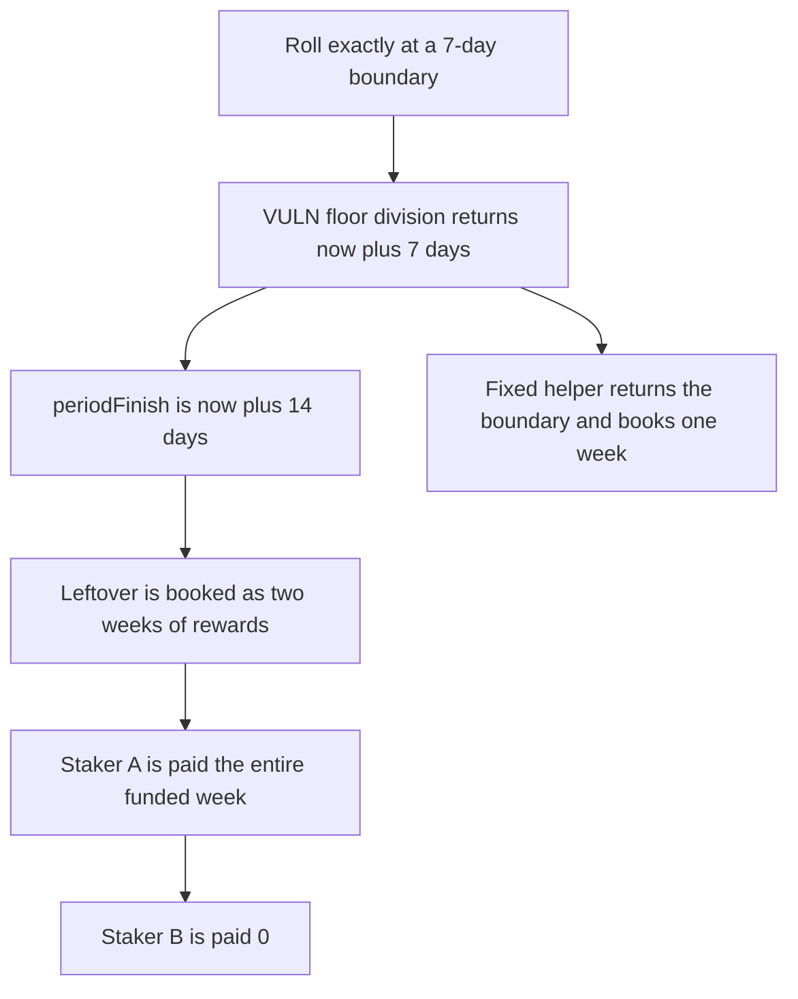

# Regnum Aurum: getNextCycleStart skips a week and one staker takes the whole pot

> **Vulnerability classes:** `vuln/logic/reward-calculation` · `vuln/arithmetic/precision-loss`

<!-- non-defihacklabs -->
<!-- source-auditvault: https://github.com/Auditware/AuditVault/blob/main/findings/66192-h-30-getnextcyclestart-returns-incorrect-value-at-the-end-of.md -->
<!-- date: 2025-05 -->

## Key info

| Field | Value |
|---|---|
| **Loss** | 604800000000000000 reward wei taken from the second staker |
| **Vulnerable contract** | `GaugeRewardsDistributor.getNextCycleStart` |
| **Attacker EOA** | `0x1111111111111111111111111111111111111111` |
| **Attack contract** | `Exploit` (staker A) |
| **Attack tx** | `Exploit.run()` |
| **Chain / block / date** | Ethereum model · timestamp 1784893842 · 2025-05 |
| **Compiler** | solc 0.8.27, cancun, via IR |
| **Bug class** | Floor division at an exact cycle boundary returns one duration late |

## TL;DR

Called at the exact end of a 7-day cycle, `getNextCycleStart` returns `timestamp + 7 days` instead of `timestamp`. The distributor then sets `periodFinish` to `timestamp + 14 days`. Leftover rewards are booked for two weeks while the gauge holds one week of tokens. Two equal stakers are each owed half of that booked leftover. Staker A receives the entire pot, 604800000000000000 wei. Staker B is paid 0. The fixed helper returns the boundary itself, so the booked leftover matches the balance.

## Background

Pashov Audit Group, Regnum Aurum review dated 2025-05-06, finding H-30. `GaugeRewardsDistributor.getNextCycleStart` is what sets the next cycle, and the same bad boundary feeds leftover math in `GaugeRewardsDistributor` and `BaseGauge`. The recommended change rounds the elapsed time up and returns `firstCycleStart + completedCycles * DURATION`.

## The vulnerable code

```solidity
uint256 timeElapsedSinceFirst = block.timestamp - firstCycleStart;
return firstCycleStart + ((timeElapsedSinceFirst / DURATION) + 1) * DURATION; // @> VULN
```

At an exact boundary, `timeElapsedSinceFirst / DURATION` is already the count of completed cycles. Adding one more skips the cycle that is starting now.

```diff
- uint256 completedCycles = timeElapsedSinceFirst / DURATION;
- return firstCycleStart + (completedCycles + 1) * DURATION;
+ uint256 completedCycles = (timeElapsedSinceFirst + DURATION - 1) / DURATION;
+ return firstCycleStart + completedCycles * DURATION;
```

## Root cause

Integer division rounds down. When the elapsed time is an exact multiple of `DURATION`, the cycle that just ended is counted, and the `+ 1` pushes the result a full duration past the boundary. The caller stores `periodFinish = next + DURATION`, so the finish lands two durations out. `leftover = remaining * rate` then double-counts the funded week.

## Preconditions

- `block.timestamp` is exactly one duration after `firstCycleStart`. This run sets that inside `run()` from the live timestamp.
- The gauge holds exactly `DURATION * rate` tokens. Rate is `1e12` wei per second, so the pot is `604800 * 1e12`.
- Two stakers have equal weight and are paid from the booked leftover.

## Attack walkthrough

1. The keeper rolls the gauge at the boundary.
2. The helper returns now plus 7 days.
3. `periodFinish` becomes now plus 14 days and leftover is two weeks of rewards.
4. Each staker is assigned half of that leftover, which equals the whole pot.
5. Staker A is paid 604800000000000000 wei. The pot is empty.
6. Staker B's transfer pays 0.

## Diagrams



## Impact

The gauge promises 1209600000000000000 wei of leftover rewards and holds 604800000000000000. Staker A withdraws the entire balance. Staker B, who had an equal claim on that week, receives nothing. The fixed helper returns the current timestamp, so leftover equals the balance and each staker can be paid half.

## Remediation

Use the rounded-up cycle count from the report and return `firstCycleStart + completedCycles * DURATION`, with no extra `+ 1`.

## How to reproduce

```bash
cd 66192-h-30-getnextcyclestart-returns-incorrect-value-at-the-end-of_exp
forge test -vv
```

`test_exploit_boundary_pays_one_staker_the_whole_week` warps to timestamp 1784893842 and asserts the doubled leftover, the 14-day finish, A's full payout, and B's zero. `test_control_fixed_helper_returns_the_boundary` asserts the fixed helper returns the timestamp itself. Captured output is `output.txt`.

## Sources

- AuditVault finding: https://github.com/Auditware/AuditVault/blob/main/findings/66192-h-30-getnextcyclestart-returns-incorrect-value-at-the-end-of.md
- Pashov report: https://github.com/pashov/audits/blob/master/team/md/RegnumAurum-security-review_2025-05-06.md
- Same H-30 is also filed as AuditVault 66371.
