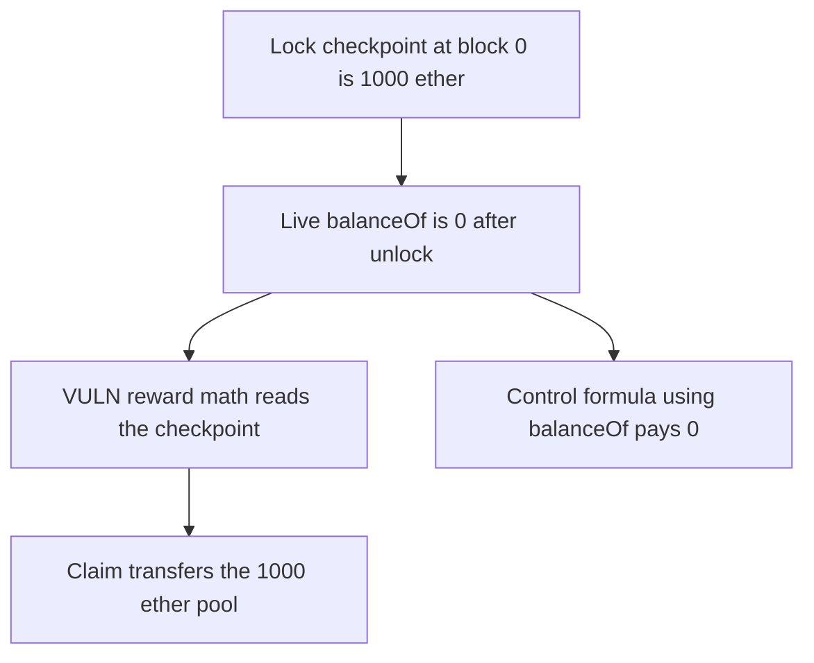

# Expired veRAAC locks keep earning rewards from a stale checkpoint

> **Vulnerability classes:** `vuln/logic/reward-calculation` · `vuln/logic/state-update`

<!-- non-defihacklabs -->
<!-- source-auditvault: https://github.com/Auditware/AuditVault/blob/main/findings/66340-c-07-users-can-accumulate-rewards-after-lock-expiry-due-to-s.md -->
<!-- date: 2025-05 -->

## Key info

| Field | Value |
|---|---|
| **Loss** | 1000 ether of reward tokens paid to a lock whose live power is 0 |
| **Vulnerable contract** | `VeRewards.getNewUserRewards` |
| **Attacker EOA** | `0x1111111111111111111111111111111111111111` |
| **Attack contract** | `Exploit` |
| **Attack tx** | `Exploit.run()` |
| **Chain / block / date** | Ethereum model · block 0 · 2025-05 |
| **Compiler** | solc 0.8.27, cancun, via IR |
| **Bug class** | Reward power is read at lastUserBlock |

## TL;DR

The user locks 1000 ether of power with `unlockTime` already behind the block timestamp, so `balanceOf` is 0. `getNewUserRewards` still multiplies the checkpoint at `lastUserBlock` by the new reward index and `claim` transfers the entire 1000 ether pool. The formula that uses `balanceOf` pays 0.

## Background

Pashov Audit Group's May 2025 Regnum Aurum review, finding C-07 (AuditVault 66340). `veRAACToken.getNewUserRewards` uses `balanceOfAt(user, uData.lastUserBlock)` and that checkpoint is not refreshed when the lock expires.

## The vulnerable code

```solidity
uint256 userPower = balanceOfAt(user, uData.lastUserBlock); // @> VULN: checkpoint power is used after the lock has expired
// FIX: userPower = balanceOf(user);
```

The change that removes the harm:

```diff
- uint256 userPower = balanceOfAt(user, uData.lastUserBlock);
+ uint256 userPower = balanceOf(user);
```

## Root cause

The reward product is checkpoint power times the increase in reward-per-token. The checkpoint is the power from before unlock. Live power is zero, so the same product with `balanceOf` is zero. Nothing in `claim` refreshes `lastUserBlock`.

## Preconditions

- A checkpoint at block 0 stores 1000 ether of power and `lastUserBlock` is 0.
- `unlockTime` is 0 and the block timestamp is 1, so the lock is expired.
- The reward index is 1e18 and the pool holds 1000 ether.

## Attack walkthrough

1. The user locks. Live `balanceOf` is 0.
2. Rewards are notified at 1e18 per unit of power.
3. `claim` reads power at block 0 and computes 1000 ether.
4. The pool transfers 1000 ether to the expired lock.
5. `currentRewards` on the same user is 0.

## Diagrams



## Impact

An expired locker drains 1000 ether that should have stayed in the pool for locks that still have voting power. The control formula pays that user nothing.

## Remediation

Use the current balance, which is 0 after `unlockTime`, instead of `balanceOfAt` at `lastUserBlock`.

## How to reproduce

```bash
cd 66340-c-07-users-can-accumulate-rewards-after-lock-expiry-due-to-s_exp
forge test -vv
```

`test_exploit` is the harm. The control test is the guarded path. Captured output is `output.txt`.

## Sources

- AuditVault finding: https://github.com/Auditware/AuditVault/blob/main/findings/66340-c-07-users-can-accumulate-rewards-after-lock-expiry-due-to-s.md
- Pashov report: https://github.com/pashov/audits/blob/master/team/md/RegnumAurum-security-review_2025-05-06.md
- Quoted function: `veRAACToken.getNewUserRewards`
