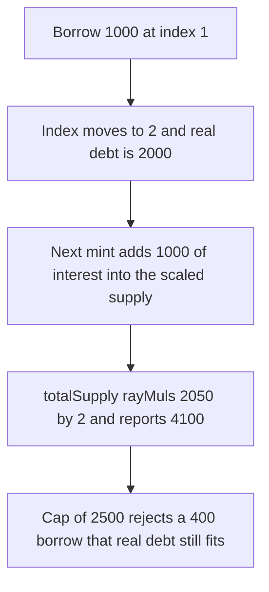

# Regnum Aurum: DebtToken total supply double-counts interest and blocks a borrow that still fits the cap

> **Vulnerability classes:** `vuln/logic/state-update`

<!-- non-defihacklabs -->
<!-- source-auditvault: https://github.com/Auditware/AuditVault/blob/main/findings/66344-h-03-debttoken-total-supply-is-inflated-pashov-audit-group-n.md -->
<!-- date: 2025-05 -->

## Key info

| Field | Value |
|---|---|
| **Loss** | A 400-token borrow that fits the 2500 cap is refused. Reported debt is 4100; real debt is 2100 |
| **Vulnerable contract** | `DebtToken.mint` / `DebtToken.totalSupply` |
| **Attacker EOA** | `0x1111111111111111111111111111111111111111` |
| **Attack contract** | `Exploit` |
| **Attack tx** | `Exploit.run()` |
| **Chain / block / date** | Local synthetic · 2025-05 |
| **Compiler** | solc 0.8.27, cancun, via IR |
| **Bug class** | Scaled interest is minted, then multiplied by the usage index again |

## TL;DR

`mint` adds `scaledBalanceIncrease` — interest that is already the raw balance times the usage index — into the scaled token supply. `totalSupply()` then `rayMul`s that whole supply by the index. After a 1000 principal borrow, an index move from 1 to 2, and a further 100 borrow, the view supply is 4100 while borrowers truly owe 2100. The 2500 borrow cap rejects another 400 even though 2100 + 400 is exactly the cap.

## The vulnerable code

```solidity
scaledBalanceIncrease = rawDebtBalance.rayMul(poolUsageIndex) - rawDebtBalance.rayMul(positionIndex); // @> VULN
uint256 amountToMint = amountScaled + scaledBalanceIncrease; // @> VULN
return super.totalSupply().rayMul(ILendingPool(_lendingPool).getNormalizedDebt());
```

The report's fix is to track borrowed principal separately and scale only that amount in `totalSupply()`. The control mint writes `amountScaled` alone. Reported supply then equals real debt (2100) and the 400 borrow is allowed.

## Root cause

Interest belongs in the index. Putting it into the scaled balance and multiplying by the index again counts it twice. Every consumer of `totalSupply()`, including the borrow cap and `reserve.totalUsage`, sees the inflated number.

## Preconditions

- A borrower already has scaled debt (here, 1000 at index 1.0).
- The usage index increases (here, to 2.0) before the next mint.
- The pool enforces `supplyCap` against `DebtToken.totalSupply()`.

## Attack walkthrough

1. Borrow 1000 at index 1.0. Scaled supply and real debt are both 1000.
2. Accrue the index to 2.0. Real debt becomes 2000. The scaled balance is still 1000.
3. Borrow 100 more. `amountScaled` is 50. `scaledBalanceIncrease` is 1000. `amountToMint` is 1050.
4. Scaled supply is 2050. `totalSupply()` returns 2050 × 2 = 4100. Real debt is 2100.
5. `canBorrow(400)` is false. 2100 + 400 = 2500, which is the cap.

## Diagrams



## Impact

Borrowers are denied credit before the real debt reaches the cap. Here the refused amount is 400 against a 2500 cap while true debt is 2100. Any accounting that copies `totalSupply()` into `reserve.totalUsage` is high by the same 2000.

## How to reproduce

```bash
cd 66344-h-03-debttoken-total-supply-is-inflated-pashov-audit-group-n_exp
forge test -vv
```

`test_exploit_inflated_supply_denies_a_borrow_that_fits` asserts reported 4100, real 2100, and a refused 400. `test_control_principal_only_mint_matches_real_debt` asserts the principal-only mint reports 2100 and allows the 400.

## Sources

- AuditVault finding: https://github.com/Auditware/AuditVault/blob/main/findings/66344-h-03-debttoken-total-supply-is-inflated-pashov-audit-group-n.md
- Report: https://github.com/pashov/audits/blob/master/team/md/RegnumAurum-security-review_2025-05-06.md
- Blamed lines: `DebtToken.mint` scaled-balance increase and `DebtToken.totalSupply` rayMul, as quoted in that review
