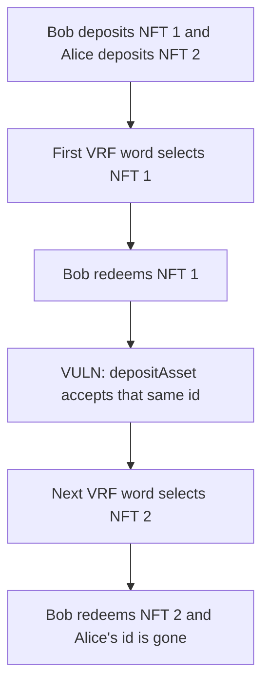

# Regnum Aurum: Bob redeposits the NFT he did not want and the next VRF word gives him Alice's NFT

> **Vulnerability classes:** `vuln/logic/missing-check` · `vuln/logic/incorrect-state-transition`

<!-- non-defihacklabs -->
<!-- source-auditvault: https://github.com/Auditware/AuditVault/blob/main/findings/66352-h-11-randomness-can-be-manipulated-in-rwavault-redemptions-p.md -->
<!-- date: 2025-05 -->

## Key info

| Field | Value |
|---|---|
| **Loss** | Bob holds Alice's NFT 2. The random draw he rejected, NFT 1, is back in the vault |
| **Vulnerable contract** | `RWAVault.depositAsset` |
| **Attacker EOA** | `0x1111111111111111111111111111111111111111` |
| **Attack contract** | `Exploit` |
| **Attack tx** | `Exploit.run()` |
| **Chain / block / date** | Ethereum model · block 0 · 2025-05 |
| **Compiler** | solc 0.8.27, cancun, optimizer 200 |
| **Bug class** | No cooldown between redeem and deposit of the same NFT |

## TL;DR

`redeemNFT` draws an index from the current VRF word, sends that NFT to the caller, and requests a new word. `depositAsset` pushes any approved id, including the one just redeemed. Bob deposits NFT 1, Alice deposits NFT 2. The first word selects NFT 1. Bob redeposits it. The consumer's next fixed word selects NFT 2. Bob redeems it. He did not choose the words. He chose to roll again. There is no profit token. The harm is who holds NFT 2.

## Background

Pashov Audit Group, Regnum Aurum, May 2025, finding H-11, AuditVault id 66352. The vault uses Chainlink VRF to pick an NFT on redemption. The published test loops `redeemNFT`, `depositAsset`, and `fulfillRandomWords` until the id is 2. The recommendation is a cooldown on re-deposit. This run uses a two-word consumer so the loop is deterministic. The words are stored in the consumer constructor, not passed by Bob.

## The vulnerable code

```solidity
rwa.transferFrom(msg.sender, address(this), id);
ids.push(id); // @> VULN: a just-redeemed id is accepted. No cooldown is stored.
```

```diff
  rwa.transferFrom(msg.sender, address(this), id);
+ require(block.timestamp > redeemedAt[id] + cooldown, "cooldown");
  ids.push(id);
```

## Root cause

Redemption and deposit are separate and neither one records that this id was just drawn. A new VRF word changes the index. Putting the unwanted id back into the array lets the caller sample again.

## Preconditions

- The vault holds at least two NFTs. Here, Bob's 1 and Alice's 2.
- A VRF word is already available, and a later fulfillment changes the selection.
- The caller can approve and deposit the NFT they just received.

## Attack walkthrough

1. Bob deposits NFT 1. Alice deposits NFT 2. The array is `[1, 2]`. Word 0 selects index 0, NFT 1.
2. Bob redeems NFT 1, approves the vault, and deposits it again.
3. The consumer fulfills the next word. The array is `[2, 1]` and the new index is Alice's NFT.
4. The loop stops. Bob redeems NFT 2.
5. `ownerOf(2)` is Bob. `ownerOf(1)` is the vault. `spins` is at least 1.

## Diagrams



## Impact

Alice no longer owns NFT 2. Bob does. NFT 1, the draw he rejected, is the one left in the vault. A cooldown on `depositAsset` would have reverted the redeposit, so he could not sample a second word in this transaction. The native profit is 0 because the loss is the NFT, not an ETH balance.

## Remediation

Record the redemption time of each id and reject `depositAsset` until a cooldown has passed, which is the report's recommendation.

## How to reproduce

```bash
cd 66352-h-11-randomness-can-be-manipulated-in-rwavault-redemptions-p_exp
forge test -vv
```

`test_bob_rolls_until_he_receives_alices_nft` asserts the first rejected id is 1, at least one retry, Bob owns 2, and the vault owns 1.

## Sources

- AuditVault finding: https://github.com/Auditware/AuditVault/blob/main/findings/66352-h-11-randomness-can-be-manipulated-in-rwavault-redemptions-p.md
- Report: https://github.com/pashov/audits/blob/master/team/md/RegnumAurum-security-review_2025-05-06.md
- Report test setup: https://gist.github.com/0xbtk/0c1f5e75815d2cf02d3437cbded026ff
