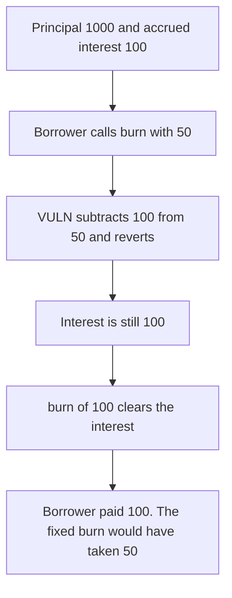

# Regnum Aurum: DebtToken.burn reverts a 50 interest payment and forces the full 100

> **Vulnerability classes:** `vuln/arithmetic/underflow` · `vuln/dos/griefing`

<!-- non-defihacklabs -->
<!-- source-auditvault: https://github.com/Auditware/AuditVault/blob/main/findings/66353-h-12-underflow-forces-full-interest-payment-in-debt-token-pa.md -->
<!-- date: 2025-05 -->

## Key info

| Field | Value |
|---|---|
| **Loss** | A 50-token interest payment reverts. The borrower must pay the full 100 accrued interest |
| **Vulnerable contract** | `DebtToken.burn` |
| **Attacker EOA** | `0x1111111111111111111111111111111111111111` |
| **Attack contract** | `Exploit` |
| **Attack tx** | `Exploit.run()` |
| **Chain / block / date** | Ethereum model · block 0 · 2025-05 |
| **Compiler** | solc 0.8.27, cancun, via IR |
| **Bug class** | Unchecked subtraction of accrued interest |

## TL;DR

AuditVault 66353 is the same H-12. `burn` subtracts accrued interest from the payment before checking which is larger. A 50 payment against 100 interest reverts. Only a payment of the full 100 succeeds. The fixed token accepts 50 and leaves 50 interest.

## The vulnerable code

```solidity
// @> VULN: amount - accrued interest underflows when the payment is partial
uint256 amountAfterPaidInterest = amount - scaledBalanceIncrease;
```

## Root cause

The partial-payment `else` branch is placed after an unchecked subtraction, so Solidity 0.8 never reaches it.

## Preconditions

- `scaledBalance` is 1000 and `scaledBalanceIncrease` is 100.
- The caller burns 50.

## Attack walkthrough

1. `burn(50)` reverts. Interest stays 100 and no tokens move.
2. `burn(100)` clears the interest.
3. The contract balance is 100. Principal is unchanged.

## Diagrams



## Impact

Partial interest payments are impossible. The borrower pays 100 to clear interest that a checked burn would reduce by 50.

## Remediation

Branch on `amount > scaledBalanceIncrease` before any subtraction.

## How to reproduce

```bash
cd 66353-h-12-underflow-forces-full-interest-payment-in-debt-token-pa_exp
forge test -vv
```

## Sources

- AuditVault finding: https://github.com/Auditware/AuditVault/blob/main/findings/66353-h-12-underflow-forces-full-interest-payment-in-debt-token-pa.md
- Pashov review: https://github.com/pashov/audits/blob/master/team/md/RegnumAurum-security-review_2025-05-06.md
- Reduced source: `test/66353-h-12-underflow-forces-full-interest-payment-in-debt-token-pa.sol`
