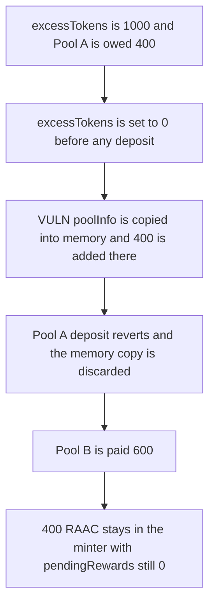

# Regnum Aurum: a failed reward deposit drops 400 RAAC with no retry balance

> **Vulnerability classes:** `vuln/logic/state-update` · `vuln/logic/incorrect-state-transition`

<!-- non-defihacklabs -->
<!-- source-auditvault: https://github.com/Auditware/AuditVault/blob/main/findings/66354-h-13-permanent-loss-of-rewards-when-distribution-fails-pasho.md -->
<!-- date: 2025-05 -->

## Key info

| Field | Value |
|---|---|
| **Loss** | 400 RAAC stuck in RAACMinter. Pool A cannot claim them |
| **Vulnerable contract** | `RAACMinter._processMintedRewards` |
| **Attacker EOA** | `0x1111111111111111111111111111111111111111` (the distribution caller) |
| **Attack contract** | `Exploit` |
| **Attack tx** | `Exploit.run()` |
| **Chain / block / date** | Ethereum model · block 0 · 2025-05 |
| **Compiler** | solc 0.8.27, cancun, via IR |
| **Bug class** | excessTokens cleared, then poolInfo copied to memory, so a revert discards pendingRewards |

## TL;DR

This is the same H-13 as AuditVault 66175, stored under a second id. `_processMintedRewards` sets `excessTokens` to 0 and then loads each pool into a memory struct. Pool A is owed 400 of a 1000 RAAC distribution and its `deposit` reverts. The 400 is added only to that memory struct, which the catch block discards. Storage `pendingRewards` stays 0, `excessTokens` stays 0, and the 400 tokens sit in the minter with no balance a retry can pay. Pool B still receives its 600.

## Background

Pashov Audit Group's 6 May 2025 Regnum Aurum review, finding H-13. `RAACMinter` mints RAAC and pushes it to pools through `IRAACMinterRewardsReceiver.deposit`. The report's numbers are `excessTokens = 1000`, Pool A weight 400, Pool B weight 600. The recommended change is to keep `poolInfo` in storage so a failed deposit leaves `pendingRewards` on the pool.

## The vulnerable code

```solidity
uint256 rewardPerWeight = excessTokens / totalWeight;
excessTokens = 0; // cleared before any receiver accepts the tokens
DistributionPool memory poolData = poolInfo[pool];
poolData.pendingRewards += rewardPerWeight * poolData.weight; // @> VULN: pendingRewards is added on a memory copy and discarded if deposit reverts
_depositPendingReward(poolData);
```

The catch in `_depositPendingReward` emits `DistributionFailed` and does not write the memory struct back.

Keeping the struct in storage, which is what the report asks for, leaves a balance `flush` can pay once the receiver accepts:

```diff
- DistributionPool memory poolData = poolInfo[pool];
+ DistributionPool storage poolData = poolInfo[pool];
  poolData.pendingRewards += rewardPerWeight * poolData.weight;
```

## Root cause

Two writes that should be durable are not. `excessTokens = 0` happens before any `deposit` succeeds, so the tokens cannot be reconstructed from `excessTokens`. The pending amount is then added to a memory copy. A revert rolls the call back and the copy with it. Storage never learned that Pool A is owed 400.

## Preconditions

- `excessTokens` is 1000 and `totalWeight` is 5. Pool A weight 2, Pool B weight 3.
- Pool A's receiver reverts inside `deposit`. Pool B's receiver accepts.
- The minter already holds the 1000 RAAC it is about to distribute.

## Attack walkthrough

1. Mint 1000 RAAC to the minter and set `excessTokens` to 1000.
2. `process` computes `rewardPerWeight = 200` and sets `excessTokens` to 0.
3. Pool A's memory `pendingRewards` becomes 400. `deposit` reverts. The catch emits and returns.
4. Pool B's memory `pendingRewards` becomes 600. `deposit` transfers 600 and succeeds.
5. The minter still holds 400. `pendingOf(poolA)` is 0. A second `process` has nothing in `excessTokens` to send.
6. The control uses a storage struct. After the same failure Pool A's `pendingRewards` is 400, and `flush` pays it once the receiver stops reverting. The minter ends at 0.

## Diagrams



## Impact

Pool A loses 400 RAAC of this distribution. The tokens are still in `RAACMinter`, but `excessTokens` and `pendingRewards` are both 0, so no later call will pay Pool A. Pool B is unaffected and receives 600. The storage control records the 400 and pays it on retry, which empties the minter.

## Remediation

Update `poolInfo` in storage, not through a memory copy, and only clear the distributed amount after `deposit` succeeds. A failed pool must keep `pendingRewards` so a later flush can transfer the tokens.

## How to reproduce

```bash
cd 66354-h-13-permanent-loss-of-rewards-when-distribution-fails-pasho_exp
forge test -vv
```

`test_exploit_pool_a_loses_400_rewards` asserts Pool A received 0, Pool B received 600, and 400 is stuck with `pendingRewards` 0. `test_control_storage_pending_can_be_retried` asserts the storage path keeps 400 and `flush` pays it. Captured output is `output.txt`.

## Sources

- AuditVault finding: https://github.com/Auditware/AuditVault/blob/main/findings/66354-h-13-permanent-loss-of-rewards-when-distribution-fails-pasho.md
- Pashov report: https://github.com/pashov/audits/blob/master/team/md/RegnumAurum-security-review_2025-05-06.md
- Same issue, other id: https://github.com/Auditware/AuditVault/blob/main/findings/66175-h-13-permanent-loss-of-rewards-when-distribution-fails-pasho.md
- Vulnerable lines: the `_processMintedRewards` and `_depositPendingReward` snippets quoted in that report. The finding does not name an audited commit.
