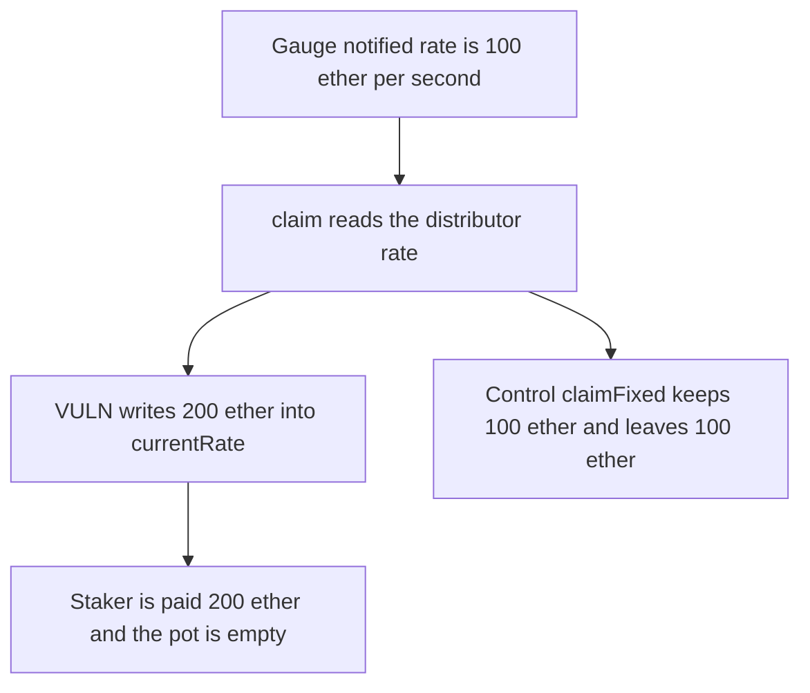

# BaseGauge pays the distributor-wide reward rate and empties the other gauge's share

> **Vulnerability classes:** `vuln/logic/reward-calculation`

<!-- non-defihacklabs -->
<!-- source-auditvault: https://github.com/Auditware/AuditVault/blob/main/findings/66355-h-14-incorrect-reward-calculation-in-calculatependingreward.md -->
<!-- date: 2025-05 -->

## Key info

| Field | Value |
|---|---|
| **Loss** | 100 ether of reward tokens that belonged to the other gauge |
| **Vulnerable contract** | `BaseGauge._calculatePendingRewards` |
| **Attacker EOA** | `0x1111111111111111111111111111111111111111` |
| **Attack contract** | `Exploit` |
| **Attack tx** | `Exploit.run()` |
| **Chain / block / date** | Ethereum model · block 0 · 2025-05 |
| **Compiler** | solc 0.8.27, cancun, via IR |
| **Bug class** | Gauge copies the shared distributor rate |

## TL;DR

The gauge's own notified rate is 100 ether per second. The shared distributor's `getRewardRate` is 200 ether per second because a second gauge is funded from the same stream. `_calculatePendingRewards` writes that rate into `currentRate` and the single staker is paid 200 ether. `claimFixed`, which keeps the notified rate, pays 100 ether and leaves 100 ether in the gauge.

## Background

Pashov Audit Group's May 2025 Regnum Aurum review, finding H-14 (AuditVault 66355). BaseGauge reads the reward rate from `IGaugeRewardsDistributor.getRewardRate` whenever a distributor is configured. That rate is not this gauge's notified amount.

## The vulnerable code

```solidity
currentRate = rate; // @> VULN: distributor-wide rate replaces this gauge's notified rate
// FIX: keep the rate stored when this gauge was notified
```

The change that removes the harm:

```diff
- currentRate = rate;
+ // keep notifiedRate
```

## Root cause

The pending-reward formula multiplies `currentRate` by the elapsed time. The assignment replaces the gauge-local rate with the distributor's global rate before that multiplication. One second at timestamp 1 therefore pays 200 ether instead of 100 ether.

## Preconditions

- Distributor rate is 200 ether per second. This gauge was notified 100 ether per second and was funded with a 200 ether pot.
- One staker owns the entire gauge supply.
- `lastUpdate` is 0 and the block timestamp is 1, so one second of rewards is due.

## Attack walkthrough

1. The staker deposits 1 ether of gauge weight.
2. Fair payout at the notified rate is 100 ether.
3. `claim` loads `getRewardRate` and stores 200 ether in `currentRate`.
4. The gauge transfers 200 ether to the staker and its balance is 0.
5. The control `claimFixed` pays 100 ether and leaves 100 ether in the gauge.

## Diagrams



## Impact

The staker receives 200 ether. Half of that was the other gauge's allocation. After the buggy claim the reward pot is empty, so the other gauge cannot pay its stakers.

## Remediation

Do not copy `getRewardRate` from the distributor over the rate stored when this gauge was notified. Pay `notifiedRate`.

## How to reproduce

```bash
cd 66355-h-14-incorrect-reward-calculation-in-calculatependingreward_exp
forge test -vv
```

`test_exploit` is the harm. The control test is the guarded path. Captured output is `output.txt`.

## Sources

- AuditVault finding: https://github.com/Auditware/AuditVault/blob/main/findings/66355-h-14-incorrect-reward-calculation-in-calculatependingreward.md
- Pashov report: https://github.com/pashov/audits/blob/master/team/md/RegnumAurum-security-review_2025-05-06.md
- Quoted function: `BaseGauge._calculatePendingRewards`
