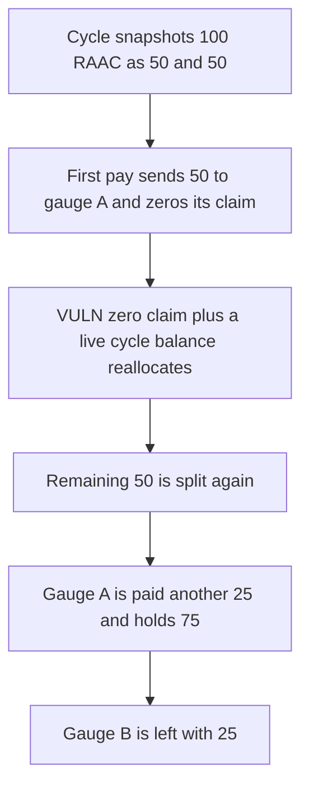

# Regnum Aurum: the same gauge is paid twice in one reward cycle

> **Vulnerability classes:** `vuln/logic/reward-calculation` · `vuln/logic/state-update`

<!-- non-defihacklabs -->
<!-- source-auditvault: https://github.com/Auditware/AuditVault/blob/main/findings/66356-h-15-malicious-users-can-distribute-more-rewards-to-the-same.md -->
<!-- date: 2025-05 -->

## Key info

| Field | Value |
|---|---|
| **Loss** | Gauge A receives 75 of a 100 RAAC cycle. Gauge B is left with 25 |
| **Vulnerable contract** | `GaugeRewardsDistributor.distributeRewards` |
| **Attacker EOA** | `0x1111111111111111111111111111111111111111` |
| **Attack contract** | `Exploit` |
| **Attack tx** | `Exploit.run()` |
| **Chain / block / date** | Ethereum model · block 0 · 2025-05 |
| **Compiler** | solc 0.8.27, cancun, via IR |
| **Bug class** | Clearing `pendingAllocations` makes the next call allocate the gauge again |

## TL;DR

This is the same `GaugeRewardsDistributor` bug as AuditVault 66177, filed again under id 66356. A cycle snapshots 100 RAAC across two gauges, 50 each. Paying gauge A zeros its claim but leaves `distributionCycleBalance` untouched. The next call treats that zero as a new gauge, recalculates, and pays A another 25. A ends at 75. B is left with 25.

## The vulnerable code

```solidity
if (gaugeShare == 0 && distributionCycleBalance[token] > 0) { // @> VULN
    _recalculateAllocations(token);
    gaugeShare = pendingAllocations[token][gauge];
}
pendingAllocations[token][gauge] = 0; // @> VULN
```

Refuse a second distribution to a gauge that was already paid in the cycle.

## Root cause

The zero written after a successful pay is the same condition `_checkAndAddGaugeToCycle` uses to decide that a gauge still needs an allocation. Recalculation then rewrites every active gauge's claim from the tokens still in the contract.

## Preconditions

- Two gauges are registered before the cycle starts.
- The distributor holds 100 RAAC.
- `distributeRewards` is permissionless.

## Attack walkthrough

1. The first call starts the cycle and pays A 50. Pending A becomes 0. The contract still holds B's 50.
2. The second call for A takes the zero-claim branch and splits the remaining 50.
3. A is paid 25 more. B's claim is overwritten from 50 to 25.
4. B's call pays 25. A holds 75. B holds 25.

## Diagrams



## Impact

A caller redirects 25 RAAC of this cycle from gauge B to gauge A. The fair split was 50 and 50. The same sequence works for any later call while the cycle balance accounting is still positive.

## How to reproduce

```bash
cd 66356-h-15-malicious-users-can-distribute-more-rewards-to-the-same_exp
forge test -vv
```

`test_same_gauge_is_paid_twice_in_one_cycle` asserts gauge A holds 75 RAAC and gauge B holds 25.

## Sources

- AuditVault finding: https://github.com/Auditware/AuditVault/blob/main/findings/66356-h-15-malicious-users-can-distribute-more-rewards-to-the-same.md
- Pashov report: https://github.com/pashov/audits/blob/master/team/md/RegnumAurum-security-review_2025-05-06.md
