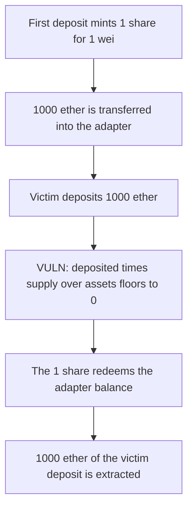

# Regnum Aurum: a 1-wei deposit plus a donation lets one share redeem a later 1000 ether deposit

> **Vulnerability classes:** `vuln/arithmetic/precision-loss` · `vuln/logic/price-calculation`

<!-- non-defihacklabs -->
<!-- source-auditvault: https://github.com/Auditware/AuditVault/blob/main/findings/66359-h-18-inflation-attack-in-rwa-vault-pashov-audit-group-none-r.md -->
<!-- date: 2025-05 -->

## Key info

| Field | Value |
|---|---|
| **Loss** | Victim deposits 1000 ether and receives 0 shares. The attacker redeems that 1000 ether with 1 share |
| **Vulnerable contract** | `RWAVault.depositAsset` |
| **Attacker EOA** | `0x1111111111111111111111111111111111111111` |
| **Attack contract** | `Exploit` |
| **Attack tx** | `Exploit.run()` |
| **Chain / block / date** | Ethereum model · block 0 · 2025-05 |
| **Compiler** | solc 0.8.27, cancun, optimizer 200 |
| **Bug class** | First-depositor share price uses the raw adapter balance |

## TL;DR

`totalValue()` is the adapter's token balance. The first depositor mints 1 share for 1 wei. A direct 1000 ether transfer into the adapter does not mint shares, so the price of that one share becomes about 1000 ether. The victim's later 1000 ether deposit computes `deposited * supply / totalAssets` and floors to 0 shares. Redeeming the 1 share returns the victim's 1000 ether.

## Background

Pashov Audit Group's May 2025 Regnum Aurum review, finding H-18. The report's share mint is 1:1 on an empty vault and `deposited * supply / assets` afterwards. `totalAssets()` sums `totalValue()`, and `totalValue()` returns `token.balanceOf(adapter)`. Donating tokens into an adapter raises the price without minting shares.

## The vulnerable code

```solidity
sharesMinted = (depositedAssetValue * supplyBefore) / assetsBefore; // @> VULN: donation inflates assetsBefore, so this floors to 0
```

`assetsBefore` is `totalAssets()`, which reads the adapter balance. There is no virtual offset. The report's recommended direction for the related swap is to take `minDy` from the caller. The share-price side of the same donation is what this run shows: the victim must not be given 0 shares for a non-zero deposit.

```diff
- sharesMinted = (depositedAssetValue * supplyBefore) / assetsBefore;
+ sharesMinted = (depositedAssetValue * (supplyBefore + 1)) / (assetsBefore + 1);
```

## Root cause

The exchange rate trusts a balance that anyone can increase with `transfer`. The numerator is the new deposit and the denominator is the donated balance, with only 1 share of supply. Integer division rounds the victim to 0.

## Preconditions

- The vault has no virtual shares or assets.
- The attacker is the first depositor and can transfer tokens into the adapter.
- The victim deposits after that transfer, in the same transaction here.

## Attack walkthrough

1. Attacker deposits 1 wei and receives 1 share.
2. Attacker transfers 1000 ether to the adapter. Supply stays 1.
3. Victim deposits 1000 ether. Shares minted are 0.
4. Attacker redeems 1 share and moves the victim's 1000 ether out.

## Diagrams



## Impact

The victim's token balance is 0 and their share balance is 0. The extracted-deposit contract holds 1000 ether that the victim paid. The attacker's own donation is returned inside the same redemption; the 1000 ether profit is the victim's deposit.

## Remediation

Mint shares with a virtual offset, or reject a deposit that would mint 0 shares. Do not let `totalAssets()` increase on a bare token transfer.

## How to reproduce

```bash
cd 66359-h-18-inflation-attack-in-rwa-vault-pashov-audit-group-none-r_exp
forge test -vv
```

`test_victim_receives_zero_shares_and_loses_1000_ether` asserts 0 victim shares and 1000 ether extracted. `test_control_donation_is_what_zeros_the_share` shows the same division without the donation mints 1000 ether of shares.

## Sources

- AuditVault finding: https://github.com/Auditware/AuditVault/blob/main/findings/66359-h-18-inflation-attack-in-rwa-vault-pashov-audit-group-none-r.md
- Report: https://github.com/pashov/audits/blob/master/team/md/RegnumAurum-security-review_2025-05-06.md
- Reduced from the `depositAsset` / `totalAssets` / `totalValue` quotes in that report
