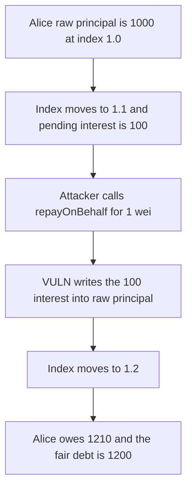

# Regnum Aurum: a 1-wei repayOnBehalf forces Alice to owe 1210 instead of 1200

> **Vulnerability classes:** `vuln/logic/state-update` · `vuln/logic/fee-calculation`

<!-- non-defihacklabs -->
<!-- source-auditvault: https://github.com/Auditware/AuditVault/blob/main/findings/66362-h-21-users-may-be-forced-to-pay-more-interest-pashov-audit-g.md -->
<!-- date: 2025-05 -->

## Key info

| Field | Value |
|---|---|
| **Loss** | Alice pays 1210 RA. The fair debt is 1200 RA. The pool takes 10 RA extra plus the 1 wei |
| **Vulnerable contract** | `LendingPool.repayOnBehalf` |
| **Attacker EOA** | `0x1111111111111111111111111111111111111111` |
| **Attack contract** | `Exploit` |
| **Attack tx** | `Exploit.run()` |
| **Chain / block / date** | Ethereum model · block 0 · 2025-05 |
| **Compiler** | solc 0.8.27, cancun, via IR |
| **Bug class** | Dust repayment capitalizes accrued interest into raw principal |

## TL;DR

This is AuditVault 66362, the same H-21 as the May 2025 Regnum Aurum review. Anyone can call `repayOnBehalf`. A 1-wei repayment writes accrued interest into raw principal. Alice borrowed 1000 at index 1.0. After a dust repayment at index 1.1 her raw balance is 1100, and at index 1.2 she owes 1210 instead of 1200.

## The vulnerable code

```solidity
uint256 interest = (raw * (usageIndex - positionIndex[user])) / RAY;
// @> VULN: a 1-wei repay writes all accrued interest into raw principal
rawBalance[user] = raw + interest;
positionIndex[user] = usageIndex;
```

## Root cause

The repayment capitalizes every unit of pending interest and does not subtract the 1 wei from the new principal. The next index delta is charged on 1100 rather than 1000.

## Preconditions

- Raw principal 1000 at index 1e27.
- The usage index moves 1.0 to 1.1 to 1.2.
- `repayOnBehalf` accepts a 1-wei payment from any caller.

## Attack walkthrough

1. Move the index to 1.1e27. Pending interest is 100.
2. Call `repayOnBehalf` for 1 wei. Debt stays 1100 and raw principal becomes 1100.
3. Move the index to 1.2e27. Debt becomes 1210.
4. Alice repays 1210. The control path with no dust repayment bills 1200.

## Diagrams



## Impact

Alice pays 10 RA more than the fair debt. The pool's RA balance increases by 1210 RA plus 1 wei.

## Remediation

Require a minimum repayment, or the borrower's approval, before `repayOnBehalf` may capitalize interest.

## How to reproduce

```bash
cd 66362-h-21-users-may-be-forced-to-pay-more-interest-pashov-audit-g_exp
forge test -vv
```

## Sources

- AuditVault finding: https://github.com/Auditware/AuditVault/blob/main/findings/66362-h-21-users-may-be-forced-to-pay-more-interest-pashov-audit-g.md
- Pashov review: https://github.com/pashov/audits/blob/master/team/md/RegnumAurum-security-review_2025-05-06.md
- Reduced source: `test/66362-h-21-users-may-be-forced-to-pay-more-interest-pashov-audit-g.sol`
