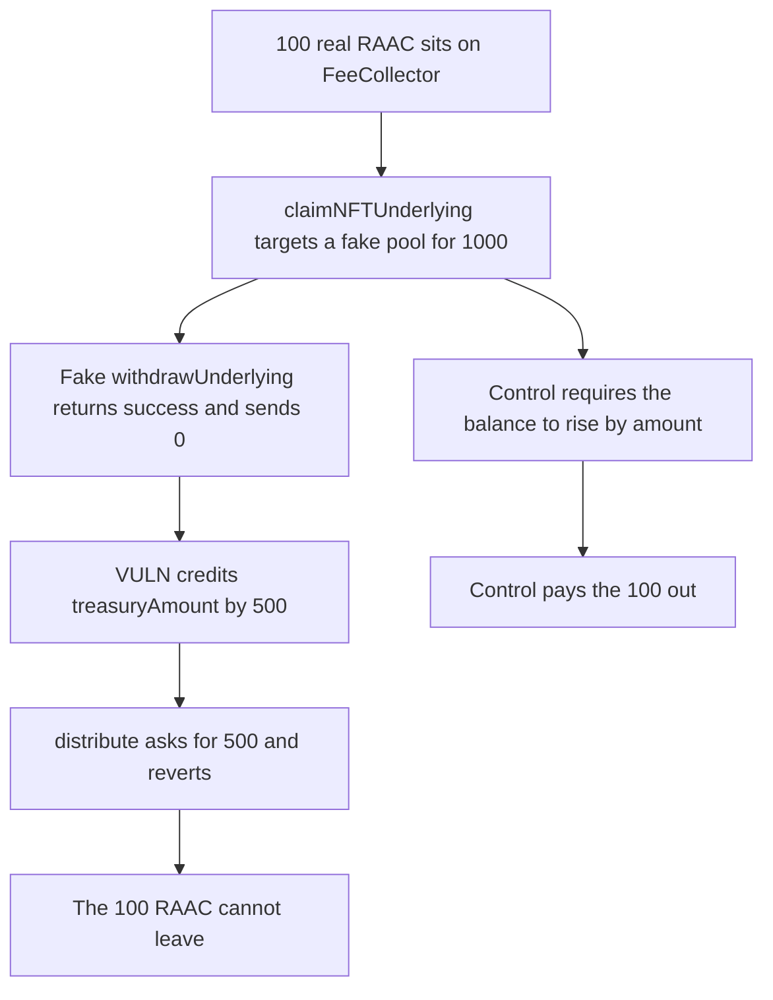

# Regnum Aurum: a fake NFT target books 500 RAAC of fees and traps the real 100

> **Vulnerability classes:** `vuln/dos/frozen-funds` · `vuln/logic/fee-calculation`

<!-- non-defihacklabs -->
<!-- source-auditvault: https://github.com/Auditware/AuditVault/blob/main/findings/66364-h-23-feecollector-will-be-dos-pashov-audit-group-none-regnum.md -->
<!-- date: 2025-05 -->

## Key info

| Field | Value |
|---|---|
| **Loss** | 100 RAAC stuck in `FeeCollector` |
| **Vulnerable contract** | `FeeCollector.claimNFTUnderlying` |
| **Attacker EOA** | `0x1111111111111111111111111111111111111111` |
| **Attack contract** | `Exploit` |
| **Attack tx** | `Exploit.run()` |
| **Chain / block / date** | Ethereum model · block 0 · 2025-05 |
| **Compiler** | solc 0.8.27, cancun, via IR |
| **Bug class** | Fee buckets credited from an unchecked target call |

## TL;DR

`claimNFTUnderlying` calls `target.withdrawUnderlying` and, if the call does not revert, adds `amount` to the fee buckets. A fake pool returns success and sends no tokens. A 1000 RAAC claim books 500 RAAC for the treasury. The collector only holds 100 real RAAC, so `distribute` reverts and those 100 cannot leave. The control requires the balance to rise by `amount`, rejects the fake target, and pays the 100 out.

## Background

Pashov Audit Group's Regnum Aurum review of 2025-05-06, finding H-23. `claimNFTUnderlying` is permissionless aside from the pause and reentrancy guards. The low-level call ignores return data. Fee shares are 50 percent treasury, 20 percent repair, 10 percent burn, 10 percent veRAAC, 5 percent corp, and 5 percent other.

## The vulnerable code

```solidity
(bool success,) = target.call(
    abi.encodeWithSelector(bytes4(keccak256("withdrawUnderlying(address,address,uint256)")), token, address(this), amount)
);
if (!success) revert ClaimCollectorUnderlyingFailed();
// @> VULN: treasuryAmount is credited even though the target transferred no tokens
collectedFee.treasuryAmount += treasuryAmount;
```

## Root cause

Success of the call is treated as delivery of `amount`. A contract that implements the selector and transfers nothing still inflates every fee bucket. Distribution then asks for more tokens than the contract holds.

## Preconditions

- The token is supported and the lending fee type sums to 100 percent.
- 100 RAAC of real fees have been pulled into the collector.
- Anyone can pass an arbitrary `target` and a non-zero `amount`.

## Attack walkthrough

1. 100 RAAC is minted and approved to the collector.
2. `receiveFees` pulls that 100. The books are still zero.
3. `claimNFTUnderlying` aims 1000 RAAC at the fake pool.
4. The fake pool returns true. The RAAC balance stays 100.
5. `treasuryAmount` becomes 500.
6. `distribute` tries to send 500 and reverts.
7. The 100 RAAC is still on the collector.

## Diagrams



## Impact

FeeCollector holds 100 RAAC and a treasury payable of 500 RAAC. The payout reverts, so the real fees are frozen. The control rejects the fake claim and transfers the 100 RAAC to the treasury.

## Remediation

After the call, require `balanceOf(address(this))` to increase by `amount`, and allow only known pool targets. Do not credit a bucket for tokens that did not arrive.

## How to reproduce

```bash
cd 66364-h-23-feecollector-will-be-dos-pashov-audit-group-none-regnum_exp
forge test -vv
```

`test_exploit_inflated_fees_lock_100_raac` asserts a 100 RAAC balance, a 500 treasury book, and a reverted distribute. `test_control_balance_check_lets_real_fees_distribute` asserts the fake claim reverts and the 100 is paid. Captured output is `output.txt`.

## Sources

- AuditVault finding: https://github.com/Auditware/AuditVault/blob/main/findings/66364-h-23-feecollector-will-be-dos-pashov-audit-group-none-regnum.md
- Pashov report: https://github.com/pashov/audits/blob/master/team/md/RegnumAurum-security-review_2025-05-06.md
