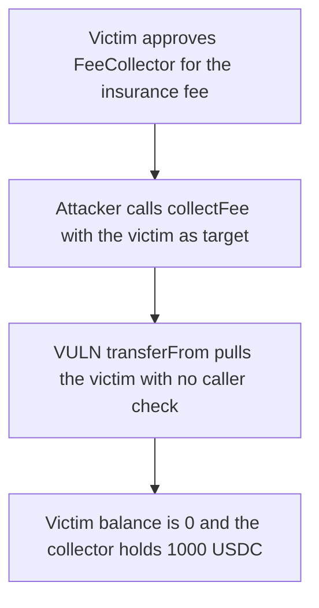

# Regnum Aurum: anyone can pull a FeeCollector allowance

> **Vulnerability classes:** `vuln/access-control/missing-auth` · `vuln/logic/missing-check`

<!-- non-defihacklabs -->
<!-- source-auditvault: https://github.com/Auditware/AuditVault/blob/main/findings/66368-h-27-unrestricted-feecollectorcollectfee-enables-unauthorize.md -->
<!-- date: 2025-05 -->

## Key info

| Field | Value |
|---|---|
| **Loss** | 1000 USDC pulled from a victim who only approved an insurance fee |
| **Vulnerable contract** | `FeeCollector.collectFee` |
| **Attacker EOA** | `0x1111111111111111111111111111111111111111` |
| **Attack contract** | `Exploit` |
| **Attack tx** | `Exploit.run()` |
| **Chain / block / date** | Ethereum model · block 0 · 2025-05 |
| **Compiler** | solc 0.8.27, cancun, via IR |
| **Bug class** | `collectFee` transferFroms an arbitrary target with no caller check |

## TL;DR

This is the same `FeeCollector.collectFee` bug as AuditVault 66189, filed again under id 66368. `borrowWithInsurance` tells the user to approve the insurance fee to the collector. `collectFee` is public and pulls `target` for `amount`. The attacker names the victim and takes 1000 USDC. The victim never borrows.

## The vulnerable code

```solidity
MockUSDC(token).transferFrom(target, address(this), amount); // @> VULN
```

Pull the fee inside `borrowWithInsurance` instead of leaving a standing allowance that any caller can spend.

## Root cause

The allowance is granted to the collector, and the collector spends it for any caller. The fee-type and supported-token checks do not restrict `msg.sender`.

## Preconditions

- USDC is supported and the insurance fee type is registered.
- The victim has approved FeeCollector for 1000 USDC.

## Attack walkthrough

1. The victim approves 1000 USDC to FeeCollector.
2. The attacker calls `collectFee` with the victim as `target` and `keccak256("INSURANCE_FEE")`.
3. `transferFrom` moves the 1000 USDC into the collector.
4. The victim's balance is 0 and the allowance is spent.

## Diagrams



## Impact

The victim loses 1000 USDC that they approved for a fee they were never charged. The tokens are held by FeeCollector. The same allowance cannot be used for the borrow that prompted it.

## How to reproduce

```bash
cd 66368-h-27-unrestricted-feecollectorcollectfee-enables-unauthorize_exp
forge test -vv
```

`test_collectFee_pulls_victim_allowance` asserts the victim's balance is 0 and the collector holds 1000 USDC.

## Sources

- AuditVault finding: https://github.com/Auditware/AuditVault/blob/main/findings/66368-h-27-unrestricted-feecollectorcollectfee-enables-unauthorize.md
- Pashov report: https://github.com/pashov/audits/blob/master/team/md/RegnumAurum-security-review_2025-05-06.md
