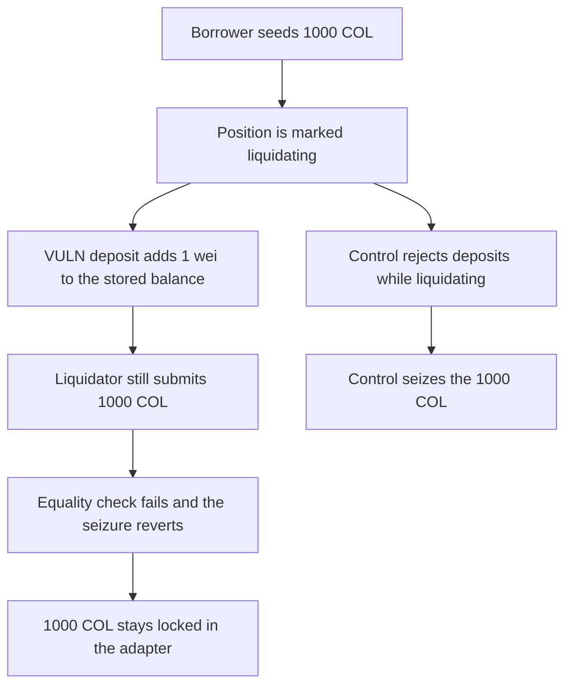

# Regnum Aurum: a 1 wei deposit during liquidation locks 1000 COL

> **Vulnerability classes:** `vuln/dos/frozen-funds` · `vuln/logic/liquidation-logic`

<!-- non-defihacklabs -->
<!-- source-auditvault: https://github.com/Auditware/AuditVault/blob/main/findings/66369-h-28-deposits-during-liquidation-enable-collateral-lockup-pa.md -->
<!-- date: 2025-05 -->

## Key info

| Field | Value |
|---|---|
| **Loss** | 1000 COL stays in the asset adapter. The stability pool seizes 0 |
| **Vulnerable contract** | `ERC20AssetAdapter.deposit` |
| **Attacker EOA** | `0x800a52710b80345d7829ef5759d2d6b8712f8a5d` (the borrower) |
| **Attack contract** | `Exploit` |
| **Attack tx** | `Exploit.run()` |
| **Chain / block / date** | Ethereum model · block 0 · 2025-05 |
| **Compiler** | solc 0.8.27, cancun, via IR |
| **Bug class** | Liquidation requires an exact balance match, and deposits are still open |

## TL;DR

`validateLiquidationData` returns true only when `balances[user]` equals the amount in the liquidator's calldata. `deposit` still adds to that balance after the position is marked liquidating. The borrower deposits 1 wei on top of 1000 COL. The stability pool's call reverts with `CollateralAndParamterDataMismatch`, and the 1000 COL never moves. The control rejects deposits while the flag is set, and the same seizure transfers the 1000 COL to the stability pool.

## Background

Pashov Audit Group's 6 May 2025 Regnum Aurum review, finding H-28. `StabilityPool.liquidateBorrower` calls the adapter's `validateLiquidationData` before it seizes collateral. The check is an equality on the stored balance. `LendingPool.depositAsset` has no `isUnderLiquidation` guard, so the borrower can change the balance in the same window the liquidator is using.

## The vulnerable code

```solidity
function deposit(address user, bytes calldata data) external virtual {
    require(msg.sender == lendingPool, "onlyLendingPool");
    uint256 amount = abi.decode(data, (uint256));
    require(amount > 0, "ERC20Adapter: invalid amount");
    // @> VULN: deposit increases the borrower balance while liquidation is open, so the stored balance no longer equals the liquidator's amount
    balances[user] += amount;
    require(token.transferFrom(user, address(this), amount), "pull");
}
```

`validateLiquidationData` is `balances[user] == amount`. After the 1 wei deposit the stored balance is 1000 COL plus 1 wei, and the calldata still encodes 1000 COL.

## Root cause

The liquidation amount is snapshotted by the caller, and the balance it is compared to is still writable. Nothing in `deposit` reads `liquidating[user]`.

## Preconditions

- The borrower has an open position of 1000 COL.
- Liquidation has been started, so the liquidator will pass that 1000 COL amount.
- `depositAsset` is not paused and the borrower is not blocked from calling it.

## Attack walkthrough

1. The borrower seeds 1000 COL. The adapter balance equals that amount.
2. The lending pool marks the borrower liquidating.
3. The borrower calls `depositAsset` with 1 wei. `balances[user]` becomes 1000 COL plus 1 wei.
4. The stability pool calls `liquidateBorrower` with the original 1000 COL encoding.
5. `validateLiquidationData` returns false. The call reverts. `seized` stays 0.
6. The adapter still holds 1000 COL plus the 1 wei. The control blocks the deposit and seizes the 1000 COL.

## Diagrams



## Impact

The collateral the liquidation was supposed to seize remains in the adapter. The stability pool receives nothing. Repeating the 1 wei deposit keeps the equality from ever holding, so the position cannot be liquidated.

## Remediation

Reject `deposit` while `liquidating[user]` is set, which is the check in the control adapter: `DepositsDisabledDuringLiquidation`.

## How to reproduce

```bash
cd 66369-h-28-deposits-during-liquidation-enable-collateral-lockup-pa_exp
forge test -vv
```

`test_exploit_one_wei_deposit_locks_collateral` asserts the adapter holds 1000 COL plus 1 wei and the stability pool seized 0. `test_control_deposit_blocked_and_seed_is_seized` asserts the deposit reverts and the stability pool receives 1000 COL. Captured output is `output.txt`.

## Sources

- AuditVault finding: https://github.com/Auditware/AuditVault/blob/main/findings/66369-h-28-deposits-during-liquidation-enable-collateral-lockup-pa.md
- Pashov report: https://github.com/pashov/audits/blob/master/team/md/RegnumAurum-security-review_2025-05-06.md
