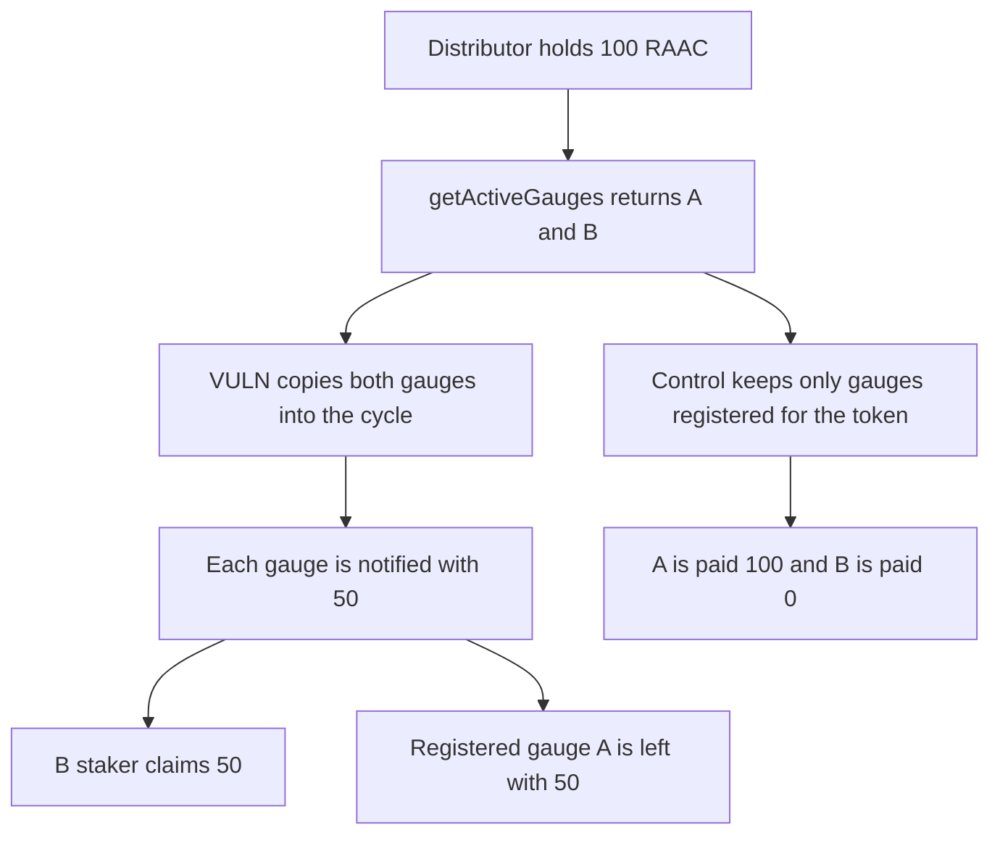

# Regnum Aurum: reward cycles pay gauges that were never registered

> **Vulnerability classes:** `vuln/logic/reward-calculation` · `vuln/logic/missing-check`

<!-- non-defihacklabs -->
<!-- source-auditvault: https://github.com/Auditware/AuditVault/blob/main/findings/66370-h-29-gaugerewardsdistributor-distributes-rewards-to-gauges-n.md -->
<!-- date: 2025-05 -->

## Key info

| Field | Value |
|---|---|
| **Loss** | 50 of 100 RAAC is paid to a gauge that was not registered for that token. The registered gauge is left with 50 |
| **Vulnerable contract** | `GaugeRewardsDistributor.distributeRewards` |
| **Attacker EOA** | `0x1111111111111111111111111111111111111111` |
| **Attack contract** | `Exploit` |
| **Attack tx** | `Exploit.run()` |
| **Chain / block / date** | Ethereum model · block 0 · 2025-05 |
| **Compiler** | solc 0.8.27, cancun, via IR |

## TL;DR

`distributeRewards` copies every gauge returned by `GaugeController.getActiveGauges` into the cycle and splits the token balance across that list. `addGaugeRewardToken` is what actually opts a gauge in, and it is never read. An active gauge that was not registered for the token still receives half. Its staker claims 50 RAAC. The registered gauge holds the other 50 instead of 100.

## The vulnerable code

```solidity
address[] memory activeGauges = controller.getActiveGauges();
for (uint256 i = 0; i < activeGauges.length; i++) {
    if (!fixedMode || gaugeRewardTokens[activeGauges[i]][address(token)]) {
        allActiveGauges[count] = activeGauges[i]; // @> VULN: every active gauge is paid, registered or not
        count++;
    }
}
```

The recommended guard, from the Pashov review, keeps a gauge only when it was registered for this token:

```diff
 for (uint256 i = 0; i < activeGauges.length; i++) {
+    if (gaugeRewardTokens[activeGauges[i]][token]) {
         allActiveGauges[count] = activeGauges[i];
         count++;
+    }
 }
```

## Root cause

Active and registered are different sets. The distributor treats the controller's active list as the payee list. A gauge can be active for voting and still not be in `gaugeRewardTokens` for this reward token. The pay loop even observes that the second gauge is unregistered, then approves it and calls `notify` anyway.

## Preconditions

- Gauge A is active and was passed to `addGaugeRewardToken`.
- Gauge B is active and was not registered for this token.
- The distributor holds 100 RAAC. The split is the balance divided by the number of gauges copied into the cycle.

## Attack walkthrough

1. `distributeRewards` reads two active gauges.
2. Both are stored. The registration mapping is not a filter.
3. 100 RAAC is divided by 2. Each gauge is notified with 50.
4. B's staker claims 50 RAAC.
5. A's balance stays 50. The control that keeps the registration check pays A 100 and pays B nothing.

## Diagrams



## Impact

The caller who stakes in the unregistered gauge receives 50 RAAC that the registration list assigned entirely to gauge A. Gauge A's stakers are short 50 RAAC of that distribution. A gauge that cannot account for the token keeps the tokens instead of crediting them, which is the second consequence called out in the review.

## How to reproduce

```bash
cd 66370-h-29-gaugerewardsdistributor-distributes-rewards-to-gauges-n_exp
forge test -vv
```

`test_exploit_unregistered_gauge_takes_half` asserts the caller received 50 and gauge A still holds 50. `test_control_only_registered_gauge_is_paid` asserts A receives 100 and B receives 0.

## Sources

- AuditVault finding: https://github.com/Auditware/AuditVault/blob/main/findings/66370-h-29-gaugerewardsdistributor-distributes-rewards-to-gauges-n.md
- Pashov review: https://github.com/pashov/audits/blob/master/team/md/RegnumAurum-security-review_2025-05-06.md
