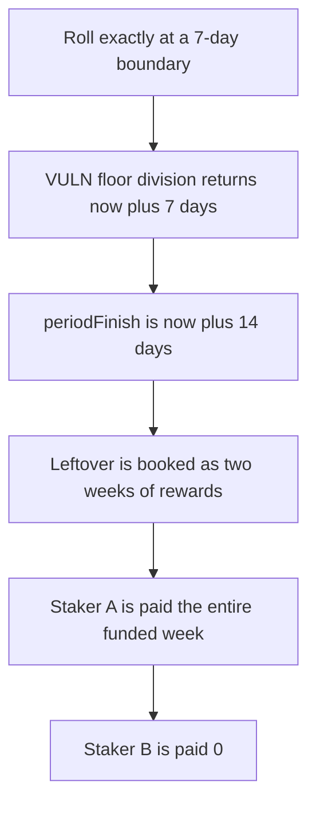

# Regnum Aurum: getNextCycleStart skips a week and one staker takes the whole pot

> **Vulnerability classes:** `vuln/logic/reward-calculation` · `vuln/arithmetic/precision-loss`

<!-- non-defihacklabs -->
<!-- source-auditvault: https://github.com/Auditware/AuditVault/blob/main/findings/66371-h-30-getnextcyclestart-returns-incorrect-value-at-the-end-of.md -->
<!-- date: 2025-05 -->

## Key info

| Field | Value |
|---|---|
| **Loss** | 604800000000000000 reward wei taken from the second staker |
| **Vulnerable contract** | `GaugeRewardsDistributor.getNextCycleStart` |
| **Attacker EOA** | `0x1111111111111111111111111111111111111111` |
| **Attack contract** | `Exploit` (staker A) |
| **Attack tx** | `Exploit.run()` |
| **Chain / block / date** | Ethereum model · timestamp 1784893842 · 2025-05 |
| **Compiler** | solc 0.8.27, cancun, via IR |
| **Bug class** | Floor division at an exact cycle boundary returns one duration late |

## TL;DR

This is the same H-30 as AuditVault 66192, stored under a second id. Called at the exact end of a 7-day cycle, `getNextCycleStart` returns `timestamp + 7 days` instead of `timestamp`. `periodFinish` becomes `timestamp + 14 days`. Leftover rewards are booked for two weeks against one week of tokens. Staker A is paid the whole pot, 604800000000000000 wei. Staker B is paid 0.

## Background

Pashov Audit Group, Regnum Aurum review dated 2025-05-06, finding H-30. The helper is used when a distribution cycle ends. The report shows the same leftover formula in `GaugeRewardsDistributor` and `BaseGauge`: `leftover = remaining * rate`, with `remaining = periodFinish - timestamp`.

## The vulnerable code

```solidity
uint256 timeElapsedSinceFirst = block.timestamp - firstCycleStart;
return firstCycleStart + ((timeElapsedSinceFirst / DURATION) + 1) * DURATION; // @> VULN
```

```diff
- uint256 completedCycles = timeElapsedSinceFirst / DURATION;
- return firstCycleStart + (completedCycles + 1) * DURATION;
+ uint256 completedCycles = (timeElapsedSinceFirst + DURATION - 1) / DURATION;
+ return firstCycleStart + completedCycles * DURATION;
```

## Root cause

At an exact multiple of `DURATION`, truncating division already counts every completed cycle. The extra `+ 1` skips the cycle that starts at `block.timestamp`. Adding another duration when the finish is stored extends the cycle by a full extra week, and the leftover product doubles.

## Preconditions

- The call happens when `block.timestamp - firstCycleStart` is an exact multiple of 7 days.
- The gauge's token balance is exactly one week of the current rate, `604800 * 1e12` wei.
- Two stakers share the booked leftover equally.

## Attack walkthrough

1. Roll at the boundary.
2. The helper returns now plus 7 days.
3. Leftover is booked as two weeks of emissions.
4. Each staker is owed half of that, equal to the entire balance.
5. Staker A receives 604800000000000000 wei.
6. Staker B receives 0.

## Diagrams



## Impact

Staker B loses their half of the funded week, 302400000000000000 wei, because staker A is paid the whole balance against a doubled leftover. The fixed helper returns the boundary, books one week, and leaves enough for both stakers.

## Remediation

Round the elapsed time up by `DURATION - 1` before dividing, and return `firstCycleStart + completedCycles * DURATION`.

## How to reproduce

```bash
cd 66371-h-30-getnextcyclestart-returns-incorrect-value-at-the-end-of_exp
forge test -vv
```

Both tests pass. The exploit test asserts the doubled leftover and the zero payment to staker B. The control asserts the fixed helper returns the warp timestamp. Captured output is `output.txt`.

## Sources

- AuditVault finding: https://github.com/Auditware/AuditVault/blob/main/findings/66371-h-30-getnextcyclestart-returns-incorrect-value-at-the-end-of.md
- Pashov report: https://github.com/pashov/audits/blob/master/team/md/RegnumAurum-security-review_2025-05-06.md
- Same report text is also filed as AuditVault 66192.
