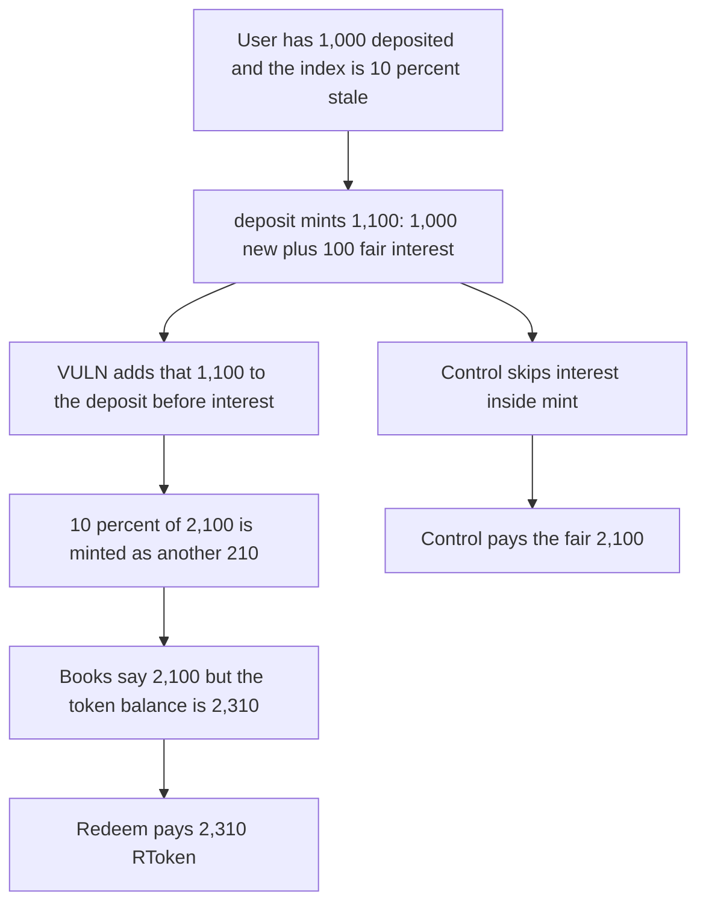

# DEToken charges interest on the tokens a deposit just minted and pays out 210 extra RToken

> **Vulnerability classes:** vuln/logic/reward-calculation · vuln/logic/state-update

<!-- non-defihacklabs -->
<!-- source-auditvault: https://github.com/Auditware/AuditVault/blob/main/findings/66498-c-01-update-inside-detoken-causes-incorrect-accounting-pash.md -->
<!-- date: 2025-06 -->

## Key info

| Field | Value |
|---|---|
| **Loss** | 210 RToken paid above the 2,100 fair claim. The books record a 2,100 deposit while the token balance is 2,310 |
| **Vulnerable contract** | `DEToken._update` |
| **Attacker EOA** | `0x1bfba3e96247449f9385c120d5fef8217550f992` (the depositor) |
| **Attack contract** | `Exploit` |
| **Attack tx** | `Exploit.run()` |
| **Chain / block / date** | Ethereum model · block 0 · 2025-06 |
| **Compiler** | solc 0.8.27, cancun, via IR |
| **Bug class** | Mint updates the deposit before interest, so the new tokens earn a full period |

## TL;DR

`DEToken._update` runs on every mint. It adds `amount` to `_userDeposits` and only then computes interest from the pool index. A user who already has 1,000 deposited, with the index 10% stale, deposits another 1,000. The pool means to mint 1,100 (the new 1,000 plus 100 interest on the old balance). `_update` first raises the deposit to 2,100 and then mints 10% of that, which is 210. Redemption pays the raw token balance, 2,310 RToken. Skipping mint and burn inside `_update` pays 2,100.

## Background

Pashov Audit Group's 26 June 2025 review of Regnum Aurum, C-01. `_update` is the ERC-20 hook for mint, burn, and transfer. The stability pool deposit calls `deToken.mint` and then `setUserDeposit` with the amount it calculated itself. The report is marked resolved. The recommended change is to skip the mint and burn cases inside `_update`.

## The vulnerable code

```solidity
if (to != address(0) && to != from) {
    // @> VULN: the minted amount is added to the deposit before interest, so the new tokens earn a full period
    _userDeposits[to] += amount;
    ...
    uint256 rawInterestAmountToMint = rawAmountWithInterest - currentBalance;
    if (rawInterestAmountToMint > 0) {
        _userIndexes[to] = currentIndex;
        _scaledTotalSupply += rawInterestAmountToMint;
        interestMinted += rawInterestAmountToMint;
        _mint(to, rawInterestAmountToMint);
    }
}
```

The index is stored at 1e27 and the pool index is 1.1e27. `rayMul` is `a * b / 1e27`. On a 2,100 balance that is 210.

## Root cause

Interest is a function of the balance at the start of the period. Adding the minted amount first makes the new deposit, and the interest that was already included in the mint, earn the same period again. `setUserDeposit` then writes the pool's intended 2,100 over `_userDeposits`, but the ERC-20 balance stays at 2,310 because the extra mint already happened.

## Preconditions

- The user has a 1,000 deposit and a deToken index of 1e27.
- The rToken index and the pool index are both 1.1e27.
- The user deposits another 1,000. The pool's own interest math on the old balance is 100, so it mints 1,100 and intends the new deposit to be 2,100.

## Attack walkthrough

1. Seed the 1,000 deposit and approve the pool.
2. `deposit(1000)` pulls 1,000 RToken and calls `mint` with 1,100.
3. `_update` adds 1,100 to the deposit, then mints 210 more interest.
4. `setUserDeposit` stores 2,100. The token balance is 2,310.
5. `redeem` pays 2,310 RToken. The fair payment is 2,100. The difference is 210.
6. The control does not run the interest path on mint. The user is paid 2,100 and the pool keeps the 210.

## Diagrams



## Impact

The depositor receives 2,310 RToken against a 2,100 claim. The extra 210 is interest charged on tokens that were minted in the same call. The pool's RToken balance is short that 210 relative to the control. Repeating the deposit while an index delta is open mints the same extra interest on every new amount.

## Remediation

Do not update `_userDeposits` or mint interest from `_update` when `from` or `to` is the zero address. Leave deposit accounting to `setUserDeposit`, which already receives the interest the pool calculated.

## How to reproduce

```bash
cd 66498-c-01-update-inside-detoken-causes-incorrect-accounting-pash_exp
forge test -vv
```

`test_exploit_deposit_mints_210_extra_interest` asserts a 2,310 redemption, a 2,100 booked deposit, and a pool shortfall of 210. `test_control_skip_mint_in_update_pays_2100` asserts the fair 2,100 payment. Captured output is `output.txt`.

## Sources

- AuditVault finding: https://github.com/Auditware/AuditVault/blob/main/findings/66498-c-01-update-inside-detoken-causes-incorrect-accounting-pash.md
- Pashov review: https://github.com/pashov/audits/blob/master/team/md/RegnumAurum-security-review_2025-06-26.md
