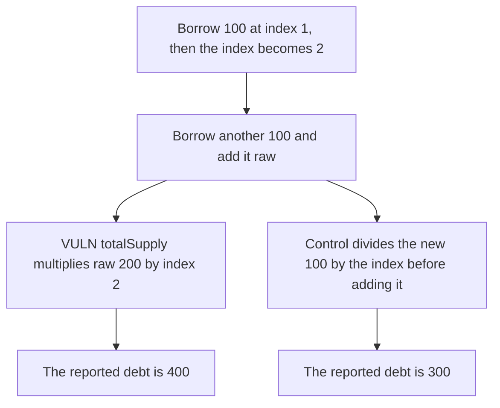

# Regnum DebtToken applies the borrow index twice and reports 400 instead of 300

> **Vulnerability classes:** vuln/arithmetic/index-scaling · vuln/defi/debt-accounting

<!-- non-defihacklabs -->
<!-- source-auditvault: https://github.com/Auditware/AuditVault/blob/main/findings/66500-c-03-incorrect-debttoken-scaling-inflates-totals-miscalculat.md -->
<!-- date: 2025-06 -->

## Key info

| Field | Value |
|---|---|
| **Loss** | `totalSupply` reports 400 of debt. Scaled principal at the same index is 300. The extra debt is 100 |
| **Vulnerable contract** | `DebtToken.totalSupply` |
| **Attacker EOA** | `0x1111111111111111111111111111111111111111` |
| **Attack contract** | `Exploit` at `0x15452ec016c4dc8c549e7fe6ff4b26324ea8b7a4` |
| **Attack tx** | `Exploit.run()` |
| **Chain / block / date** | Ethereum model · block 0 · 2025-06 |
| **Compiler** | solc 0.8.27, cancun, via IR |
| **Bug class** | A new borrow is added to the raw total and the raw total is then multiplied by the index |



## TL;DR

The published example borrows 100 while `usageIndex` is 1, so the raw total is 100 and `totalSupply` reads 100. The index grows to 2 and that raw total reads 200, which is the grown debt. A second borrow of 100 is added straight onto the raw total. `totalSupply` multiplies the raw total by the index again: `200 * 2 = 400`.

Scaled accounting divides the new borrow by the current index first. The second 100 is 50 of principal. Scaled total 150 times index 2 is 300. The quoted path overstates the debt by 100.

## The vulnerable code

```solidity
function borrow(uint256 amount) external {
    raw += amount;
}

function totalSupply() public returns (uint256 supply) {
    supply = raw * idx / 1 ether; // @> VULN: the new 100 is multiplied by the index that already scaled the old debt
}
```

## Impact

Utilization and the rates that read total debt see 400 where the scaled debt is 300. The second borrow of 100 is counted as 200 the moment it is opened.

## How to reproduce

```bash
cd 66500-c-03-incorrect-debttoken-scaling-inflates-totals-miscalculat_exp
forge test -vv
```

`test_exploit_second_borrow_is_doubled` asserts `totalSupply` is 400. `test_control_scales_the_second_borrow` asserts 300.

## Sources

- AuditVault finding: https://github.com/Auditware/AuditVault/blob/main/findings/66500-c-03-incorrect-debttoken-scaling-inflates-totals-miscalculat.md
- Pashov report: Regnum Aurum security review, 2025-06-26
