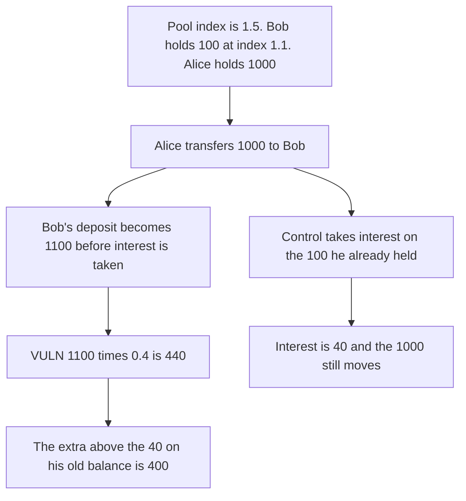

# Regnum DEToken pays interest on tokens that were just transferred

> **Vulnerability classes:** vuln/arithmetic/interest-on-transfer · vuln/defi/interest-mint

<!-- non-defihacklabs -->
<!-- source-auditvault: https://github.com/Auditware/AuditVault/blob/main/findings/66501-c-04-incorrect-detoken-interest-causes-pool-drainage-and-los.md -->
<!-- date: 2025-06 -->

## Key info

| Field | Value |
|---|---|
| **Loss** | Bob is credited 440 of interest. Interest on the 100 he already held is 40. The extra mint is 400 |
| **Vulnerable contract** | `DEToken.transfer` |
| **Attacker EOA** | `0x1111111111111111111111111111111111111111` |
| **Attack contract** | `Exploit` at `0x15452ec016c4dc8c549e7fe6ff4b26324ea8b7a4` |
| **Attack tx** | `Exploit.run()` |
| **Chain / block / date** | Ethereum model · block 0 · 2025-06 |
| **Compiler** | solc 0.8.27, cancun, via IR |
| **Bug class** | Interest uses the recipient balance after the incoming transfer and the recipient's old index |



## TL;DR

The pool index is 1.5. Bob holds 100 deposited at index 1.1. Alice holds 1000 at the current index and transfers all of it to Bob. The quoted update adds the 1000 onto Bob's deposit first, then computes interest with Bob's old index:

`1100 * (1.5 - 1.1) = 440`.

Interest on the balance he already held is `100 * 0.4 = 40`. The fixed transfer uses that prior balance, returns 40, and still delivers the 1000. The extra interest is 400.

## The vulnerable code

```solidity
deposits[to] += amount;
uint256 idx = indexes[to];
interest = deposits[to] * (poolIndex - idx) / 1 ether; // @> VULN: the tokens that just arrived earn Bob's old index gap
```

The sender side is the quoted debit, which does not mint the sender's accrued interest before the balance changes:

```solidity
if (from != address(0) && from != to) {
    deposits[from] -= amount;
}
```

## Impact

The recipient is minted interest on tokens they did not hold across the index gap. In the published numbers that is 440 instead of 40, so 400 of interest is created by the transfer.

## How to reproduce

```bash
cd 66501-c-04-incorrect-detoken-interest-causes-pool-drainage-and-los_exp
forge test -vv
```

`test_exploit_interest_uses_the_post_transfer_balance` asserts 440. `test_control_interest_uses_the_prior_balance` asserts 40 and a Bob deposit of 1100.

## Sources

- AuditVault finding: https://github.com/Auditware/AuditVault/blob/main/findings/66501-c-04-incorrect-detoken-interest-causes-pool-drainage-and-los.md
- Pashov report: Regnum Aurum security review, 2025-06-26
