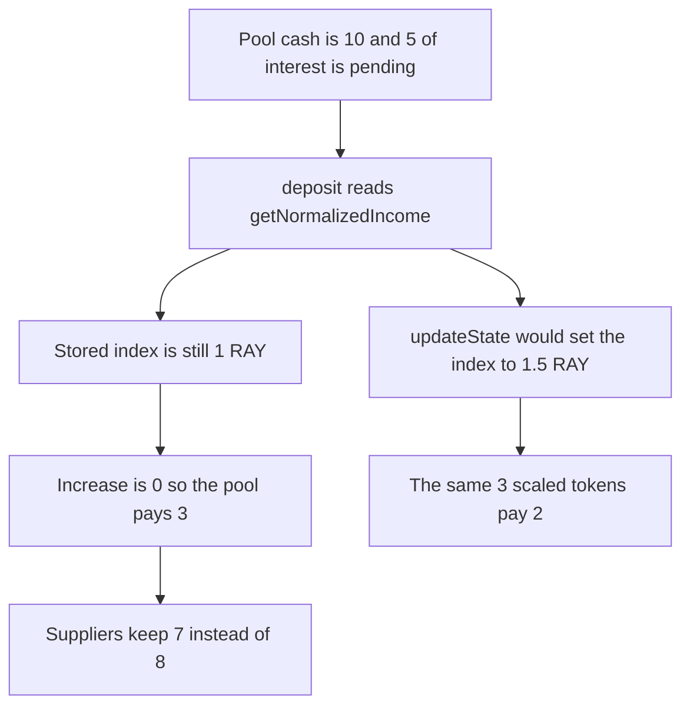

# Regnum Aurum: StabilityPool.deposit prices an rToken withdrawal with a stale lending index

> **Vulnerability classes:** `vuln/logic/state-update` · `vuln/logic/reward-calculation`

<!-- non-defihacklabs -->
<!-- source-auditvault: https://github.com/Auditware/AuditVault/blob/main/findings/66502-h-01-stabilitypool-functions-skip-the-latest-lendingpool-ind.md -->
<!-- date: 2025-06 -->

**AuditVault taxonomy:** `severity/high` · `platform/pashov` · `sector/lending` · protocol Regnum Aurum, review 2025-06-26

## Key info

| Field | Value |
|---|---|
| **Loss** | 1 crvUSD overpaid. A 3-scaled deposit pays 3 instead of 2, and supplier cash falls from 10 to 7 instead of 8 |
| **Vulnerable contract** | `StabilityPool.deposit` |
| **Attacker EOA** | `0x1111111111111111111111111111111111111111` |
| **Attack contract** | `Exploit` |
| **Attack tx** | `Exploit.run()` |
| **Chain / block / date** | Ethereum model · block 0 · 2025-06 |
| **Compiler** | solc 0.8.27, cancun, via IR |
| **Bug class** | `getNormalizedIncome` is used without `updateState` |

## TL;DR

`deposit` reads `getNormalizedIncome()` and never calls `lendingPool.updateState()`. The stored index is still 1 RAY while 5 of interest is pending on 10 of cash, so the fresh index is 1.5 RAY. The depositor's user index is also 1 RAY, the increase is 0, and the pool pays the full 3 scaled tokens as 3 crvUSD. The fresh formula pays 2. Suppliers are short 1, and the pending interest is still unapplied.

## Background

Pashov Audit Group's 26 June 2025 Regnum Aurum review, H-01. `deposit` and `withdraw` both take `poolIndex` from `ILendingPool.getNormalizedIncome()` and use it for the rest of the call. The lending pool only refreshes `liquidityIndex` inside `updateState`. The review rates the impact medium and the likelihood high. The quoted fix is to call `updateState` at the start of both functions.

## The vulnerable code

```solidity
uint256 poolIndex = ILendingPool(lendingPool).getNormalizedIncome();
// @> VULN: poolIndex is read without lendingPool.updateState(), so accrued interest is not in the price
```

The same function then does `userIndexIncrease = poolIndex - userIndex` and, when that difference is 0, sets `rawAmount = scaledAmount`. Otherwise it ray-divides by `RAY + userIndexIncrease`.

Calling `updateState` first pulls the 5 of pending interest into cash and sets the index to 1.5 RAY. The same 3-scaled deposit then pays 2:

```diff
 function deposit(uint256 scaledAmount) external {
+    lendingPool.updateState();
     uint256 poolIndex = ILendingPool(lendingPool).getNormalizedIncome();
```

## Root cause

`getNormalizedIncome` is a view of the stored index. Interest that has accrued since the last update is invisible until `updateState` writes the new index. `deposit` treats that view as the current price.

## Preconditions

- The lending pool holds 10 crvUSD of cash and 5 of pending interest. The stored index is 1 RAY. `updateState` would move it to 1.5 RAY.
- The caller already holds 3 scaled rTokens recorded at user index 1 RAY, so the balance check passes and the index increase is 0 only while the pool index is stale.

## Attack walkthrough

1. `fairRaw` computes the price after `updateState`: 3 scaled ray-divided by 1.5 RAY is 2 crvUSD.
2. `deposit(3 ether)` reads the stored index. The increase is 0, so `rawAmount` is 3.
3. The pool transfers 3 crvUSD. Cash is 7. Pending interest is still 5.
4. The control calls `updateState` first. The same deposit pays 2 and leaves cash at 13 after the 5 of interest has been merged.

## Diagrams



## Impact

The depositor receives 3 crvUSD. The fair raw amount at the updated index is 2 crvUSD. The other suppliers' cash is 7 rather than 8, and the 5 of pending interest has still not been applied to the index. The same missing `updateState` is present on `withdraw` in the review.

## Remediation

Call `lendingPool.updateState()` before `getNormalizedIncome()` in `deposit` and `withdraw`.

## How to reproduce

```bash
cd 66502-h-01-stabilitypool-functions-skip-the-latest-lendingpool-ind_exp
forge test -vv
```

`test_stale_index_overpays_depositor` asserts a payment of 3 against a fair value of 2. `test_control_updateState_pays_two` asserts the refreshed index pays 2. Captured output is `output.txt`.

## Sources

- AuditVault finding: https://github.com/Auditware/AuditVault/blob/main/findings/66502-h-01-stabilitypool-functions-skip-the-latest-lendingpool-ind.md
- Pashov report: https://github.com/pashov/audits/blob/master/team/md/RegnumAurum-security-review_2025-06-26.md
- Blamed function: `StabilityPool.deposit`, the `getNormalizedIncome()` read quoted in that report
