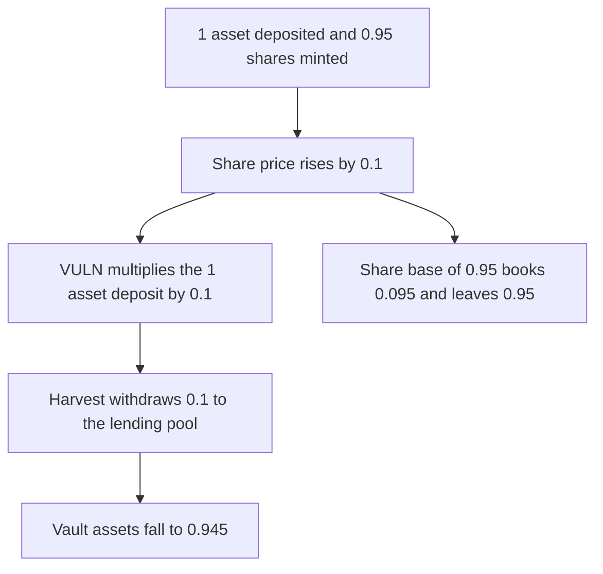

# Regnum Aurum: harvest books 0.1 yield on a 0.095 share position and takes 0.005 of principal

> **Vulnerability classes:** `vuln/logic/reward-calculation` · `vuln/logic/state-update`

<!-- non-defihacklabs -->
<!-- source-auditvault: https://github.com/Auditware/AuditVault/blob/main/findings/66503-h-02-harvestyield-incorrectly-uses-total-deposits-when-calc.md -->
<!-- date: 2025-06 -->

## Key info

| Field | Value |
|---|---|
| **Loss** | The lending pool receives 0.1 asset. Fair yield is 0.095. Vault principal falls from 0.95 to 0.945 |
| **Vulnerable contract** | `VaultYield.harvest` |
| **Attacker EOA** | `0x1111111111111111111111111111111111111111` |
| **Attack contract** | `Exploit` |
| **Attack tx** | `Exploit.run()` |
| **Chain / block / date** | Ethereum model · block 0 · 2025-06 |
| **Compiler** | solc 0.8.27, cancun, via IR |
| **Bug class** | Yield is priced on assets deposited instead of shares minted |

## TL;DR

`_harvestYield` multiplies `totalDeposits` by the share-price increase. `totalDeposits` stores the 1e18 assets deposited, not the 0.95e18 shares received. A 0.1e18 price increase books 0.1e18 of yield. The shares earned 0.095e18. The extra 0.005e18 is depositor principal withdrawn to the lending pool.

## The vulnerable code

```solidity
uint256 priceDifference = currentSharePrice - lastSharePrice;
// @> VULN: totalDeposits is assets deposited, not the shares that earn the price
uint256 totalYield = (totalDeposits * priceDifference) / 1e18;
```

The finding's numbers: `1e18 * 0.1e18 / 1e18 = 0.1e18`, against `0.95e18 * 0.1e18 / 1e18 = 0.095e18`.

## Root cause

The deposit path records assets in `totalDeposits` and mints fewer shares. Harvest then treats that asset figure as if it were the share balance.

## Preconditions

- 1 asset deposited, 0.95 shares minted, `lastSharePrice` recorded as 1.
- Vault assets later stand at 1.045, so the share price is 1.1.

## Attack walkthrough

1. Read the share price. It is 1.1, so the difference from the recorded price is 0.1.
2. Harvest books `1 * 0.1 = 0.1` and transfers 0.1 to the lending pool.
3. Vault assets fall to 0.945. Principal at the old price was 0.95.
4. The control stores 0.95 in `totalDeposits`, books 0.095, and leaves 0.95 in the vault.

## Diagrams



## Impact

Depositors' principal is 0.005 asset smaller, and `unclaimedRewards` is overstated by that amount. The lending pool's reserve is the account that received the extra withdrawal.

## Remediation

Store the minted shares in `totalDeposits`, which is what the finding recommends. Yield is then `shares * priceDifference / 1e18`.

## How to reproduce

```bash
cd 66503-h-02-harvestyield-incorrectly-uses-total-deposits-when-calc_exp
forge test -vv
```

## Sources

- AuditVault finding: https://github.com/Auditware/AuditVault/blob/main/findings/66503-h-02-harvestyield-incorrectly-uses-total-deposits-when-calc.md
- Pashov review: https://github.com/pashov/audits/blob/master/team/md/RegnumAurum-security-review_2025-06-26.md
- Reduced source: `test/66503-h-02-harvestyield-incorrectly-uses-total-deposits-when-calc.sol`
