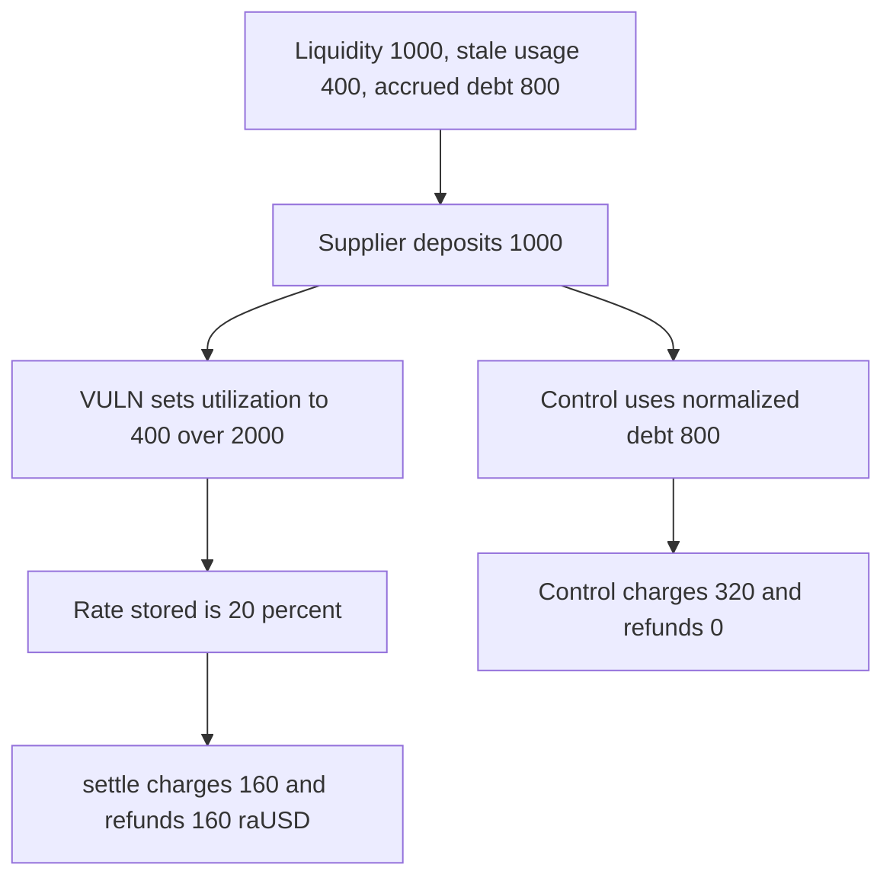

# Regnum: a deposit prices utilization on stale debt and refunds 160 raUSD

> **Vulnerability classes:** vuln/logic/fee-calculation · vuln/logic/state-update

<!-- non-defihacklabs -->
<!-- source-auditvault: https://github.com/Auditware/AuditVault/blob/main/findings/66504-h-03-incorrect-utilization-rate-in-deposit-and-withdraw-oper.md -->
<!-- date: 2025-06 -->

## Key info

| Field | Value |
|---|---|
| **Loss** | Borrower is refunded 160 raUSD of interest that should have been charged |
| **Vulnerable contract** | `LendingPool.updateInterestRatesAndLiquidity` |
| **Attacker EOA** | `0x0000000000000000000000000000000000066504` |
| **Attack contract** | `Exploit` |
| **Attack tx** | `Exploit.run()` |
| **Chain / block / date** | Ethereum model · block 0 · 2025-06 |
| **Compiler** | solc 0.8.27, cancun, via IR |
| **Bug class** | Utilization reads `totalUsage` from the last debt action |

## TL;DR

`updateInterestRatesAndLiquidity` adds the new deposit to `totalLiquidity` and then computes utilization from `reserve.totalUsage`. That field is only written on borrow, repay, and liquidation. Accrued debt lives in `normalizedDebt`. After a 1000 raUSD deposit the pool has 2000 liquidity, stale usage 400, and real debt 800. The rate is 20 percent instead of 40 percent. `settle` charges 160 raUSD and refunds the other 160 from a 320 raUSD escrow. The control, which rates on normalized debt, refunds nothing.

## Background

Pashov Audit Group's Regnum Aurum review dated 2025-06-26, finding H-03. The report shows `totalUsage` assigned only inside `_borrow`, `_repay`, and `finalizeLiquidation`. Deposit and withdraw call `updateInterestRatesAndLiquidity` without refreshing usage first, so the borrow rate and the protocol fee are computed on a stale, lower utilization.

## The vulnerable code

```solidity
if (liquidityAdded > 0) {
    reserve.totalLiquidity += liquidityAdded;
}
uint256 totalDebt = reserve.totalUsage;
// @> VULN: utilization is calculated from stale totalUsage, not the interest-accrued debt
uint256 utilizationRate = calculateUtilizationRate(reserve.totalLiquidity, totalDebt);
currentUsageRate = utilizationRate;
```

`calculateUtilizationRate` is `usage * 1e18 / liquidity`. Here that is `400 ether * 1e18 / 2000 ether = 0.2 ether`.

## Root cause

Interest accrual updates the normalized debt and does not write `totalUsage`. The next deposit still divides the old usage by the new, larger liquidity. The charged interest is `normalizedDebt * currentUsageRate / 1e18`, so the stale rate is applied to the real debt and the borrower pays too little.

## Preconditions

- `totalLiquidity` is 1000 ether, `totalUsage` is 400 ether, and `normalizedDebt` is 800 ether.
- The borrower prepaid 320 ether, which is one period of interest at the true 40 percent rate.
- A supplier deposits 1000 ether. That deposit is a normal user action, not an admin call.

## Attack walkthrough

1. The supplier deposits 1000 raUSD. Liquidity becomes 2000. `totalUsage` stays 400.
2. Utilization is stored as 0.2 ether.
3. `settle` charges `800 ether * 0.2 = 160 ether`.
4. The escrow was 320 ether. The difference, 160 ether, is transferred to the borrower.
5. The control rates on the 800 ether of normalized debt, stores 0.4 ether, charges 320 ether, and refunds 0.

## Diagrams



## Impact

The borrower receives 160 ether of raUSD that was reserved as interest for lenders. The true charge on 800 ether of debt at 40 percent is 320 ether. The protocol and the suppliers are short that 160 ether for the period. The control leaves the borrower's balance at 0.

## Remediation

Set `reserve.totalUsage` from the normalized debt before `calculateUtilizationRate`. Deposit, withdraw, borrow, repay, and liquidation should all read the same accrued usage.

## How to reproduce

```bash
cd 66504-h-03-incorrect-utilization-rate-in-deposit-and-withdraw-oper_exp
forge test -vv
```

`test_exploit_stale_usage_refunds_160_ether` asserts a 0.2 rate, 160 interest, and a 160 refund. `test_control_accrued_debt_charges_the_full_320` asserts a 0.4 rate and a 0 refund. Captured output is `output.txt`.

## Sources

- AuditVault finding: https://github.com/Auditware/AuditVault/blob/main/findings/66504-h-03-incorrect-utilization-rate-in-deposit-and-withdraw-oper.md
- Report: https://github.com/pashov/audits/blob/master/team/md/RegnumAurum-security-review_2025-06-26.md
