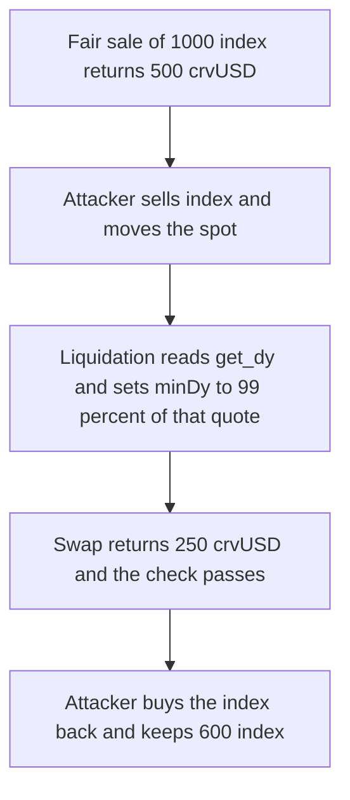

# Regnum Aurum: LiquidationSwap's slippage floor is the already-sandwiched spot

> **Vulnerability classes:** `vuln/defi/sandwich-attack`

<!-- non-defihacklabs -->
<!-- source-auditvault: https://github.com/Auditware/AuditVault/blob/main/findings/66505-h-04-liquidationswap-at-risk-of-sandwich-attacks-due-to-spot.md -->
<!-- date: 2025-06 -->

## Key info

| Field | Value |
|---|---|
| **Loss** | Stability pool receives 250 crvUSD instead of 500. Attacker nets 600 index tokens |
| **Vulnerable contract** | `LiquidationSwap._swap` |
| **Attacker EOA** | `0x1111111111111111111111111111111111111111` |
| **Attack contract** | `Exploit` |
| **Attack tx** | `Exploit.run()` |
| **Chain / block / date** | Local synthetic · 2025-06 |
| **Compiler** | solc 0.8.27, cancun, via IR |
| **Bug class** | min-out is a haircut of get_dy inside the same transaction |

## TL;DR

`_swap` reads `liquidityPool.get_dy` and sets `minDy` to that quote times `(10000 - slippageProtectionBps) / 10000`. The quote is the spot at execution time. A searcher sells index tokens first, so the spot the liquidation sees is already the bad price. With a 1% bps setting the check still passes. A 1000 index sale that was worth 500 crvUSD returns 250. The searcher buys the index back and finishes 600 index tokens ahead. The same sale with a floor taken from the pre-trade 500 reverts and the index stays unsold.

## The vulnerable code

```solidity
uint256 expectedDy = liquidityPool.get_dy(1, 0, amount);
if (expectedDy == 0) revert InvalidExchange();
uint256 minDy = enableSlippageProtection ? (expectedDy * (10000 - slippageProtectionBps)) / 10000 : 0; // @> VULN
liquidityPool.exchange(1, 0, amount, minDy);
```

## Root cause

Slippage protection compares the swap to itself. `get_dy` and `exchange` see the same manipulated reserves, so a haircut of the spot cannot detect a sandwich that already landed.

## Preconditions

- Slippage protection is on. Here `slippageProtectionBps` is 100.
- The pool is a constant-product index/crvUSD pool the liquidation sells into. Reserves start at 2000 index and 1500 crvUSD.
- The liquidation sells a large clip. This run sells 1000 index, the whole seized balance.

## Attack walkthrough

1. Fair `get_dy(1, 0, 1000)` on the opening reserves is 500 crvUSD.
2. The attacker sells 1000 index and receives 500 crvUSD. Reserves become 3000 index and 1000 crvUSD.
3. `liquidate` calls `_swap`. `get_dy` is now 250. `minDy` is 247.5. The swap returns 250 and passes the check.
4. The attacker sells the 500 crvUSD back and receives 1600 index. They started the call with 1000 index, so the profit is 600 index tokens.
5. The stability pool is short 250 crvUSD versus the fair quote.

## Diagrams



## Impact

The stability pool is the loser on the liquidation swap. In this constant-product example it receives half of the pre-trade output, and the searcher extracts 600 index tokens. The report's concern is the same shape on a large RAAC-NFT liquidation, where `swapPercentage` is typically most of the seized index balance.

## How to reproduce

```bash
cd 66505-h-04-liquidationswap-at-risk-of-sandwich-attacks-due-to-spot_exp
forge test -vv
```

## Sources

- AuditVault finding: https://github.com/Auditware/AuditVault/blob/main/findings/66505-h-04-liquidationswap-at-risk-of-sandwich-attacks-due-to-spot.md
- Report: https://github.com/pashov/audits/blob/master/team/md/RegnumAurum-security-review_2025-06-26.md
- Blamed lines: `LiquidationSwap._swap` `get_dy` haircut and `exchange(..., minDy)`, as quoted in that review
