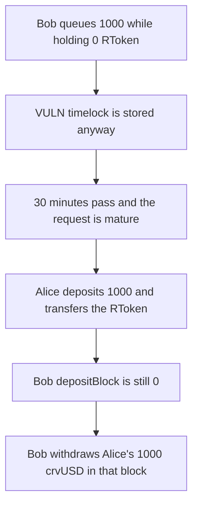

# Regnum Aurum: a withdrawal can be queued before the tokens exist

> **Vulnerability classes:** `vuln/governance/timelock-bypass` · `vuln/logic/missing-validation`

<!-- non-defihacklabs -->
<!-- source-auditvault: https://github.com/Auditware/AuditVault/blob/main/findings/66506-h-05-bypassing-withdrawal-timelock-via-pre-requests-and-tran.md -->
<!-- date: 2025-06 -->

## Key info

| Field | Value |
|---|---|
| **Loss** | Bob withdraws Alice's 1000 crvUSD in the same block she deposited it |
| **Vulnerable contract** | `LendingPool.requestWithdraw` |
| **Attacker EOA** | `0x1111111111111111111111111111111111111111` |
| **Attack contract** | `Exploit` |
| **Attack tx** | `queue` at t=1000, then `complete` at t=2801 |
| **Chain / block / date** | Ethereum model · block 0 · 2025-06 |
| **Compiler** | solc 0.8.27, cancun, via IR |
| **Bug class** | Timelock queued with no balance check |

## TL;DR

`requestWithdraw` stores `timelock.amount` without reading the caller's RToken balance. Bob queues 1000 while holding nothing. Thirty minutes later Alice deposits 1000 crvUSD, receives RToken, and transfers it to Bob. Bob's `depositBlock` is still 0, so the same-block flash-loan check does not see Alice's deposit. His timelock is already mature, and he withdraws her 1000 crvUSD immediately. A request made in that same block is not mature and the withdraw reverts.

## Background

Pashov Audit Group's Regnum Aurum review of 26 June 2025, finding H-05. The withdrawal timelock and the same-block deposit check are both keyed to the address that calls withdraw, not to the address that just received the RToken.

## The vulnerable code

```solidity
function requestWithdraw(uint256 amount) external {
    Timelock storage t = timelock[msg.sender];
    t.amount = amount; // @> VULN: no RToken balance check
    t.readyAt = uint64(block.timestamp + parameters.withdrawTimelockDuration);
    t.expireAt = uint64(block.timestamp + parameters.withdrawTimelockDuration + parameters.withdrawTimelockDelay);
}
```

`withdrawTimelockDuration` is 30 minutes and `withdrawTimelockDelay` is 7 days. `withdraw` reverts when `depositBlock[msg.sender] == block.timestamp`.

The fix is `require(rToken.balanceOf(msg.sender) >= amount)` inside `requestWithdraw`.

## Root cause

The right to withdraw later is granted before the tokens exist. A transfer after the wait gives the queued address a balance the same-block check never recorded.

## Preconditions

- Bob's RToken balance is 0 when he calls `requestWithdraw(1000)`.
- 30 minutes pass. `readyAt` is now behind `block.timestamp`, and `expireAt` is still ahead.
- Alice deposits in the later block and transfers the RToken to Bob before he withdraws.

## Attack walkthrough

1. At timestamp 1000, Bob queues 1000. `readyAt` becomes 2800.
2. At timestamp 2801, Alice deposits 1000 crvUSD. Her `depositBlock` is 2801. Bob's stays 0.
3. Alice transfers 1000 RToken to Bob.
4. Bob withdraws. The same-block check compares his `depositBlock` of 0 with 2801 and passes. The timelock is mature.
5. He receives 1000 crvUSD. The control queues and withdraws at the same timestamp and reverts `timelock`.

## Diagrams



## Impact

Alice's 1000 crvUSD, which should have been locked behind a fresh 30 minute timelock and a same-block deposit ban, is withdrawn by Bob in the deposit block. His `depositBlock` is still 0. A request that has not aged reverts, so the pre-queue is what makes the withdrawal possible.

## How to reproduce

```bash
cd 66506-h-05-bypassing-withdrawal-timelock-via-pre-requests-and-tran_exp
forge test -vv
```

`test_exploit_prequeue_bypasses_timelock` warps from 1000 to 2801 and asserts Bob received 1000 crvUSD. `test_control_fresh_request_is_not_ready` asserts an immediate withdraw reverts. Output is `output.txt`.

## Sources

- AuditVault finding: https://github.com/Auditware/AuditVault/blob/main/findings/66506-h-05-bypassing-withdrawal-timelock-via-pre-requests-and-tran.md
- Report: https://github.com/pashov/audits/blob/master/team/md/RegnumAurum-security-review_2025-06-26.md
