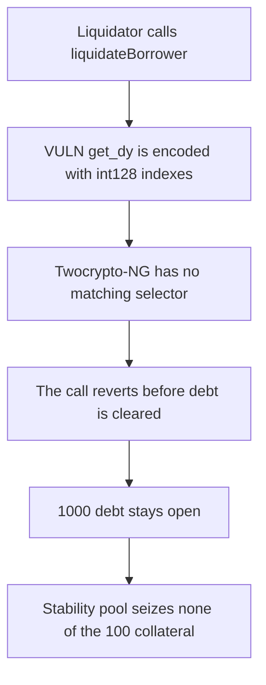

# Regnum Aurum: liquidations call Curve with the wrong function signature

> **Vulnerability classes:** `vuln/input-validation/wrong-type` · `vuln/logic/liquidation-logic`

<!-- non-defihacklabs -->
<!-- source-auditvault: https://github.com/Auditware/AuditVault/blob/main/findings/66507-h-06-liquidation-failure-due-to-incorrect-interface-signatur.md -->
<!-- date: 2025-06 -->

## Key info

| Field | Value |
|---|---|
| **Loss** | Liquidation reverts. 1000 of debt stays open and 100 of collateral is not seized |
| **Vulnerable contract** | `LiquidationSwap._swap` |
| **Attacker EOA** | `0x1111111111111111111111111111111111111111` |
| **Attack contract** | `Exploit` |
| **Attack tx** | `Exploit.run()` |
| **Chain / block / date** | Ethereum model · block 0 · 2025-06 |
| **Compiler** | solc 0.8.27, cancun, via IR |
| **Bug class** | int128 Curve selector against a uint256 Twocrypto-NG pool |

## TL;DR

`LiquidationSwap` calls `get_dy(int128,int128,uint256)` and `exchange(int128,int128,uint256,uint256)`. Curve Twocrypto-NG implements `get_dy(uint256,uint256,uint256)` and `exchange(uint256,uint256,uint256,uint256,address)`. The selectors do not match, so `liquidateBorrower` reverts before it can clear debt or move collateral. A borrower with 1000 of debt and 100 of collateral cannot be liquidated. The stability pool's seized total stays 0. The same pool, called with the uint256 interface, clears the debt and seizes the 100 collateral.

## Background

Pashov Audit Group's Regnum Aurum review of 26 June 2025, finding H-06. The in-contract `ILiquidityPool` interface is the older Curve shape. The deployment target is Twocrypto-NG, whose Vyper signatures use `uint256` indexes and add a `receiver` argument to `exchange`.

## The vulnerable code

```solidity
function _swap(address sender, uint256 amount) internal {
    uint256 expectedDy = liquidityPool.get_dy(1, 0, amount); // @> VULN: int128 selector
    if (expectedDy == 0) revert InvalidExchange();
    uint256 minDy = enableSlippageProtection ? (expectedDy * (10000 - slippageProtectionBps)) / 10000 : 0;
    liquidityPool.exchange(1, 0, amount, minDy);
}
```

The pool in this reduction only exposes the Twocrypto-NG signatures. `get_dy` reverts, so `exchange` is never reached. The debt write sits after `_swap` and does not run.

The fix is to call `get_dy(uint256,uint256,uint256)` and `exchange(uint256,uint256,uint256,uint256,address)`.

## Root cause

The call is encoded for a different function than the one deployed at the pool. Every liquidation depends on that call, so every liquidation reverts.

## Preconditions

- `liquidityPool` is a Twocrypto-NG pool, not an int128 stableswap.
- A borrower owes 1000. The liquidation contract holds 100 of their collateral.
- `enableSlippageProtection` is true. The value does not matter, because `get_dy` reverts first.

## Attack walkthrough

1. The liquidator calls `liquidateBorrower` for the 1000 debt.
2. `_swap` calls `get_dy` with the int128 selector.
3. The pool has no such function. The call reverts.
4. Debt is still 1000. `stability.seized` is 0. The 100 collateral is still on the liquidation contract.
5. The control uses the uint256 interface. Debt goes to 0 and the stability pool is credited 100.

## Diagrams



## Impact

The position cannot be liquidated. The protocol still records 1000 of debt, and the 100 of collateral that should have gone to the stability pool stays where it is. Repeating the call reverts the same way, so underwater debt accumulates for as long as the pool is Twocrypto-NG. The corrected interface liquidates this position in one call.

## How to reproduce

```bash
cd 66507-h-06-liquidation-failure-due-to-incorrect-interface-signatur_exp
forge test -vv
```

`test_exploit_liquidation_reverts_and_debt_remains` asserts the revert, the 1000 debt, and a seized total of 0. `test_control_uint256_interface_liquidates` asserts the debt is cleared and 100 collateral is seized. Output is `output.txt`.

## Sources

- AuditVault finding: https://github.com/Auditware/AuditVault/blob/main/findings/66507-h-06-liquidation-failure-due-to-incorrect-interface-signatur.md
- Report: https://github.com/pashov/audits/blob/master/team/md/RegnumAurum-security-review_2025-06-26.md
- Twocrypto-NG exchange: https://github.com/curvefi/twocrypto-ng/blob/main/contracts/main/Twocrypto.vy
