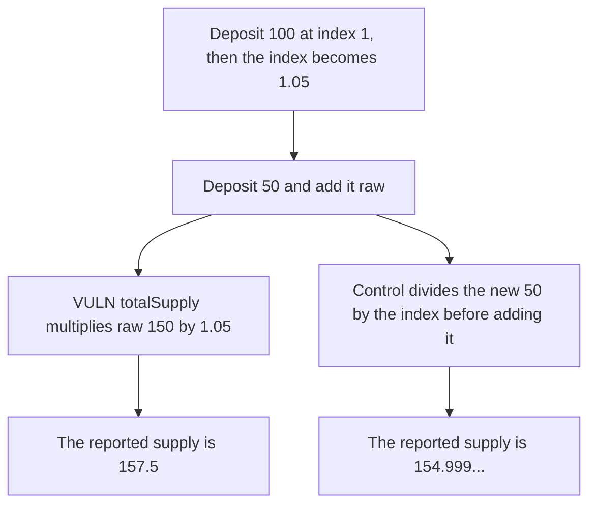

# Regnum RToken applies the liquidity index twice and reports 157.5

> **Vulnerability classes:** vuln/arithmetic/index-scaling · vuln/defi/supply-accounting

<!-- non-defihacklabs -->
<!-- source-auditvault: https://github.com/Auditware/AuditVault/blob/main/findings/66508-h-07-incorrect-rtoken-scaling-inflates-supply-and-breaks-res.md -->
<!-- date: 2025-06 -->

## Key info

| Field | Value |
|---|---|
| **Loss** | `totalSupply` reports 157.5. One application of the 1.05 index reports 154.999... The gap is 2.5 ether plus 1 wei. The report's unrounded total is 155 |
| **Vulnerable contract** | `RToken.totalSupply` |
| **Attacker EOA** | `0x1111111111111111111111111111111111111111` |
| **Attack contract** | `Exploit` at `0x15452ec016c4dc8c549e7fe6ff4b26324ea8b7a4` |
| **Attack tx** | `Exploit.run()` |
| **Chain / block / date** | Ethereum model · block 0 · 2025-06 |
| **Compiler** | solc 0.8.27, cancun, via IR |
| **Bug class** | A new deposit is added to the raw total and the raw total is then multiplied by the liquidity index |



## TL;DR

The published example deposits 100 while `liquidityIndex` is 1. The index grows to 1.05, so that deposit reads 105. A second deposit of 50 is added straight onto the raw total, which is now 150. `totalSupply` multiplies by the index again: `150 * 1.05 = 157.5`.

The report's unrounded honest total is `(100 * 1.05) + 50 = 155`. Integer scaling divides the new 50 by 1.05 before storing it and then multiplies once, which is `154.999...` wei short of 155 because `1.05 ether` does not divide `50 ether` evenly. The quoted path is `2.5 ether + 1 wei` above that scaled total.

## The vulnerable code

```solidity
function deposit(uint256 amount) external {
    raw += amount;
}

function totalSupply() public returns (uint256 supply) {
    supply = raw * idx / 1 ether; // @> VULN: the second deposit is multiplied by the index a second time
}
```

## Impact

Reserve and utilization math that reads this supply sees 157.5 where one pass of the index is 154.999... The second deposit of 50 is scaled a second time as soon as it is added.

## How to reproduce

```bash
cd 66508-h-07-incorrect-rtoken-scaling-inflates-supply-and-breaks-res_exp
forge test -vv
```

`test_exploit_second_deposit_is_scaled_twice` asserts 157.5 ether. `test_control_scales_the_deposit_once` asserts `154999999999999999999`.

## Sources

- AuditVault finding: https://github.com/Auditware/AuditVault/blob/main/findings/66508-h-07-incorrect-rtoken-scaling-inflates-supply-and-breaks-res.md
- Pashov report: Regnum Aurum security review, 2025-06-26
