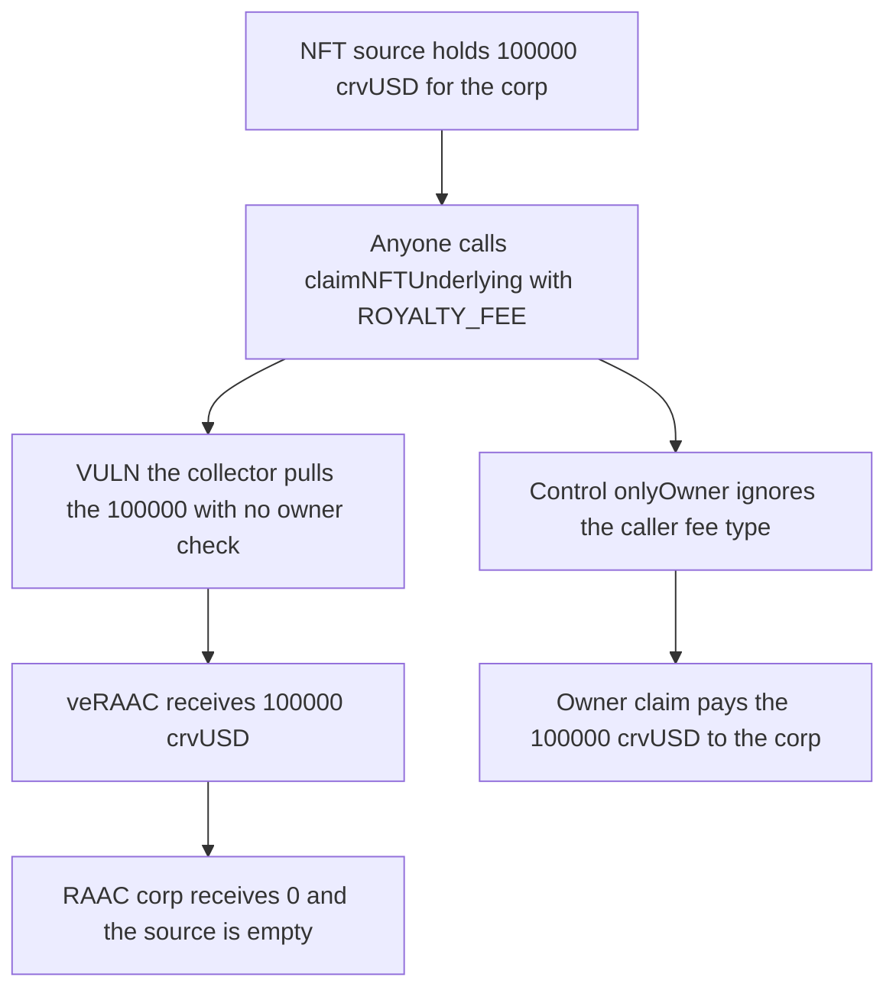

# Regnum Aurum: anyone can send NFT mint fees to veRAAC instead of the corp

> **Vulnerability classes:** `vuln/access-control/missing-auth` · `vuln/defi/fee-manipulation`

<!-- non-defihacklabs -->
<!-- source-auditvault: https://github.com/Auditware/AuditVault/blob/main/findings/66509-h-08-access-control-missing-on-fee-functions-enables-misuse.md -->
<!-- date: 2025-06 -->

## Key info

| Field | Value |
|---|---|
| **Loss** | 100,000 crvUSD of NFT mint fees paid to veRAAC. RAAC corp receives 0 |
| **Vulnerable contract** | `FeeCollector.claimNFTUnderlying` |
| **Attacker EOA** | `0x1111111111111111111111111111111111111111` |
| **Attack contract** | `Exploit` |
| **Attack tx** | `Exploit.run()` |
| **Chain / block / date** | Ethereum model · block 0 · 2025-06 |
| **Compiler** | solc 0.8.27, cancun, via IR |
| **Bug class** | Permissionless claim, caller-chosen `feeType` |

## TL;DR

`claimNFTUnderlying` and `claimCollectorRewards` have `nonReentrant` and `whenNotPaused` and no owner check. The caller passes `feeType`. `ROYALTY_FEE` forwards the pulled tokens to veRAAC. `CORP_REVENUE` would forward them to RAAC corp. A caller claims 100,000 crvUSD of NFT mint fees as `ROYALTY_FEE`. veRAAC receives 100,000. The corp receives 0. An owner-only collector ignores the caller's fee type and pays the corp.

## Background

Pashov Audit Group, Regnum Aurum review dated 2025-06-26, finding H-08. The report's example is 100,000 crvUSD of NFT mint fees meant for the RAAC corp revenue pool. Front-running the claim with `ROYALTY_FEE` accounts those fees to veRAAC holders instead.

## The vulnerable code

```solidity
function claimNFTUnderlying(address _token, address target, uint256 amount, bytes32 feeType)
    external
    nonReentrant
    whenNotPaused
    returns (bool)
{
    return _pullAndSplit(_token, target, amount, feeType);
}

// @> VULN: no onlyOwner. The caller-supplied feeType chooses who receives the fees.
if (feeType == ROYALTY_FEE) {
    require(CrvUsd(_token).transfer(veRaac, amount), "ve");
}
```

The owner-only collector drops the caller's fee type and always pays the corp:

```diff
- function claimNFTUnderlying(...) external nonReentrant whenNotPaused returns (bool)
+ function claimNFTUnderlying(...) external returns (bool) {
+     require(msg.sender == owner, "owner");
+     // pay corp, ignore feeType
```

## Root cause

The fee split is an argument. The function that applies it is external. Whitelisting the target does not constrain who may choose the split.

## Preconditions

- The NFT fee source is whitelisted and holds 100,000 crvUSD.
- The source has approved the collector for that amount.
- `ROYALTY_FEE` pays veRAAC. `CORP_REVENUE` pays the corp.

## Attack walkthrough

1. The source is funded with 100,000 crvUSD and approves the collector.
2. The attacker calls `claimNFTUnderlying` with `ROYALTY_FEE` and amount 100,000.
3. The collector pulls 100,000 crvUSD from the source.
4. The royalty branch transfers all of it to veRAAC.
5. The corp balance stays 0 and the source is empty.
6. The control is `onlyOwner`. A stranger's `ROYALTY_FEE` call reverts. The owner claim pays the corp 100,000 even if the passed fee type is `ROYALTY_FEE`.

## Diagrams



## Impact

veRAAC receives 100,000 crvUSD that the report assigns to the RAAC corp revenue pool. The corp balance is 0. The source cannot be claimed a second time. The owner-only control pays that 100,000 to the corp and rejects the same call from any other address.

## Remediation

Restrict `claimCollectorRewards` and `claimNFTUnderlying` to the fee operator. Do not let the caller select a fee type that changes the beneficiary of funds already collected for a different purpose.

## How to reproduce

```bash
cd 66509-h-08-access-control-missing-on-fee-functions-enables-misuse_exp
forge test -vv
```

`test_exploit_royalty_fee_takes_corp_crvusd` asserts veRAAC holds 100,000 crvUSD and the corp holds 0. `test_control_only_owner_pays_corp` asserts a stranger reverts and the owner pays the corp 100,000. Captured output is `output.txt`.

## Sources

- AuditVault finding: https://github.com/Auditware/AuditVault/blob/main/findings/66509-h-08-access-control-missing-on-fee-functions-enables-misuse.md
- Pashov report: https://github.com/pashov/audits/blob/master/team/md/RegnumAurum-security-review_2025-06-26.md
