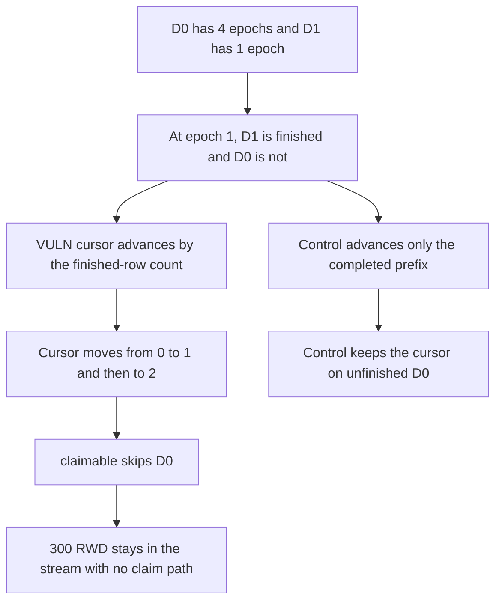

# Regnum Aurum: a finished short stream skips 300 RWD of an older one

> **Vulnerability classes:** `vuln/logic/reward-calculation` · `vuln/logic/state-update`

<!-- non-defihacklabs -->
<!-- source-auditvault: https://github.com/Auditware/AuditVault/blob/main/findings/66589-h-01-lastprocesseddistributionindex-can-skip-unfinished-olde.md -->
<!-- date: 2026-03 -->

## Key info

| Field | Value |
|---|---|
| **Loss** | 300 RWD from distribution 0, epochs 2 through 4, can no longer be claimed |
| **Vulnerable contract** | `RewardStream.updateReward` |
| **Attacker EOA** | `0x766a64ea674c5c599a63cc61408e239c8e1f455a` (the reward recipient) |
| **Attack contract** | `Exploit` |
| **Attack tx** | `Exploit.run()` |
| **Chain / block / date** | Ethereum model · block 0 · 2026-03 |
| **Compiler** | solc 0.8.27, cancun, via IR |
| **Bug class** | The cursor advances by a count of finished rows, not by a finished prefix |

## TL;DR

`updateReward` adds `processed` to `lastProcessedDistributionIndex`. `processed` counts every distribution in the window that is fully claimed, including ones that are not a contiguous prefix. At timestamp 1, a 4-epoch stream has vested 1 epoch and a later 1-epoch stream has vested all of it. The cursor moves from 0 to 1. A second update starts at 1, pays 0, and steps the cursor to 2. `claimable` is 0 while 300 RWD sits in the contract. The control advances only through the completed prefix, so the cursor stays on the unfinished stream.

## Background

Pashov Audit Group's 21 March 2026 Regnum Aurum review, finding H-01. Distributions have their own `epochs` and `startTimestamp`. A one-epoch stream can finish while an older four-epoch stream is still paying. Both `updateReward` and `claimable` start at `lastProcessedDistributionIndex`, so anything left behind that cursor is never read again.

## The vulnerable code

```solidity
function updateReward(address user) external virtual returns (uint256 paid) {
    uint256 startIndex = lastProcessedDistributionIndex[user];
    uint256 processed;
    (paid, processed) = _scan(user, startIndex);
    // @> VULN: processed counts every finished distribution in the window, so a later 1-epoch stream advances the cursor past an older unfinished stream
    lastProcessedDistributionIndex[user] = uint32(startIndex + processed);
}
```

Inside the scan, `processed` increments when `epochsClaimed >= epochs`, wherever that row sits in the window.

## Root cause

The cursor is defined as "everything before me is fully claimed." The update implements "add the number of fully claimed rows I saw." Those are equal only when the completed rows are a prefix.

## Preconditions

- Two distributions for the same user. The first has 4 epochs and 400 RWD. The second has 1 epoch and 100 RWD. Both start at timestamp 0.
- Block timestamp is 1, so the current epoch is 1. The short stream is finished. The long stream is 1 of 4.
- The stream contract holds the 500 RWD.

## Attack walkthrough

1. The user queues the 4-epoch distribution, then the 1-epoch distribution.
2. The first `updateReward` pays 100 RWD on index 0 and 100 RWD on index 1.
3. Index 0 is stored as 1 of 4 epochs. Index 1 is fully claimed. `processed` is 1.
4. The cursor becomes 1. Index 0 is behind it with 300 RWD unpaid.
5. The second `updateReward` starts at 1, pays 0, and moves the cursor to 2.
6. `claimable` is 0 and `stranded` is 300 RWD, equal to the token balance left in the stream. The control leaves the cursor at 0.

## Diagrams



## Impact

The user is paid the 200 RWD that is vested now and permanently loses the remaining 300 RWD of the older distribution. Later updates and `claimable` both start at the cursor, so epochs 2, 3, and 4 of distribution 0 are never scanned.

## Remediation

Advance `lastProcessedDistributionIndex` only by the length of the contiguous completed prefix. Stop at the first distribution that is not fully claimed.

## How to reproduce

```bash
cd 66589-h-01-lastprocesseddistributionindex-can-skip-unfinished-olde_exp
forge test -vv
```

`test_exploit_cursor_skips_unfinished_distribution` asserts the cursor is 2, `stranded` is 300 RWD, and `claimable` is 0. `test_control_cursor_stops_at_unfinished_prefix` asserts the cursor stays 0 and `stranded` is 0. Captured output is `output.txt`.

## Sources

- AuditVault finding: https://github.com/Auditware/AuditVault/blob/main/findings/66589-h-01-lastprocesseddistributionindex-can-skip-unfinished-olde.md
- Pashov report: https://github.com/pashov/audits/blob/master/team/md/RegnumAurum-security-review_2026-03-21.md
