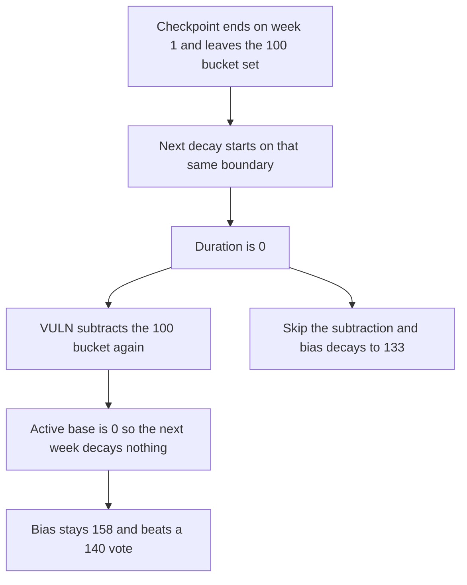

# Regnum Aurum: an epoch-boundary checkpoint subtracts the same expired lock twice and the vote stays 158

> **Vulnerability classes:** `vuln/governance/proposal-manipulation` · `vuln/logic/wrong-condition`

<!-- non-defihacklabs -->
<!-- source-auditvault: https://github.com/Auditware/AuditVault/blob/main/findings/66590-h-02-duplicate-deduction-of-expired-locks-at-epoch-boundary.md -->
<!-- date: 2026-03 -->

## Key info

| Field | Value |
|---|---|
| **Loss** | Voting power stays 158 instead of decaying to 133, so the lock beats a 140-vote counterparty |
| **Vulnerable contract** | `LockManager.decayBias` |
| **Attacker EOA** | `0x1111111111111111111111111111111111111111` |
| **Attack contract** | `Exploit` |
| **Attack tx** | `Exploit.run()` |
| **Chain / block / date** | Ethereum model · block 0 · 2026-03 |
| **Compiler** | solc 0.8.27, cancun, via IR |
| **Bug class** | A zero-duration epoch boundary subtracts the expired-lock bucket again |

## TL;DR

`_decayBias` rounds the start timestamp up to a week and, on every loop, subtracts `userTotalLockedAtEpochEnd` for that boundary. A checkpoint that ends exactly on the boundary does not zero the mapping. The next walk starts on that same boundary, so the first iteration has duration 0 and still subtracts the residual 100. The remaining 100 of active lock is then decayed from a zero base. Bias stays 158. Skipping the subtraction when duration is 0 decays that bias to 133 over the following week. 158 beats a 140-vote counterparty. 133 does not.

## The vulnerable code

```solidity
uint256 duration = epochEnd - currentTimestamp;
uint256 decayAmount = (effectiveTotalLocked * duration) / MAX_TIME;
decayedBias -= int128(int256(decayAmount));
// @> VULN: duration 0 still subtracts the expired-lock bucket a second time
effectiveTotalLocked = _decrease(user, effectiveTotalLocked, epochEnd);
```

`_roundUpToWeek` returns a timestamp that is already on a boundary unchanged, which is the finding's `_roundUpToWeekInternal` behavior.

## Root cause

The expired-lock mapping is not cleared when the boundary is processed, and the next decay treats that boundary as a new iteration even though no time has elapsed.

## Preconditions

- One lock of 100 expired at week 1. The mapping still holds 100. Another 100 remains locked.
- The stored bias at that boundary is 158 and the stored locked base is 100.
- The next checkpoint ends at week 2. `MAX_TIME` is 4 weeks.

## Attack walkthrough

1. Start the decay at week 1 and end it at week 2.
2. The first iteration has duration 0 and subtracts 100. The base becomes 0.
3. The second iteration decays `0 * 1 week / 4 weeks`. Bias stays 158.
4. The same walk that skips a zero duration keeps the base at 100 and decays bias by 25, to 133.

## Diagrams



## Impact

The lock keeps 25 more voting power than the fair decay and wins a vote a 140-vote counterparty should win. Repeating the boundary interaction can pin the decay base at zero while locks are still active, which is the non-decaying voting power the finding describes.

## Remediation

Zero `userTotalLockedAtEpochEnd` when the epoch is processed, or skip `_decrease` when `duration` is 0. The fair function in this file does the second.

## How to reproduce

```bash
cd 66590-h-02-duplicate-deduction-of-expired-locks-at-epoch-boundary_exp
forge test -vv
```

## Sources

- AuditVault finding: https://github.com/Auditware/AuditVault/blob/main/findings/66590-h-02-duplicate-deduction-of-expired-locks-at-epoch-boundary.md
- Pashov review: https://github.com/pashov/audits/blob/master/team/md/RegnumAurum-security-review_2026-03-21.md
- Reduced source: `test/66590-h-02-duplicate-deduction-of-expired-locks-at-epoch-boundary.sol`
