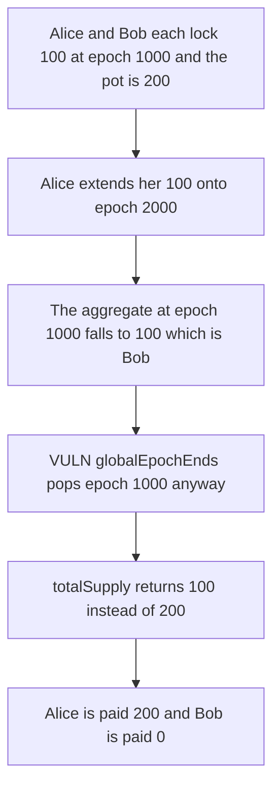

# Regnum Aurum: one extendLock deletes Bob's epoch and Alice takes the whole reward

> **Vulnerability classes:** `vuln/logic/incorrect-state-transition` · `vuln/logic/reward-calculation`

<!-- non-defihacklabs -->
<!-- source-auditvault: https://github.com/Auditware/AuditVault/blob/main/findings/66591-h-03-global-epoch-index-corruption-from-subtractfromepochend.md -->
<!-- date: 2026-03 -->

## Key info

| Field | Value |
|---|---|
| **Loss** | Alice takes 200 of a 200 reward pot. Her pro-rata share is 100. Bob is paid 0 |
| **Vulnerable contract** | `EpochLocker._subtractFromEpochEndLocked` |
| **Attacker EOA** | `0x1111111111111111111111111111111111111111` (Alice) |
| **Attack contract** | `Exploit` |
| **Attack tx** | `Exploit.run()` |
| **Chain / block / date** | Ethereum model · block 0 · 2026-03 |
| **Compiler** | solc 0.8.27, cancun, via IR |
| **Bug class** | globalEpochEnds pops an epoch whose aggregate lock is still non-zero |

## TL;DR

`_subtractFromEpochEndLocked` subtracts one user's amount from `totalLockedAtEpochEnd` and then always removes that epoch from `globalEpochEnds`. Alice and Bob each have 100 locked at epoch 1000, and the reward pot is 200. Alice extends her 100 to a new epoch. The aggregate at epoch 1000 falls to 100, which is Bob's lock, but the epoch is popped anyway. `totalSupply()` then returns 100 instead of 200. Alice's claim is `100 * 200 / 100 = 200`. Bob's claim pays 0. Guarding the pop on a zero aggregate pays 100 to each.

## Background

Pashov Audit Group's 21 March 2026 Regnum Aurum review, finding H-03. Global accounting walks `globalEpochEnds` and treats it as the list of every epoch that still has a non-zero lock. `_checkpointExpiredLocksCumulative(address(0))` and the reward denominator both use that list. Removing an epoch while `totalLockedAtEpochEnd` is still positive hides every other user at that epoch. The report names `extendLock`, `withdrawSpecificLock`, and `emergencyWithdrawAll` as callers. The fix pops only when the updated aggregate is 0.

## The vulnerable code

```solidity
uint256 currentAmountGlobal = totalLockedAtEpochEnd[epochEnd];
totalLockedAtEpochEnd[epochEnd] = currentAmountGlobal > amount ? currentAmountGlobal - amount : 0;
uint256[] memory epochEnds = _globalEpochEnds;
for (uint256 i; i < epochEnds.length; i++) {
    if (epochEnds[i] == epochEnd) {
        _globalEpochEnds[i] = epochEnds[epochEnds.length - 1]; // @> VULN: epoch slot is overwritten while other users still have a balance
        _globalEpochEnds.pop();
    }
}
```

The aggregate update is correct. The pop is not conditional on it.

```diff
- _globalEpochEnds.pop();
+ if (totalLockedAtEpochEnd[epochEnd] == 0) {
+     _globalEpochEnds[i] = epochEnds[epochEnds.length - 1];
+     _globalEpochEnds.pop();
+ }
```

## Root cause

`globalEpochEnds` is an index of epochs with a non-zero global balance, but the removal decision is "a subtraction happened", not "the balance hit zero". One user's `extendLock` therefore deletes an epoch Bob still occupies. `totalSupply()` sums only the index, so it understates the sum of user locks. Reward math that divides by that supply overpays the first claimer until the pot is empty.

## Preconditions

- Alice and Bob each lock 100 at epoch 1000. `globalEpochEnds` is `[1000]` and the aggregate is 200.
- `accReward` is 200 and the locker holds 200 reward tokens.
- Alice calls `extendLock(100, 1000, 2000)`, which is one of the report's standard callers of `_subtractFromEpochEndLocked`.

## Attack walkthrough

1. Alice extends 100 from epoch 1000 to epoch 2000. Her user lock stays 100. Bob's stays 100.
2. The aggregate at epoch 1000 becomes 100. The pop removes epoch 1000. The index is then `[2000]` with aggregate 100.
3. `totalSupply()` returns 100. The two user locks still sum to 200.
4. Alice claims. `100 * 200 / 100 = 200`. She receives the whole pot.
5. Bob claims. The formula would also be 200, but the locker is empty, so the payout is capped at 0.
6. The control skips the pop because the aggregate is not 0. The index keeps both epochs, `totalSupply()` is 200, and each claim pays 100.

## Diagrams



## Impact

Alice receives 200 reward tokens. Her pro-rata share of a 200 pot against 200 of locks is 100, so she is overpaid by 100. Bob still has 100 locked at epoch 1000 and is paid 0. The index no longer lists his epoch, so later global checkpoints keep ignoring him. The guarded pop pays 100 to Alice and 100 to Bob.

## Remediation

Pop `epochEnd` from `globalEpochEnds` only when `totalLockedAtEpochEnd[epochEnd]` is 0 after the subtraction. The report states that condition directly. Removing a user's own `userEpochEnds` entry is fine, because that user's balance at the epoch did hit zero. The global index is the one other users still depend on.

## How to reproduce

```bash
cd 66591-h-03-global-epoch-index-corruption-from-subtractfromepochend_exp
forge test -vv
```

`test_exploit_alice_takes_200_and_bob_gets_0` asserts the aggregate at epoch 1000 is still 100, the index length is 1, Alice received 200, and Bob received 0. `test_control_pop_only_when_aggregate_is_zero` asserts both epochs remain and each claim pays 100. Captured output is `output.txt`.

## Sources

- AuditVault finding: https://github.com/Auditware/AuditVault/blob/main/findings/66591-h-03-global-epoch-index-corruption-from-subtractfromepochend.md
- Pashov report: https://github.com/pashov/audits/blob/master/team/md/RegnumAurum-security-review_2026-03-21.md
- Vulnerable lines: the `_subtractFromEpochEndLocked` loop quoted in that report. The finding does not name an audited commit.
