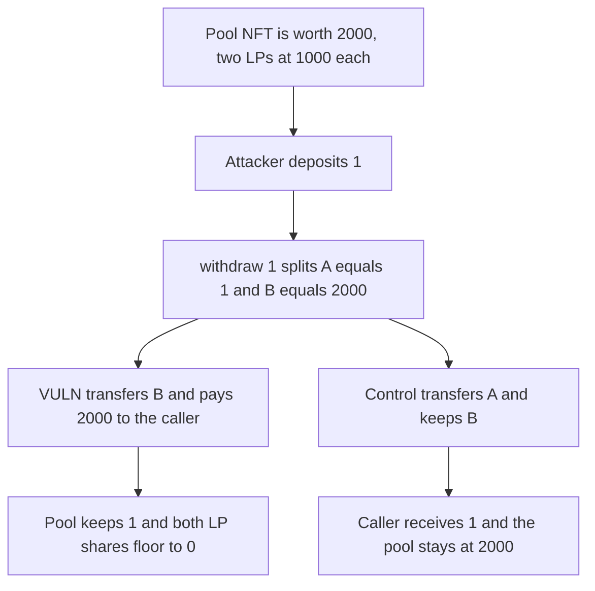

# STBL redemption pays the pool remainder to a 1-unit withdraw

> **Vulnerability classes:** vuln/logic/state-update · vuln/dos/frozen-funds

<!-- non-defihacklabs -->
<!-- source-auditvault: https://github.com/Auditware/AuditVault/blob/main/findings/66728-full-redemption-pool-drain-via-inverted-split-piece-assignme.md -->
<!-- date: 2026-06 -->

## Key info

| Field | Value |
|---|---|
| **Loss** | 1999 units taken. A deposit of 1 is withdrawn as 2000. The pool keeps 1 and both LPs fetch a 0 share |
| **Vulnerable contract** | `Redemption.iWithdraw` |
| **Attacker EOA** | `0x1111111111111111111111111111111111111111` |
| **Attack contract** | `Exploit` at `0x15452ec016c4dc8c549e7fe6ff4b26324ea8b7a4` |
| **Attack tx** | `Exploit.run()` |
| **Chain / block / date** | Ethereum model · block 0 · 2026-06 |
| **Compiler** | solc 0.8.27, cancun, via IR |
| **Bug class** | Split piece B, the remainder, is transferred to the caller and piece A is kept |

## TL;DR

`YLD.split` returns A with value equal to the requested amount and B with value equal to the pool minus that amount. `iWithdraw` transfers B to the caller and sets `NFTID = A`. Any LP who deposited 1 unit can `withdraw(1)` and receive 2000. The pool NFT is then worth 1, so the other LPs' `iFetchShare` floors to 0 and they cannot withdraw.

## Background

Cyfrin's 17 June 2026 review of STBL Ess, reported by Stalin. `STBL_Redemption_Core.iWithdraw` split the pooled YLD NFT and then assigned the pieces backwards relative to `withdraw`'s own NatSpec, which says the caller receives the `_amt`-sized piece.

## The vulnerable code

```solidity
(uint256 _A, uint256 _B) = yld.split(NFTID, _amt);
uint256 taken = yld.getNFTData(_B);
// @> VULN: _B is the pool-minus-amt remainder and is transferred to the caller; the pool keeps the amt-sized _A
yld.transferFrom(address(this), msg.sender, _B);
NFTID = _A;
require(value.transfer(msg.sender, taken), "pay");
```

On a pool of 2001 after the attacker's deposit, `split(NFTID, 1)` makes A worth 1 and B worth 2000. The caller is paid 2000. `RedemptionFixed.withdraw` sends A and keeps B, so the caller gets their 1 unit back and the pool stays at 2000.

## Root cause

The two ids from `split` are used in the opposite order from the split's own definition. The share check is correct. `iFetchShare` of the attacker is 1, so `withdraw(1)` is allowed. The token that moves is the other piece.

## Preconditions

- The redemption pool custodies one YLD NFT. Here it is worth 2000, with LP1 and LP2 each recorded at 1000.
- The attacker can deposit any non-zero NFT. This run deposits 1.
- `withdraw` is permissionless for an LP. No admin is required.

## Attack walkthrough

1. The attacker mints a YLD NFT worth 1 and deposits it. `totalSupply` becomes 2001.
2. `withdraw(1)` passes `iFetchShare`, which is 1.
3. `split` creates A worth 1 and B worth 2000.
4. B is transferred to the attacker and the value token pays 2000. `NFTID` becomes A.
5. The attacker's balance goes from 1 to 2000. Net gain is 1999.
6. `iFetchShare` for LP1 and LP2 is `1000 * 1 / 2001 = 0`.
7. The fixed withdraw pays 1 and leaves the pool NFT at 2000.

## Diagrams



## Impact

The attacker extracts 1999 units they did not deposit. LP1 and LP2 cannot withdraw, because any positive request is larger than a 0 share. The pool's remaining value is 1 unit.

## Remediation

Transfer `_A` to the caller and set `NFTID = _B`. Cyfrin verified that commit 3300d4c does this.

## How to reproduce

```bash
cd 66728-full-redemption-pool-drain-via-inverted-split-piece-assignme_exp
forge test -vv
```

`test_exploit_withdraw_1_takes_the_remainder` asserts the attacker holds 2000, the pool NFT is worth 1, and LP1's share is 0. `test_control_caller_receives_the_amt_slice` asserts the caller receives 1 and the pool keeps 2000. Captured output is `output.txt`.

## Sources

- AuditVault finding: https://github.com/Auditware/AuditVault/blob/main/findings/66728-full-redemption-pool-drain-via-inverted-split-piece-assignme.md
- Cyfrin report: https://github.com/solodit/solodit_content/blob/main/reports/Cyfrin/2026-06-17-cyfrin-stbl-ess-v2.0.md
- Fix: https://github.com/USD-Pi-Protocol/stbl-contracts-evm-redemptions/commit/3300d4cea4d586ba55166e17fa9f279a48544288
