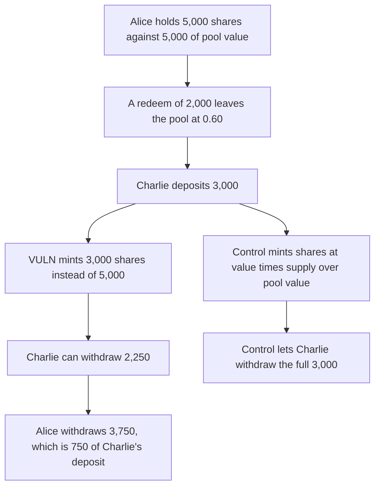

# A 3,000 deposit into a 0.60 redemption pool mints par shares and moves 750 to the old LP

> **Vulnerability classes:** vuln/logic/price-calculation · vuln/logic/state-update

<!-- non-defihacklabs -->
<!-- source-auditvault: https://github.com/Auditware/AuditVault/blob/main/findings/66729-stbl-redemption-coreideposit-mints-lp-shares-11-instead-of-a.md -->
<!-- date: 2026-06 -->

## Key info

| Field | Value |
|---|---|
| **Loss** | Charlie's 3,000 deposit is worth 2,250. Alice withdraws 3,750, which is 750 more than her claim before the deposit |
| **Vulnerable contract** | `Redemption._iDeposit` |
| **Attacker EOA** | `0xda9a11165d441b5d3e3446d6b353d4fa9ca54599` (any new LP) |
| **Attack contract** | `Exploit` |
| **Attack tx** | `Exploit.run()` |
| **Chain / block / date** | Ethereum model · block 0 · 2026-06 |
| **Compiler** | solc 0.8.27, cancun, via IR |
| **Bug class** | Shares are minted 1:1 with `stableValueNet` after the pool value has fallen below `totalSupply` |

## TL;DR

`iFetchShare` prices a user as `shares * poolValue / totalSupply`. `iDeposit` still does `shares += stableValueNet`. Alice deposits 5,000. Bob redeems 2,000, so the pool value is 3,000 and the supply is still 5,000. The rate is 0.60. Charlie deposits 3,000 and receives 3,000 shares. Those shares are worth 2,250. Alice's claim rises from 3,000 to 3,750, and she withdraws 3,750 USST. Minting `deposited * supply / poolValue` gives Charlie 5,000 shares and he withdraws his full 3,000.

## Background

Cyfrin's 17 June 2026 review of STBL ESS v2.0. The contest proof uses a 5,000 deposit against a 0.60 pool and shows about 1,333 moving to the old LP, with 1 wei of truncation. This run uses 3,000 so the same 0.60 rate divides evenly: the loss is 750 on both sides. The fix cited in the report is commit `32f6d32`, which mints `depositedValue * totalSupply / poolValue`.

## The vulnerable code

```solidity
} else {
    NFTID = yld.merge(NFTID, id);
    // @> VULN: shares are minted 1:1 with stableValueNet, ignoring pool value / totalSupply
    userData[msg.sender].stableValueNet += meta.stableValueNet;
    totalSupply += meta.stableValueNet;
}
```

The first deposit, when `NFTID` is 0, can mint 1:1. Every later deposit hits the branch above. `redeem` shrinks the pool NFT and does not reduce `totalSupply`, which is what drives the rate to 0.60.

## Root cause

`userData.stableValueNet` is a share count, because `iFetchShare` multiplies it by pool value and divides by supply. `iDeposit` treats it as an asset amount. After any redeem, pool value is below supply, so new shares are worth less than the assets just added. The difference is claimable by the shares already outstanding.

## Preconditions

- Alice has deposited 5,000 and holds 5,000 shares.
- A redeem of 2,000 has left pool value at 3,000 and supply at 5,000.
- Charlie deposits 3,000. No admin action is required.

## Attack walkthrough

1. Alice deposits 5,000. Supply and pool value are both 5,000.
2. Bob redeems 2,000. Pool value is 3,000. Supply is 5,000. Alice's claim is 3,000.
3. Charlie deposits 3,000. He is minted 3,000 shares, not `3000 * 5000 / 3000 = 5000`.
4. Pool value is 6,000 and supply is 8,000. Charlie's claim is `3000 * 6000 / 8000 = 2250`.
5. Alice's claim is `5000 * 6000 / 8000 = 3750`. She withdraws 3,750 USST.
6. Her gain over the pre-deposit claim is 750, which is Charlie's 3,000 minus 2,250.
7. The control mints Charlie 5,000 shares. His withdrawal is 3,000.

## Diagrams



## Impact

Charlie pays 3,000 and can take out 2,250. Alice, who does nothing after the deposit, withdraws 3,750 USST instead of the 3,000 her shares were worth before Charlie arrived. The 750 moves in the same transaction. Every later deposit while the pool is below peg does the same thing. The report's larger case, a 5,000 deposit at this same 0.60 rate, moves about 1,333.

## Remediation

When the pool NFT already exists, mint `stableValueNet * totalSupply / poolValue` and add that share count, not the raw deposit, to `userData` and `totalSupply`.

## How to reproduce

```bash
cd 66729-stbl-redemption-coreideposit-mints-lp-shares-11-instead-of-a_exp
forge test -vv
```

`test_exploit_charlie_loses_750_to_alice` asserts Charlie's claim is 2,250, Alice's gain is 750, and Alice's USST balance is 3,750. `test_control_exchange_rate_mint_lets_charlie_withdraw_3000` asserts Charlie withdraws 3,000. Captured output is `output.txt`.

## Sources

- AuditVault finding: https://github.com/Auditware/AuditVault/blob/main/findings/66729-stbl-redemption-coreideposit-mints-lp-shares-11-instead-of-a.md
- Cyfrin report: https://github.com/solodit/solodit_content/blob/main/reports/Cyfrin/2026-06-17-cyfrin-stbl-ess-v2.0.md
