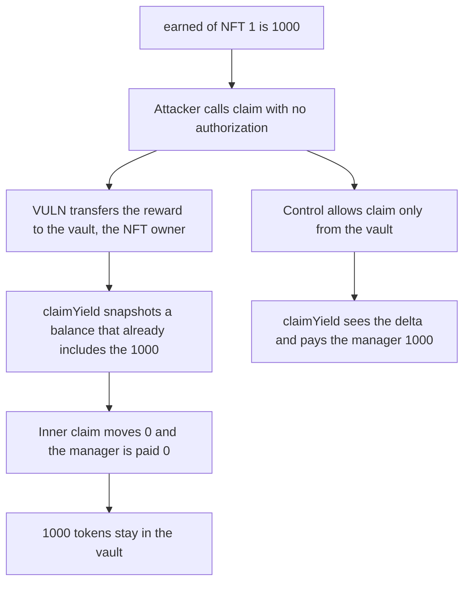

# STBL vault: permissionless claim() strands 1000 reward tokens before claimYield

> **Vulnerability classes:** vuln/access-control/missing-auth · vuln/dos/frozen-funds

<!-- non-defihacklabs -->
<!-- source-auditvault: https://github.com/Auditware/AuditVault/blob/main/findings/66730-yield-permanently-locked-in-stbl-xlayer-nft-vault-via-permis.md -->
<!-- date: 2026-06 -->

## Key info

| Field | Value |
|---|---|
| **Loss** | 1000 reward tokens stuck in the NFT vault. The wrapper manager's claimYield pays 0 |
| **Vulnerable contract** | `YieldDistributor.claim` |
| **Attacker EOA** | `0x1111111111111111111111111111111111111111` |
| **Attack contract** | `Exploit` |
| **Attack tx** | `Exploit.run()` |
| **Chain / block / date** | Ethereum model · block 0 · 2026-06 |
| **Compiler** | solc 0.8.27, cancun, via IR |
| **Bug class** | `claim` has no owner check and sends rewards to the NFT owner, which is the vault |

## TL;DR

`YieldDistributor.claim(id)` is permissionless. It zeroes `earned[id]` and transfers the reward to `YToken.ownerOf(id)`. For a vault-held NFT that recipient is the vault. `claimYield` then snapshots the vault balance, calls `claim` again, sees a zero delta, and transfers nothing to the wrapper manager. The 1000 tokens stay in the vault. Restricting `claim` to the vault lets `claimYield` observe the delta and pay the manager.

## Background

Cyfrin's June 2026 STBL ESS review, reported by Stalin. `STBL_XLayer_NFT_Vault.claimYield` measures yield with a balance-before/after around `YieldDistributor.claim`. The distributor inherits `STBL_T1e_YieldDistributor.claim` and does not override it. The NatSpec says only the token owner or an operator may call it. The implementation has no such check.

## The vulnerable code

```solidity
earned[id] = 0;
// @> VULN: claim has no owner check and safeTransfers the reward to YToken.ownerOf, the vault
require(token.transfer(ytoken.ownerOf(id), reward), "push");
```

`claimYield` then does:

```solidity
uint256 balanceBefore = token.balanceOf(address(this));
distributor.claim(nftId);
uint256 balanceAfter = token.balanceOf(address(this));
if (balanceAfter > balanceBefore) {
    paid = balanceAfter - balanceBefore;
}
```

## Root cause

The reward is pushed to the NFT owner before the vault measures the transfer. Once `earned` is zero, the vault's own `claim` moves nothing, the delta guard is false, and the vault has no sweep.

## Preconditions

- The vault owns YLD NFT 1.
- The distributor has `earned[1] == 1000` and holds 1000 reward tokens.
- Anyone may call `claim`. The wrapper manager is a different address.

## Attack walkthrough

1. 1000 reward tokens are minted and `fund(1, 1000)` sets `earned[1]`.
2. The attacker calls `claim(1)`. The tokens move to the vault and `earned` becomes 0.
3. The wrapper manager calls `claimYield`. The balance snapshot already includes the 1000.
4. The inner `claim` returns immediately. `balanceAfter == balanceBefore`, so `paid` is 0.
5. The vault still holds 1000. The control sets `onlyVault` and the same `claimYield` pays the manager 1000.

## Diagrams



## Impact

The wrapper manager receives 0 of a 1000 token distribution. The tokens are stranded in the NFT vault. Repeating this on every reward cycle stops yield collection for the lot. The control pays the full 1000 to the manager and leaves the vault empty.

## Remediation

Require `msg.sender == vault` in `claim`, and route collection through `claimYield` so the balance delta is the transfer the vault itself triggered.

## How to reproduce

```bash
cd 66730-yield-permanently-locked-in-stbl-xlayer-nft-vault-via-permis_exp
forge test -vv
```

`test_exploit_permissionless_claim_strands_1000` asserts the vault holds 1000 and the manager holds 0. `test_control_vault_only_claim_pays_manager` asserts the direct claim reverts and the manager receives 1000. Captured output is `output.txt`.

## Sources

- AuditVault finding: https://github.com/Auditware/AuditVault/blob/main/findings/66730-yield-permanently-locked-in-stbl-xlayer-nft-vault-via-permis.md
- Report: https://github.com/solodit/solodit_content/blob/main/reports/Cyfrin/2026-06-17-cyfrin-stbl-ess-v2.0.md
