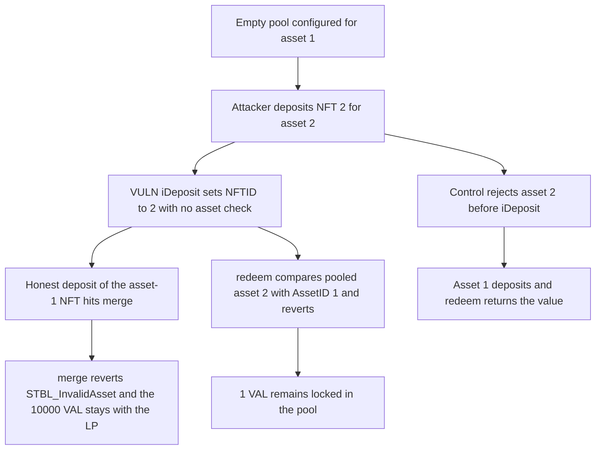

# STBL redemption: the first iDeposit stores a wrong-asset NFT and locks 1 VAL

> **Vulnerability classes:** vuln/logic/missing-check · vuln/dos/frozen-funds

<!-- non-defihacklabs -->
<!-- source-auditvault: https://github.com/Auditware/AuditVault/blob/main/findings/66731-missing-assetid-validation-in-stbl-redemption-coreideposit-f.md -->
<!-- date: 2026-06 -->

## Key info

| Field | Value |
|---|---|
| **Loss** | 1 VAL locked in the redemption pool. The honest 10000 VAL deposit reverts, and redeem reverts |
| **Vulnerable contract** | `RedemptionCore.iDeposit` |
| **Attacker EOA** | `0x1111111111111111111111111111111111111111` |
| **Attack contract** | `Exploit` |
| **Attack tx** | `Exploit.run()` |
| **Chain / block / date** | Ethereum model · block 0 · 2026-06 |
| **Compiler** | solc 0.8.27, cancun, via IR |
| **Bug class** | First deposit sets `NFTID = id` with no `assetID == AssetID` check |

## TL;DR

On an empty pool, `iDeposit` reads `stableValueNet` and assigns `NFTID = _id`. It never checks `MetaData.assetID` against the pool's `AssetID`. An asset-2 NFT becomes the pooled position. The next deposit, an asset-1 NFT worth 10000 VAL, hits `merge` and reverts with `STBL_InvalidAsset`. `redeem` compares the pooled asset with `AssetID` and reverts, so the attacker's 1 VAL stays in the pool. A caller that checks `assetID` before `iDeposit` rejects the foreign NFT and redeems a real deposit.

## Background

Cyfrin's June 2026 STBL ESS review, reported by Stalin. `STBL_Redemption_Core` keeps one pooled YLD NFT. Later deposits merge into it, and `merge` requires both NFTs to share an `assetID`. The first deposit skips that merge, which is the only place the asset is checked.

## The vulnerable code

```solidity
if (NFTID == 0) {
    // @> VULN: first deposit stores _id and never checks MetaData.assetID == AssetID
    NFTID = id;
} else {
    NFTID = splitter.merge(NFTID, id);
}
```

`merge` is the check the first branch skips:

```solidity
require(metaA.assetID == metaB.assetID, "STBL_InvalidAsset");
```

## Root cause

`iDeposit` uses `stableValueNet` for the share total and ignores `assetID` when `NFTID` is still 0. After that write, every honest deposit takes the merge branch and reverts, and `redeem` refuses to pay a foreign NFT out through the configured asset.

## Preconditions

- The pool is constructed for asset 1 and `NFTID` is 0.
- The attacker holds YLD id 2, asset 2, value 1 VAL, and has approved the pool.
- The LP holds YLD id 1, asset 1, value 10000 VAL.

## Attack walkthrough

1. `iDeposit(2)` pulls the NFT and 1 VAL, then sets `NFTID` to 2.
2. The LP calls `iDeposit(1)`. `merge` sees asset 2 against asset 1 and reverts. The LP still holds the NFT and the 10000 VAL.
3. `redeem` loads the pooled asset, finds 2 instead of 1, and reverts.
4. The pool still holds 1 VAL and NFT 2.
5. The control requires `assetID == AssetID` before `iDeposit`. The foreign NFT reverts, the asset-1 deposit is accepted, and `redeem` returns the 10000 VAL.

## Diagrams



## Impact

1 VAL is locked in the redemption contract and `redeem` cannot release it. Every later deposit of the pool's real asset reverts, including the LP's 10000 VAL NFT, which is not consumed only because the call reverts. The pool has to be replaced. The checked path deposits the real asset and redeems it.

## Remediation

After reading `MetaData`, require `meta.assetID == AssetID` before the `NFTID == 0` branch. `STBL_InvalidAsset` is the error `merge` already uses.

## How to reproduce

```bash
cd 66731-missing-assetid-validation-in-stbl-redemption-coreideposit-f_exp
forge test -vv
```

`test_exploit_wrong_asset_locks_1_ether_and_bricks_pool` asserts the pool holds 1 VAL, the LP deposit reverts, and redeem reverts. `test_control_asset_check_rejects_wrong_nft_and_redeems` asserts the foreign id is rejected and a correct deposit redeems cleanly. Captured output is `output.txt`.

## Sources

- AuditVault finding: https://github.com/Auditware/AuditVault/blob/main/findings/66731-missing-assetid-validation-in-stbl-redemption-coreideposit-f.md
- Report: https://github.com/solodit/solodit_content/blob/main/reports/Cyfrin/2026-06-17-cyfrin-stbl-ess-v2.0.md
- Fix commit: https://github.com/USD-Pi-Protocol/stbl-contracts-evm-redemptions/commit/08f6ad6711d7d24875ec761fbb6b2597dad1ab3d
