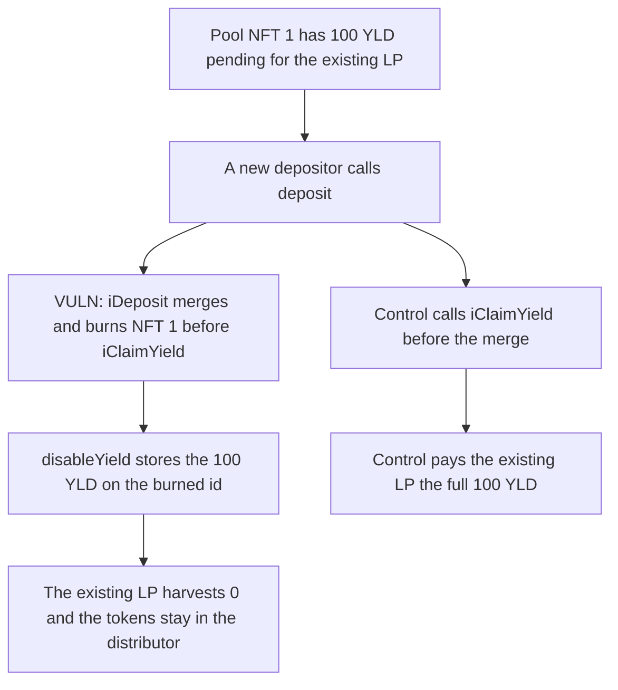

# A new STBL deposit burns the pool NFT and destroys 100 of pending LP yield

> **Vulnerability classes:** vuln/dos/frozen-funds · vuln/logic/missing-check

<!-- non-defihacklabs -->
<!-- source-auditvault: https://github.com/Auditware/AuditVault/blob/main/findings/66732-pending-lp-yield-permanently-destroyed-in-stbl-redemption-co.md -->
<!-- date: 2026-06 -->

## Key info

| Field | Value |
|---|---|
| **Loss** | 100 YLD stranded on a burned pool NFT. The existing LP harvests 0 |
| **Vulnerable contract** | `STBL_Redemption_Core.iDeposit` |
| **Attacker EOA** | `0x0000000000000000000000000000000000066732` (any new depositor) |
| **Attack contract** | `Exploit` |
| **Attack tx** | `Exploit.run()` |
| **Chain / block / date** | Ethereum model · block 0 · 2026-06 |
| **Compiler** | solc 0.8.27, cancun, via IR |
| **Bug class** | Deposit merges and burns the pool NFT before `iClaimYield` |

## TL;DR

`iDeposit` snapshots the new depositor at the current `rewardIndex` and then `spliter.merge` burns the pool NFT. It never calls `iClaimYield`. `disableYield` parks the pending yield on the burned id, and `claim` on that id reverts. One new deposit of 1,000 shares destroys 100 YLD that the existing LP had already accrued. Calling `iClaimYield` before the merge pays that LP the full 100.

## Background

Cyfrin's June 2026 STBL Ess review. The redemption pool holds one YLD NFT for every LP. Yield accrues on that id inside `YieldDistributor` and reaches LPs only when `iClaimYield` pulls it into `rewardIndex`. A later deposit is supposed to flush that yield first. It does not.

## The vulnerable code

```solidity
function iDeposit(uint256 _id) internal {
    _updateRewards(msg.sender); // snapshot at stale rewardIndex
    // @> VULN: iDeposit never calls iClaimYield, so merge burns the pool NFT and strands its pending yield
    NFTID = spliter.merge(NFTID, _id); // burns old NFTID
    userData[msg.sender].stableValueNet += MetaData.stableValueNet;
    totalSupply += MetaData.stableValueNet;
}
```

`merge` calls `disableYield` on the old id. That copies `pending` into `earned` and clears `alive`. The next `claim` reverts because the NFT is gone. The merged NFT starts at zero pending yield, so a later `iClaimYield` returns 0.

## Root cause

The pool's accounting only pays yield that has been copied into `rewardIndex`. Burning the NFT before that copy leaves the tokens in the distributor under an id nobody can claim.

## Preconditions

- One LP already has 1,000 shares on NFT id 1.
- 100 YLD has accrued on that id and has not been claimed.
- Anyone can call `deposit` with a new NFT. No role is required.

## Attack walkthrough

1. The distributor mints 100 YLD of pending yield for NFT 1.
2. A new depositor calls `deposit` for 1,000 shares.
3. `iDeposit` snapshots them at `rewardIndex` 0, then merge burns NFT 1.
4. `disableYield` stores the 100 YLD on the dead id.
5. The existing LP harvests 0. `iClaimYield` on the new NFT also returns 0.
6. The control claims before the merge. The same LP receives 100 YLD and the distributor is empty.

## Diagrams



## Impact

The distributor still holds 100 YLD. The existing LP's harvest pays 0, and `claim` on the burned id reverts. That yield cannot be redirected to the new depositor either, because their snapshot is the pre-claim index. The control path pays the existing LP the full 100 YLD.

## Remediation

Call `iClaimYield` at the start of `iDeposit` when `totalSupply > 0`, before `_updateRewards` and before `merge`.

## How to reproduce

```bash
cd 66732-pending-lp-yield-permanently-destroyed-in-stbl-redemption-co_exp
forge test -vv
```

`test_exploit_deposit_destroys_pending_lp_yield` asserts the 100 YLD is stranded and the LP is paid 0. `test_control_claim_before_deposit_pays_lp` asserts the claim-first path pays the LP 100 YLD. Captured output is `output.txt`.

## Sources

- AuditVault finding: https://github.com/Auditware/AuditVault/blob/main/findings/66732-pending-lp-yield-permanently-destroyed-in-stbl-redemption-co.md
- Cyfrin report: https://github.com/solodit/solodit_content/blob/main/reports/Cyfrin/2026-06-17-cyfrin-stbl-ess-v2.0.md
