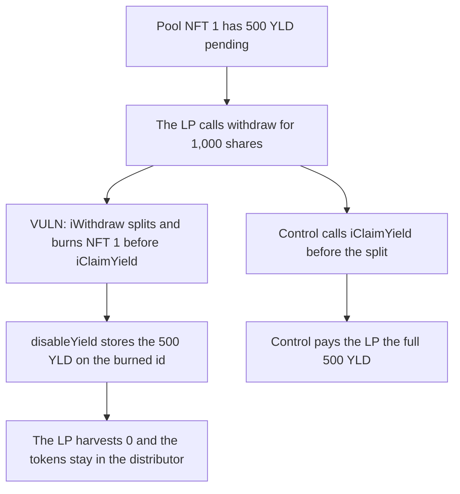

# An STBL withdrawal splits the pool NFT and orphans 500 of LP yield

> **Vulnerability classes:** vuln/dos/frozen-funds · vuln/logic/missing-check

<!-- non-defihacklabs -->
<!-- source-auditvault: https://github.com/Auditware/AuditVault/blob/main/findings/66733-lp-yield-permanently-orphaned-in-stbl-redemption-coreiwithdr.md -->
<!-- date: 2026-06 -->

## Key info

| Field | Value |
|---|---|
| **Loss** | 500 YLD orphaned on a burned pool NFT. The withdrawing LP harvests 0 |
| **Vulnerable contract** | `STBL_Redemption_Core.iWithdraw` |
| **Attacker EOA** | `0x0000000000000000000000000000000000066733` (any LP) |
| **Attack contract** | `Exploit` |
| **Attack tx** | `Exploit.run()` |
| **Chain / block / date** | Ethereum model · block 0 · 2026-06 |
| **Compiler** | solc 0.8.27, cancun, via IR |
| **Bug class** | Withdraw splits the pool NFT before `iClaimYield` |

## TL;DR

`iWithdraw` updates the LP against the stale `rewardIndex` and then `spliter.split` burns the pool NFT. It never calls `iClaimYield`. The 500 YLD that had accrued on the old id is snapshotted by `disableYield` and can never be claimed. The LP's harvest pays 0. Claiming before the split pays the LP the full 500.

## Background

Cyfrin's June 2026 STBL Ess review, the withdraw and redeem twin of the deposit bug. The pool still holds one YLD NFT. `split` burns it and mints a pool fragment plus the withdrawer's fragment. Only `iClaimYield` moves distributor yield into `rewardIndex`. Neither `iWithdraw` nor `iRedeem` calls it.

## The vulnerable code

```solidity
function iWithdraw(uint256 _amt) internal {
    _updateRewards(msg.sender);
    // @> VULN: iWithdraw splits the pool NFT before iClaimYield, so pending yield is snapshotted onto a burned id
    (uint256 tokenIdA,) = spliter.split(NFTID, _amt);
    NFTID = tokenIdA;
    userData[msg.sender].stableValueNet -= _amt;
    totalSupply -= _amt;
}
```

`split` calls `disableYield(oldId)` before the new ids are enabled. `claim(oldId)` then reverts. The new pool NFT has no pending yield, so a later `iClaimYield` returns 0 for the period before the split.

## Root cause

Yield is keyed by NFT id. Burning that id without first calling `claim` leaves the tokens in the distributor under an id the pool no longer owns.

## Preconditions

- An LP holds 10,000 shares on NFT id 1.
- 500 YLD has accrued since the last claim.
- `withdraw` is permissionless. No admin action is required.

## Attack walkthrough

1. The distributor mints 500 YLD of pending yield for NFT 1.
2. The LP withdraws 1,000 shares.
3. `iWithdraw` splits the NFT. The old id is burned.
4. `disableYield` stores the 500 YLD on that dead id.
5. The LP harvests 0. The new NFT's `iClaimYield` also returns 0.
6. The control claims first. The same LP receives 500 YLD.

## Diagrams



## Impact

The distributor still holds 500 YLD after the withdrawal. The LP who accrued it is paid 0, and no later claim on the replacement NFT recovers it. The control path pays that LP the full 500 YLD and leaves the distributor empty.

## Remediation

Call `iClaimYield` at the top of `iWithdraw` and `iRedeem`, before `spliter.split`.

## How to reproduce

```bash
cd 66733-lp-yield-permanently-orphaned-in-stbl-redemption-coreiwithdr_exp
forge test -vv
```

`test_exploit_withdraw_orphans_lp_yield` asserts the 500 YLD is stranded and the harvest is 0. `test_control_claim_before_withdraw_pays_lp` asserts the claim-first path pays 500 YLD. Captured output is `output.txt`.

## Sources

- AuditVault finding: https://github.com/Auditware/AuditVault/blob/main/findings/66733-lp-yield-permanently-orphaned-in-stbl-redemption-coreiwithdr.md
- Cyfrin report: https://github.com/solodit/solodit_content/blob/main/reports/Cyfrin/2026-06-17-cyfrin-stbl-ess-v2.0.md
