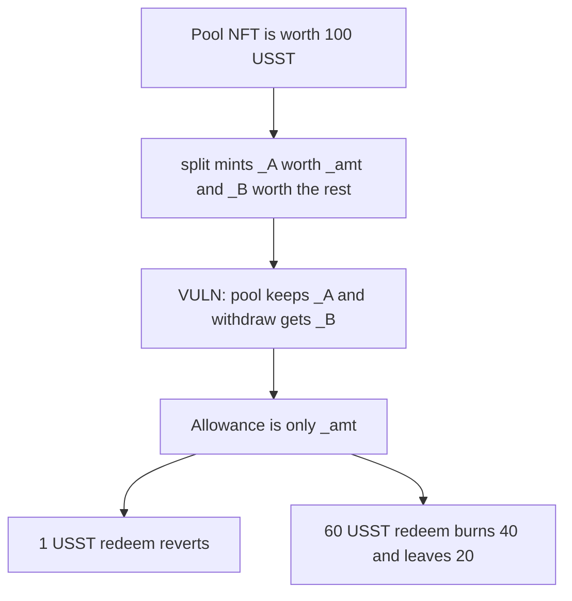

# STBL: iRedeem keeps the amount slice and burns the remainder, so 60 USST pays for a 40 burn

> **Vulnerability classes:** `vuln/logic/incorrect-order-of-operations` · `vuln/logic/missing-allowance`

<!-- non-defihacklabs -->
<!-- source-auditvault: https://github.com/Auditware/AuditVault/blob/main/findings/66734-stbl-redemption-coreiredeem-burns-the-wrong-split-slice-caus.md -->
<!-- date: 2026-06 -->

## Key info

| Field | Value |
|---|---|
| **Loss** | A 1 USST redeem reverts. A 60 USST redeem on a 100 pool burns 40 and leaves 20 USST in the redemption contract |
| **Vulnerable contract** | `Redemption.iRedeem` |
| **Attacker EOA** | `0x1111111111111111111111111111111111111111` |
| **Attack contract** | `Exploit` |
| **Attack tx** | `Exploit.run()` |
| **Chain / block / date** | Ethereum model · block 0 · 2026-06 |
| **Compiler** | solc 0.8.27, cancun, optimizer 200 |
| **Bug class** | Pool keeps `_A` worth `_amt` and `withdraw` burns `_B` worth `poolSVN - _amt` |

## TL;DR

`split` returns `_A` worth the user's `_amt` and `_B` worth the rest of the pool. `iRedeem` stores `_A` as the new pool NFT and passes `_B` to `issuer.withdraw`, but it only pulls and approves `_amt` USST. When `_amt` is 1 and the pool is 100, the issuer needs 99 and the allowance is 1, so `redeem` reverts. When `_amt` is 60, the burn is 40, the user has paid 60, and 20 USST stays in the redemption contract. The pool NFT is the 60 slice the user meant to redeem.

## Background

Cyfrin's June 2026 STBL Ess review, reported by Stalin. The blamed function is `STBL_Redemption_Core.iRedeem`. The fix, commit `f6a7fe7`, keeps `_B` as the pool and withdraws `_A`, and approves the burned slice's `stableValueNet`. Cyfrin verified that change.

## The vulnerable code

```solidity
(uint256 a, uint256 b) = yld.split(nftId, amt);
nftId = a; // @> VULN: pool keeps the `_amt` slice and withdraws the remainder
usst.transferFrom(msg.sender, address(this), amt);
usst.approve(address(issuer), amt);
issuer.withdraw(b);
```

```diff
- nftId = a;
- usst.approve(address(issuer), amt);
- issuer.withdraw(b);
+ nftId = b;
+ uint256 burned = yld.stableValueNet(a);
+ usst.approve(address(issuer), burned);
+ issuer.withdraw(a);
```

## Root cause

The slice kept by the pool and the slice passed to `withdraw` are swapped, and the allowance is the user input rather than the slice that is actually burned. Those two amounts are equal only at half the pool. Below that, the burn does not fit the allowance. Above that, the user overpays.

## Preconditions

- A pool NFT with `stableValueNet` of 100 ether.
- The redeemer holds USST and has approved the redemption contract.
- No other attacker setup. The function fails on its own amounts.

## Attack walkthrough

1. Deposit the 100 USST pool NFT.
2. `iRedeem(1 ether)` splits 1 and 99, approves 1, and `withdraw` reverts. State rolls back.
3. `iRedeem(60 ether)` splits 60 and 40, pulls 60, and burns 40.
4. The redemption contract holds 20 USST. The pool id is worth 60. The user's USST balance is 0.

## Diagrams



## Impact

Every redeem under half the pool reverts, which is the report's denial of service. A redeem of 60 on a pool of 100 takes 20 USST more than it burns. The user pays 60 and the burned slice is worth 40. Burning the `_amt` slice would leave an overpayment of 0.

## Remediation

Keep the remainder as the pool NFT, withdraw the `_amt` slice, and approve that slice's `stableValueNet`. Reset the allowance after the burn.

## How to reproduce

```bash
cd 66734-stbl-redemption-coreiredeem-burns-the-wrong-split-slice-caus_exp
forge test -vv
```

`test_small_redeem_reverts_and_large_redeem_overpays` asserts the 1 ether revert, `overpaid == 20 ether`, `lastBurned == 40 ether`, and the pool id worth 60 ether. `test_control_burning_the_amt_slice_leaves_nothing` asserts a matched burn overpays 0.

## Sources

- AuditVault finding: https://github.com/Auditware/AuditVault/blob/main/findings/66734-stbl-redemption-coreiredeem-burns-the-wrong-split-slice-caus.md
- Report: https://github.com/solodit/solodit_content/blob/main/reports/Cyfrin/2026-06-17-cyfrin-stbl-ess-v2.0.md
- Fix: https://github.com/USD-Pi-Protocol/stbl-contracts-evm-redemptions/commit/f6a7fe7a75b1e298a10ac5ca82192514ca5ac382
