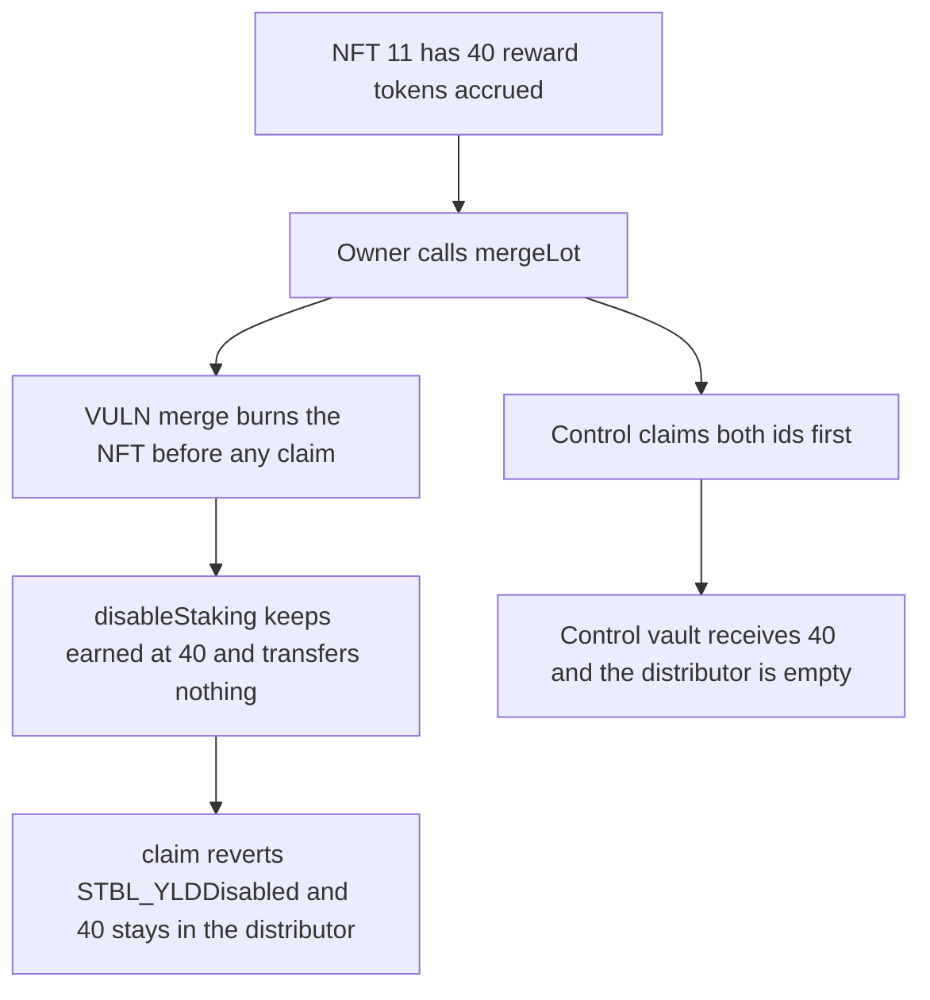

# STBL: mergeLot burns the NFT before the 40 of accrued yield can be claimed

> **Vulnerability classes:** vuln/dos/frozen-funds · vuln/logic/incorrect-order-of-operations

<!-- non-defihacklabs -->
<!-- source-auditvault: https://github.com/Auditware/AuditVault/blob/main/findings/66735-stbl-ess-nft-vault1-vault-mergelot-skips-yield-claim-before.md -->
<!-- date: 2026-06 -->

## Key info

| Field | Value |
|---|---|
| **Loss** | 40 reward tokens stay in the YieldDistributor. `claim` on the burned NFT reverts |
| **Vulnerable contract** | `Vault.mergeLot` |
| **Attacker EOA** | `0x1111111111111111111111111111111111111111` |
| **Attack contract** | `Exploit` |
| **Attack tx** | `Exploit.run()` |
| **Chain / block / date** | Ethereum model · block 0 · 2026-06 |
| **Compiler** | solc 0.8.27, cancun, via IR |
| **Bug class** | Merge burns the NFT, which sets `isDisabled`, before yield is transferred |

## TL;DR

`mergeLot` calls `SplitMerge.merge` without claiming yield. `merge` burns both NFTs, which sets `isDisabled`, and only then `disableYield` snapshots `earned` without transferring it. `claim` on the burned id reverts `STBL_YLDDisabled`. The 40 reward tokens stay in the distributor, and the new NFT starts at earned 0. Claiming both ids before `merge` pays the 40 and leaves the distributor empty.

## Background

Cyfrin's June 2026 STBL ESS review, reported by Stalin. `STBL_ESS_NFT_Vault1._Vault_mergeLot` delegates to `STBL_YLD_SplitMerge.merge`. The withdraw path already claims before `disableStaking`. STBL fixed the merge path in commit `4a7ed80`.

## The vulnerable code

```solidity
function mergeLot(uint256 lotA, uint256 lotB) external returns (uint256 merged) {
    // @> VULN: merge burns both NFTs before any yield claim, stranding earned rewards
    merged = splitMerge.merge(msg.sender, lotA, lotB);
    lastMerged = merged;
}
```

Inside `merge`, `YLD.burn` runs before `Issuer.disableYield`. `disableStaking` keeps `earned[id]` and zeroes only the staking balance.

## Root cause

The burn and the claim are ordered the wrong way. The burn is what makes the claim revert, and the snapshot that preserves `earned` does not move the tokens. After the burn there is no id that can still call `claim` for those rewards.

## Preconditions

- NFT 11 has `earned` of 40 reward tokens sitting in the distributor.
- The owner calls `mergeLot(11, 12)`.
- `claim` reverts when `isDisabled` is true.

## Attack walkthrough

1. `distribute` pulls 40 reward tokens into the distributor and sets `earned[11] = 40`.
2. The owner merges the two lots. `mergeLot` does not claim.
3. `merge` burns NFT 11, then `disableStaking` leaves `earned[11]` at 40 and pays nothing.
4. The merged NFT's earned balance is 0.
5. `claim(11)` reverts because the NFT is disabled.
6. The distributor still holds 40 and the owner holds 0.
7. The control claims both ids first. The vault receives 40 and the distributor balance is 0, then the burn runs.

## Diagrams



## Impact

The lot owner loses the 40 reward tokens that had already accrued. They are not forwarded to the merged NFT. They remain in the YieldDistributor and every claim on the burned id reverts. The control pays the 40 before the burn.

## Remediation

Call the yield claim for both input lots inside `mergeLot` before `SplitMerge.merge`, which is the order `iWithdraw` already uses and the order applied in commit `4a7ed80`.

## How to reproduce

```bash
cd 66735-stbl-ess-nft-vault1-vault-mergelot-skips-yield-claim-before_exp
forge test -vv
```

`test_exploit_merge_strands_40_reward_on_the_burned_nft` asserts 40 still earned and 40 held by the distributor. `test_control_claim_before_merge_pays_the_40` asserts the vault receives 40 and the distributor is empty. Captured output is `output.txt`.

## Sources

- AuditVault finding: https://github.com/Auditware/AuditVault/blob/main/findings/66735-stbl-ess-nft-vault1-vault-mergelot-skips-yield-claim-before.md
- Cyfrin report: https://github.com/solodit/solodit_content/blob/main/reports/Cyfrin/2026-06-17-cyfrin-stbl-ess-v2.0.md
- Fix: https://github.com/USD-Pi-Protocol/stbl-contracts-evm-ess-common/commit/4a7ed809e053d739cd47c4c3a283988b2076a751
