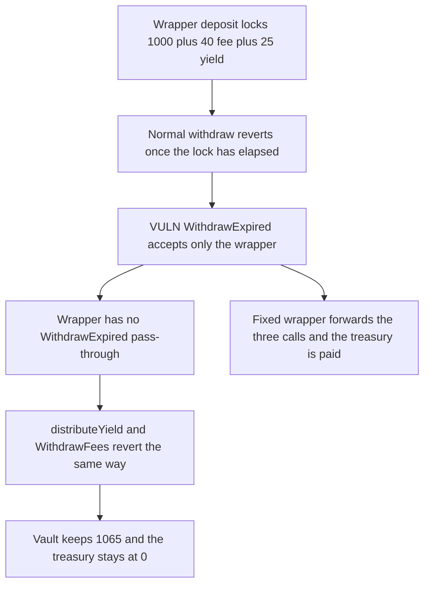

# STBL ESS: the wrapper never calls WithdrawExpired, distributeYield, or WithdrawFees, so 1065 tokens stay locked

> **Vulnerability classes:** `vuln/access-control/broken-logic` · `vuln/dos/frozen-funds`

<!-- non-defihacklabs -->
<!-- source-auditvault: https://github.com/Auditware/AuditVault/blob/main/findings/66736-stbl-ess-wrapper1-exposes-no-call-paths-to-withdrawexpired-d.md -->
<!-- date: 2026-06 -->

## Key info

| Field | Value |
|---|---|
| **Loss** | 1000 expired lock-time tokens, 40 of fees, and 25 of yield stuck in the vault |
| **Vulnerable contract** | `Issuer.WithdrawExpired`, `AssetVault.distributeYield`, `AssetVault.WithdrawFees` |
| **Attacker EOA** | `0x1111111111111111111111111111111111111111` (the depositor) |
| **Attack contract** | `Exploit` |
| **Attack tx** | `Exploit.run()` |
| **Chain / block / date** | Ethereum model · block 0 · 2026-06 |
| **Compiler** | solc 0.8.27, cancun, via IR |
| **Bug class** | `isWrapper` gates three exits the wrapper never calls |

## TL;DR

`WithdrawExpired`, `distributeYield`, and `WithdrawFees` revert unless `msg.sender` is the wrapper. `STBL_ESS_Wrapper1` has a deposit and a withdraw that itself reverts once the lock has elapsed. It has no pass-through to the three admin functions. After a 1000 token lock-time deposit, a 40 token fee, and 25 tokens of yield, every exit fails. The vault holds 1065 tokens. The treasury holds 0. A wrapper that forwards the three calls releases the assets and the fee.

## Background

Cyfrin, STBL ESS, 17 June 2026, Stalin. The issuer's `WithdrawExpired` is the only way to reclaim an expired lock-time position, and the normal withdraw reverts on expired assets. The vault's `distributeYield` and `WithdrawFees` are the only ways to push price-appreciation yield and to sweep fees. The concrete wrapper never calls any of the three. The fix in commit afc1f16 added pass-throughs for yield and fees. `WithdrawExpired` was left unused because that deployment only uses PT assets. This reduction keeps the LT path so the frozen deposit is visible.

## The vulnerable code

```solidity
function WithdrawExpired(uint256) external {
    require(msg.sender == wrapper, "wrapper"); // @> VULN: the wrapper never calls this
    token.transfer(treasury, locked);
}
```

`distributeYield` and `WithdrawFees` use the same check. The wrapper's only exit is:

```solidity
function withdraw() external {
    require(block.timestamp < vault.lockEnd(), "expired");
}
```

## Root cause

The gate and the caller do not meet. Only the wrapper may enter, and the wrapper has no function that enters. External callers, the depositor, and the treasury all fail the check. After `lockEnd`, the normal withdraw fails too, so the expired position has no path out.

## Preconditions

- The wrapper address is the `wrapper` stored on the issuer and the vault.
- A lock-time deposit of 1000 tokens has been recorded, with `lockEnd` equal to the current timestamp.
- The vault also holds a 40 token fee and 25 tokens of minted yield.

## Attack walkthrough

1. The depositor calls `wrapper.deposit`. 1000 tokens, the 40 token fee, and 25 of yield land in the vault.
2. `wrapper.withdraw` reverts because the lock has elapsed.
3. `Issuer.WithdrawExpired` reverts because the caller is not the wrapper.
4. A call to `WithdrawExpired` on the wrapper itself reverts. That function does not exist there.
5. `distributeYield` reverts on the same gate. The 25 of yield stays.
6. `WithdrawFees` reverts. The treasury receives nothing.

## Diagrams



## Impact

The depositor cannot reclaim 1000 tokens after expiry. NFT holders never receive the 25 tokens of yield. The treasury cannot sweep the 40 token fee. All 1065 tokens remain in the vault. The control wrapper is set as `wrapper` and its three pass-throughs zero the yield bucket and send the 1000 plus the 40 fee to the treasury.

## Remediation

Add wrapper pass-throughs, gated by the admin role, for `WithdrawExpired`, `distributeYield`, and `WithdrawFees`, and expose them on the wrapper interfaces. That is what commit afc1f16 did for yield and fees.

## How to reproduce

```bash
cd 66736-stbl-ess-wrapper1-exposes-no-call-paths-to-withdrawexpired-d_exp
forge test -vv
```

`test_exploit_expired_assets_yield_and_fees_stay_locked` asserts the 1065 token vault balance and the three buckets. `test_control_passthrough_releases_fees_and_expired_assets` asserts the treasury receives 1040. Captured output is `output.txt`.

## Sources

- AuditVault finding: https://github.com/Auditware/AuditVault/blob/main/findings/66736-stbl-ess-wrapper1-exposes-no-call-paths-to-withdrawexpired-d.md
- Cyfrin report: https://github.com/solodit/solodit_content/blob/main/reports/Cyfrin/2026-06-17-cyfrin-stbl-ess-v2.0.md
- Fix: https://github.com/USD-Pi-Protocol/stbl-contracts-evm-ess-common/commit/afc1f164f3b3ffcb06e0eff5f84cb9bfa3098173
