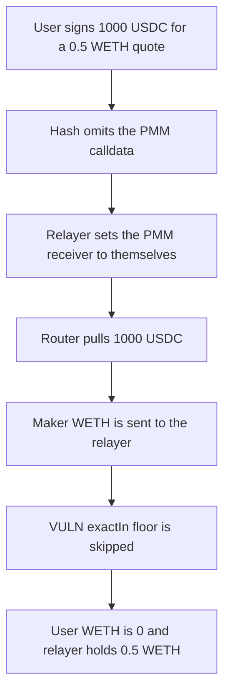

# Bebop Router: exactIn settle pays the relayer instead of the user

> **Vulnerability classes:** `vuln/logic/missing-check`

<!-- non-defihacklabs -->
<!-- source-auditvault: https://github.com/Auditware/AuditVault/blob/main/findings/66835-beboproutersettle-lets-relayers-steal-exactin-user-input-by.md -->
<!-- date: 2026-06 -->

## Key info

| Field | Value |
|---|---|
| **Loss** | User pays 1000 USDC and receives 0 WETH. Relayer receives 0.5 WETH |
| **Vulnerable contract** | `BebopRouter.settle` |
| **Attacker EOA** | `0x1111111111111111111111111111111111111111` |
| **Attack contract** | `Exploit` |
| **Attack tx** | `Exploit.run()` |
| **Chain / block / date** | Ethereum model · local · 2026-06 |
| **Compiler** | solc 0.8.27, cancun |
| **Bug class** | PMM calldata omitted from the signed hash, and exactIn has no output floor |

## TL;DR

The user signs a router order for 1000 USDC in and a 0.5 WETH quote, with `limitAmount` 0. The hash does not include the PMM calldata. The relayer submits a PMM order whose receiver is the relayer. The router pulls the user's USDC, the maker sends 0.5 WETH to the relayer, and the exactIn minimum check is skipped because `limitAmount` is not negative.

## Background

Cyfrin's 12 June 2026 Bebop Router review. The report's redirect proof expects the user to spend 1000 USDC, receive 0 WETH, and the attacker to receive 0.5 WETH. Bebop fixed it in commit 9db95bc.

## The vulnerable code

```solidity
return keccak256(abi.encode(o.fromAmount, o.toAmount, o.limitAmount, o.fromToken, o.toToken, o.tokensOwner, o.receiver, o.routerNonce));
// ...
require(ERC20(order.toToken).transferFrom(pmm.maker, pmm.receiver, pmm.makerAmount), "maker");
require(!isExactOut || receiverAmount >= toAmountAfterFeeSlippage, "LimitAmountViolation"); // @> VULN: exactIn skips the quote floor
```

```diff
- require(!isExactOut || receiverAmount >= toAmountAfterFeeSlippage, "LimitAmountViolation");
+ require(receiverAmount >= toAmountAfterFeeSlippage, "LimitAmountViolation");
```

The report also requires the decoded PMM receiver to be the router.

## Root cause

Two checks that would have stopped the redirect are both absent. The signature does not bind the PMM receiver, and an exactIn order with `limitAmount == 0` treats a zero router balance as acceptable.

## Preconditions

- The user has signed an exactIn order with `limitAmount` 0 and has approved the router for 1000 USDC.
- A maker can pay 0.5 WETH and the relayer sets the PMM receiver to the relayer.
- The router signer and the user both accept the same order hash. This reduction checks the user hash only.

## Attack walkthrough

1. The user commits the hash of the router fields. The PMM bytes are not in it.
2. The relayer calls `settle` with `receiver = relayer` and `makerAmount = 0.5 ether`.
3. The hash check passes.
4. The router pulls 1000 USDC from the user.
5. The maker's 0.5 WETH is transferred to the relayer.
6. The router's WETH balance is 0. The exactIn floor is skipped. The user receives nothing.

## Diagrams



## Impact

The user loses the 1000 USDC they authorized and receives 0 WETH. The relayer receives the 0.5 WETH the quote described. The router's USDC balance is 1000e6.

## Remediation

Require the delivered output to meet `toAmountAfterFeeSlippage` for exactIn as well as exactOut, and require the PMM receiver to be the router before the external settlement.

## How to reproduce

```bash
cd 66835-beboproutersettle-lets-relayers-steal-exactin-user-input-by_exp
forge test -vv
```

`test_exploit_relayer_takes_half_weth_user_gets_zero` asserts the user at 0 USDC and 0 WETH, and the relayer at 0.5 WETH. Captured output is `output.txt`.

## Sources

- AuditVault finding: https://github.com/Auditware/AuditVault/blob/main/findings/66835-beboproutersettle-lets-relayers-steal-exactin-user-input-by.md
- Cyfrin report: https://github.com/solodit/solodit_content/blob/main/reports/Cyfrin/2026-06-12-cyfrin-bebop-router-v2.0.md
- Fix: https://github.com/bebop-dex/bebop-rfqa/commit/9db95bc2b423d9317c149e90a70ae51565e26367
